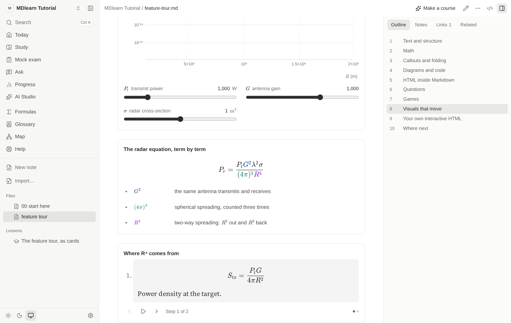
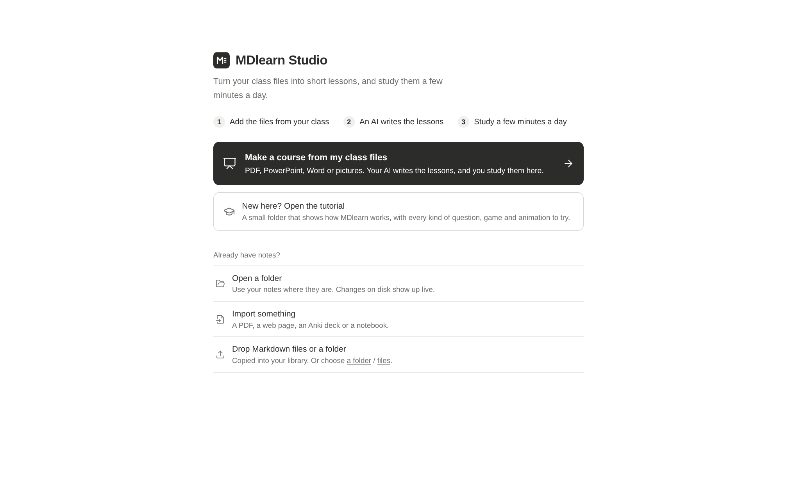
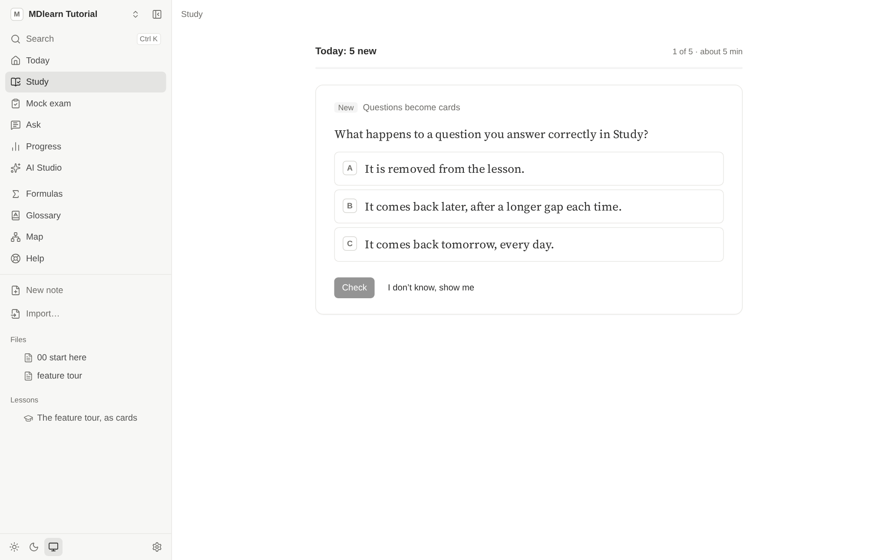

# MDlearn

**Turn your class files into short lessons, and study them a few minutes a day.**

Give MDlearn your PDFs, slides and Word files. An AI you already use writes the lessons, a strict compiler checks
them, and spaced repetition brings each idea back just before you would forget it. It runs on your computer, needs
no account, and your lessons are plain files you keep.

[](https://github.com/teo-clerk/MDlearn/actions/workflows/ci.yml)
[](https://github.com/teo-clerk/MDlearn/releases/latest)
[](LICENSE)



## Download

| System | File |
|---|---|
| **Windows** | `.exe` installer, or `.zip` |
| **macOS** (Apple silicon) | `.dmg`, or `.zip` |
| **Linux** | AppImage, `.deb`, or `.zip` |

Get them from the [latest release](https://github.com/teo-clerk/MDlearn/releases/latest). Nothing else is needed:
no Node.js, no terminal.

The builds are not code-signed yet, so Windows and macOS warn you the first time. [DESKTOP.md](docs/DESKTOP.md) shows
how to open them, and each release has a `SHA256SUMS.txt` to check your download against.

## Your first course

1. **Add your files.** Open MDlearn, choose *Make a course from my class files*, and drop in your PDFs, PowerPoint
   or Word files and pictures. MDlearn tells you what it could read from each one.
2. **Choose who writes the lessons.**
   - *Claude, from here:* runs Claude Code on your computer, and you watch it work.
   - *Your coding assistant:* Claude Code, Codex, OpenCode or Pi, with one command to paste in a terminal.
   - *A chat:* ChatGPT, Claude or Gemini. MDlearn gives you the prompt, and you paste the answer back.
3. **Study.** *Today* gives you a short daily session: the cards that are due, then a few new ones.

Your course can change with you. After a week you can move or pause lessons, add class files, or ask for changes,
and cards you have already studied keep their schedule.

New here? *Open the tutorial* on the first page gives you a small sample course with every kind of question and game
to try.



## What you get

- **Lessons that check you.** Quizzes, fill-in-the-gaps, ordering, written answers, worked steps, code, and games.
  You say whether you were sure before you see the answer, and what you miss comes back sooner.
- **A schedule that fits your memory**, using the [FSRS](https://github.com/open-spaced-repetition) algorithm.
- **Reading that keeps up with technical notes:** math, tables, diagrams, code you can run, and notes beside the text.
- **Colour with a job.** Callouts, formula terms and highlights each mean one thing. Mark a passage *confusing* or
  *for the exam* and MDlearn does something about it.
- **Mock exams, deadlines and progress**, with an honest look at how well you know what you think you know.
- **Your language:** the app comes in English, Italian, Spanish, French and Catalan.



## Your files stay yours

MDlearn has no account, no analytics and no server of its own. Lessons, notes and progress are ordinary files on your
computer, and your notes are never changed unless you ask.

It only goes online when you do something that needs it: importing a web page, allowing a site's pictures, playing
an embedded video, downloading a local AI model, or running code that needs a Python package.

When an AI writes your lessons, the files you give it go to that AI, under its own terms. To keep everything on
your computer, use a local model through [Ollama](https://ollama.com) for asking and explaining.

## Optional extras

| You need | For |
|---|---|
| [Claude Code](https://claude.com/claude-code), signed in once | writing lessons from inside MDlearn, and the terminal tutor |
| [Ollama](https://ollama.com), then a model from *Settings → Local AI* | asking about a passage, explaining it, and searching your folder by meaning |
| poppler (`pdftohtml`) | quick PDF import |
| [SciNet](https://github.com/teo-clerk/SciNet) running on this computer | importing papers from your library |

MDlearn runs the Claude Code you installed, under your own login, and never sees or stores that login. Your use of it
is covered by [Anthropic's terms](https://code.claude.com/docs/en/legal-and-compliance), and it's up to you to check
they fit how you use it.

## Install from source

This gives you the web app in your browser (`mdlearn studio`), the command line and the MCP server. You need
Node.js 22.15 or newer and git.

```bash
git clone https://github.com/teo-clerk/MDlearn.git
cd MDlearn
npm install && npm run build

# put the two commands on your PATH (~/.local/bin must be on it)
mkdir -p ~/.local/bin
ln -s "$PWD/packages/cli/dist/index.js" ~/.local/bin/mdlearn
ln -s "$PWD/packages/mcp/dist/index.js" ~/.local/bin/mdlearn-mcp
mdlearn --help
```

After pulling changes, run `npm run build` again; the links keep working.

## Using your own Markdown notes

### 1. Open your notes

```bash
cd ~/my-notes          # any folder of .md files
mkdir -p learn         # lessons and your progress go here; mdlearn finds the folder from anywhere below it
mdlearn studio .       # opens http://localhost:4747 in your browser
```

Studio reads any Markdown well (math, tables, Mermaid, code, `<details>`), so it's useful before you
have a single lesson. Your notes are never modified unless you use the editor or *Insert*.

### 2. Get lessons

Pick whichever fits:

- **Let Claude write them in Studio.** *AI Studio* → *Create a course* (one document), *Whole folder*
  (every document without lessons, one after another), *Improve a lesson*, or *Something else*. Each
  job streams live, can only write Markdown inside its allowed folder (`learn/` by default), is
  linted, and can be undone. It runs Claude Code on your computer, under your own login.
- **Ask Claude Code in a terminal.** Set up the skills once (see [Claude Code](#use-with-claude-code)),
  then say e.g. *"turn bayes.md into a lesson with mdlearn-course"* or *"convert 00_FOUNDATIONS with
  mdlearn-curriculum"*.
- **Write one by hand.** Save this as `learn/demo/01-radar.learn.md`:

  ```markdown
  ---
  title: Radar basics
  level: beginner
  lang: en
  goals:
    - State how received power depends on range
    - Compute range resolution from bandwidth
  ---

  ## Power falls with range⁴

  The pulse spreads out on the way to the target and again on the way back, so the
  received power falls as $1/R^4$.

  :::quiz
  You double the range to a target. What happens to the received power?
  - [ ] It halves.
    > That would be a one-way, $1/R$ spreading, not the two-way radar case.
  - [ ] It drops to a quarter.
    > That is one-way $1/R^2$ spreading; the echo spreads a second time.
  - [x] It drops to a sixteenth.
    > Right: two-way spreading gives $1/R^4$, and $2^4 = 16$.
  :::

  ## Range resolution

  Two targets are told apart in range when their echoes do not overlap:
  $\delta_r = c / 2B$.

  :::cloze
  A 50 MHz pulse gives a range resolution of {{3.0±0.1}} m.
  :::
  ```

  Then run `mdlearn lint` and fix anything it reports. Other question types (`order`, `explain`,
  `steps`, `code`), games (`match`, `sort`, `speed`), visuals (`plot`, `formula`, `animate`, `sim`,
  sandboxed `html`), videos with checkpoint questions (`::video`) and HTML in Markdown are described in
  [docs/DSL_SPECIFICATION.md](docs/DSL_SPECIFICATION.md). To see them all working, run
  `mdlearn studio examples/showcase` (or *Help → Open the tutorial* in Studio).

**Long, structured documents** (numbered `##` sections, like a course or a textbook chapter) work best
as *companion lessons*. These link each card to its section instead of repeating the text:

```bash
mdlearn plan 04_sar     # how the document would be split into lessons
mdlearn new 04_sar      # create those lesson files with one card per section (never overwrites)
# then fill the TODOs: AI Studio → Improve a lesson, Claude Code, or by hand
mdlearn lint            # flags cards whose ::read[§…] no longer matches the source
```

`plan` needs headings. For rough notes without them, use Claude (notes mode) or write the lesson yourself.

### 3. Study

- **Studio:** a folder opens on **Today**. Press *Start* and answer one card at a time.
- **Terminal:** `mdlearn review` gives due cards first, then up to 5 new ones (about 10 cards). Type your
  answer and press Enter; `?` shows a hint, `s` shows the answer, `q` stops. Progress is saved after every
  card.
- **Claude Code:** *"quiz me on SAR physics"* runs the same session as a conversation (the `mdlearn-tutor`
  skill), with follow-up questions grounded in your source.

Each card asks *"were you sure?"* before giving feedback. Missed cards come back before the session ends,
and the summary tells you which section to reread. `mdlearn report` shows what you've seen, your
accuracy, what's due and your streak.

**A good habit:** one short session a day (`mdlearn review`, 5–10 minutes). Add new lessons for the
document you're reading this week, rather than converting everything up front.

## Use with any AI: Claude Code, Codex, OpenCode, Pi, Claude.ai, ChatGPT

Ask any assistant for a course on a topic, with or without your notes; it writes MDlearn lessons with
the same method Studio uses (retrieval every few cards, misconception feedback, worked examples that
fade, a free-recall recap), and you study them in Studio. `mdlearn setup` prints these steps with the
real paths; Studio shows them under **Settings → Use MDlearn in other apps**.

| Where | How |
|---|---|
| **Claude Code**, any folder | Install the plugin once: `claude plugin marketplace add "/path/to/MDlearn/packages/studio/dist/integrations/claude-plugin"`, then `claude plugin install mdlearn@mdlearn`. In any project, `/mdlearn:course how vaccines work, beginner` writes a lint-checked course into that folder; `/mdlearn:study` quizzes you. The plugin brings the MCP server (one file, no setup), the four skills and the ready-made prompts `create_course`, `companion_lessons` and `study`. |
| **Codex, OpenCode, Pi**, one folder | Nothing to install: `mdlearn agents "<folder>"` (or Ctrl+K in Studio → *Get this folder ready for my AI*) writes `AGENTS.md` and `.agents/skills/`. Start the assistant there and ask for a course. `mdlearn agents --mcp` prints how to add the tools that quiz you. |
| **Claude.ai** | Upload `packages/studio/dist/integrations/mdlearn-skill.zip` under Settings → Capabilities → Skills; ask "Make an MDlearn course on …". |
| **ChatGPT, Gemini, any chat** | Paste the output of `mdlearn prompt` into the chat (or a Custom GPT's or Project's instructions; `mdlearn prompt --full` is the whole guide, to attach as a file). Then paste the chat's answer into Studio → *Import* → **From a chat**, or run `mdlearn import-chat answer.md`: every file is checked, the good ones are saved in a new course folder, and errors become a message to paste back into the chat. |

The prompt lives in [docs/CHAT_PROMPT.md](docs/CHAT_PROMPT.md); `npm run build` regenerates the plugin,
the skill and the prompt files from the docs.

### Claude Code on one folder, without the plugin

Do this once in your notes folder so Claude Code gets the MCP tools (outline, sections, lint, the
tutor) and the four skills. Replace `/path/to/MDlearn` and `/path/to/my-notes` with absolute paths:

```bash
cat > .mcp.json <<'EOF'
{
  "mcpServers": {
    "mdlearn": {
      "command": "node",
      "args": ["/path/to/MDlearn/packages/mcp/dist/index.js"],
      "env": { "MDLEARN_ROOT": "/path/to/my-notes" }
    }
  }
}
EOF
mkdir -p .claude/skills
ln -s /path/to/MDlearn/.claude/skills/mdlearn-course .claude/skills/
for s in mdlearn-curriculum mdlearn-tutor mdlearn-visuals; do ln -s /path/to/MDlearn/skills/$s .claude/skills/; done
```

Start `claude` in the folder and approve the `mdlearn` server when asked. Then try *"quiz me on …"*,
*"what is due?"*, *"write a lesson for notes/bayes.md"*, *"fix the lint errors in learn/…"*.

## What Studio can do

- **New here?** A short welcome tour on first run, a Help page (`?`), and an interactive tutorial
  (*Help → Open the tutorial*) that shows every feature live, with its Markdown.
- **Games and HTML in your notes:** match pairs (or play them as a memory game), sort into groups,
  true/false speed rounds — graded and scheduled like the other questions — plus safe HTML in place
  (`<mark>`, `<kbd>`, `<details>`, animated SVG) and your own HTML/CSS/JS games in a sandbox.
- **Videos with questions:** `::video[clip.mp4]` or a YouTube/Vimeo link (a plain `` works
  too). Questions after it with `{at=4:15}` pause the video and ask; notes can be pinned to a moment.
  YouTube and Vimeo load only when you press Play.
- **Read any Markdown:** math (KaTeX), tables, Mermaid diagrams, highlighted code, folded `<details>`,
  section numbers, an outline, full-text search (Ctrl+K) and the raw source. Changes on disk show up live.
- **Study:** the coach flow above. **Today** also shows a 7-day forecast, a heatmap, how well your
  confidence matches your results, **deadlines** (turned into new cards per day) and the cards you keep
  failing, with a one-click AI fix.
- **Exam practice:** a **mock exam** (questions on what you studied, mixed across lessons, optionally timed,
  marked only at the end, then every answer); the **confidence check** on Progress (the cards you were sure
  about and got wrong, one click to review them); **teach-back** (explain a lesson or a section in your own
  words; the local model or Claude says which key ideas you covered, what to correct, and asks one question).
- **Notes and AI beside the text:** select a passage to leave a note, ask the local model about it,
  have it explained or **visualised** (a plot, an explained formula, an animation), or turn it into a
  **quick card**.
- **Run Python** blocks in the browser (Pyodide with numpy, scipy, pandas, matplotlib, …). Exercises
  with `assert` checks are graded.
- **Your folder as a knowledge base:** formulas, glossary (defined terms are underlined in the text),
  links and backlinks, a **graph** of your documents in 2D or 3D (coloured by how well you remember each,
  like Obsidian's) and a prerequisite map, **Ask** (the local model answers from your documents, with
  sources), **Related** (what else in the folder is about the section you are reading) and printable cheat sheets.
- **A capture inbox:** save a thought, a link or a passage in a moment (Ctrl+Shift+K, your phone, or
  Ctrl+Alt+Space in the desktop app) and sort it later on Today into a card or a document. It is plain Markdown in
  `Inbox/`.
- **Edit, import, export:** a built-in editor with live preview and history; import web pages, PDFs,
  Anki decks, Jupyter notebooks and **papers from SciNet**; **export to Anki** to study on your phone anywhere.
- **LaTeX:** write `.tex` documents with highlighting and completion, compile them to PDF beside the source
  (Ctrl+S), with errors linked to their line and explained. Uses Tectonic or TeX Live on your computer
  (`sudo pacman -S tectonic` on Arch, `brew install tectonic` on macOS).
- **On your phone at home:** `mdlearn studio --lan` prints a private link and a QR code (reading,
  studying and notes; no file changes or AI jobs unless you add `--lan-full`). **Study offline** takes the
  next 1, 3 or 7 days of cards onto the phone, marks them there with no connection, and syncs the answers
  when the computer is reachable again (keep the page open while offline; add it to the home screen).
- **Your language and colours:** *Settings* switches the interface to Italiano, Español, Français or
  Català (help included), and picks the theme and an accent colour (presets or your own, always readable).

How it works, its security model and its tests are in [docs/STUDIO.md](docs/STUDIO.md).

## Commands

Run them inside your notes folder (or pass `--root <dir>`, or set `MDLEARN_ROOT`). Each command has
`--help`.

| Command | What it does |
|---|---|
| `mdlearn studio [folder] [--lan] [--port 4747]` | Open MDlearn Studio in the browser |
| `mdlearn review [--scope text] [--limit 10] [--new-cards 5] [--due]` | Study session (`--scope` matches a lesson id or title) |
| `mdlearn queue` · `mdlearn report` | What a session would contain · your progress |
| `mdlearn status [filter] [--all]` | Every document and how many lessons it has |
| `mdlearn outline <doc>` · `mdlearn section <doc> <§>` | A document's section map · the exact text of one section |
| `mdlearn plan <doc>` · `mdlearn new <doc>` | Plan / create companion lessons for a document |
| `mdlearn lint [file\|folder]` | Check lessons (errors and warnings; exit 1 on errors) |
| `mdlearn build <file>` · `mdlearn errata` | A lesson as JSON · corrections to the source collected from lessons |
| `mdlearn setup` | How to add MDlearn to Claude Code, Claude.ai and other chats |
| `mdlearn prompt [--full]` | The prompt for chats without tools (`--full`: the whole guide) |
| `mdlearn import-chat <file\|-> [--to folder]` | Save the lessons a chat wrote: checked first, errors become a fix request |

`<doc>` is a path or any unique part of a file name (`04_sar`).

## Where things are stored

| Path | What |
|---|---|
| your `.md` files | untouched (except by the editor, *Insert*, or moving an inbox item there) |
| `Inbox/YYYY-MM-DD.md` | what you captured, one file a day |
| `learn/**/*.learn.md` | lessons, mirroring your folder layout |
| `learn/.mdlearn/progress.json` | your reviews and answers, shared by Studio, terminal and Claude; **personal** |
| `learn/.mdlearn/goals.json` | daily goal, deadlines, suspended cards |
| `.mdlearn/` in the folder | Studio notes, AI job history, search index, editor history |
| `~/.config/mdlearn/studio.json` | Studio settings: recent folders, Ollama and Claude models |

If your notes are in git, add `.mdlearn/` to their `.gitignore`.

## Troubleshooting

| Problem | Fix |
|---|---|
| `mdlearn: command not found` | add `~/.local/bin` to your `PATH`, or check the links from *Install* |
| "No .learn.md files found" | there are no lessons yet: see *Get lessons*, and run from inside the folder that has `learn/` |
| `mdlearn plan` prints nothing | the document has no `##` sections: write the lesson with Claude or by hand |
| AI Studio says Claude Code is not installed | install Claude Code and run `claude` once to log in |
| Ask / Explain / Visualise are unavailable | start Ollama and `ollama pull qwen3:8b` (the model is set in `studio.json`) |
| Quick PDF import fails | install poppler: `brew install poppler`, `sudo apt install poppler-utils` or `sudo pacman -S poppler` |

## Documentation

| Document | What it is |
|---|---|
| [docs/PEDAGOGICAL_SPEC.md](docs/PEDAGOGICAL_SPEC.md) | The learning science behind every construct, with verified citations |
| [docs/DSL_SPECIFICATION.md](docs/DSL_SPECIFICATION.md) | The `.learn.md` format: syntax, formal grammar, diagnostics, companion lessons |
| [docs/ENGINE_ARCHITECTURE.md](docs/ENGINE_ARCHITECTURE.md) | Compiler, rendering, state machine, persistence, security, roadmap |
| [docs/TOOLING.md](docs/TOOLING.md) | Importer, `mdlearn` CLI, `mdlearn-mcp` server, skills, a curriculum workflow |
| [docs/STUDIO.md](docs/STUDIO.md) | MDlearn Studio: architecture, AI engines and jobs, notes, visuals runtime, security, tests |
| [docs/DESKTOP.md](docs/DESKTOP.md) | The desktop app: how it is built and packaged, its security choices, opening unsigned builds |
| [docs/AGENT_SKILL.md](docs/AGENT_SKILL.md) | The authoring skill (installed as `/mdlearn-course`) |
| [CHANGELOG.md](CHANGELOG.md) | What each version brings |

## Packages

| Package | |
|---|---|
| `packages/core` | `@mdlearn/core`: Stage-0 scanner, compiler, CourseAST (Zod), checkers, importer, tutor, FSRS; `@mdlearn/core/node` for file-system helpers |
| `packages/cli` | `mdlearn`: studio, lint, build, status, outline, section, plan, new, queue, review, report, errata |
| `packages/mcp` | `mdlearn-mcp`: 13 MCP tools for curriculum access, authoring and tutoring |
| `packages/studio` | MDlearn Studio: local server (Hono) and web app (React 19, Vite 8, Tailwind 4) |
| `skills/` | `mdlearn-curriculum`, `mdlearn-tutor` and `mdlearn-visuals` skills (plus `docs/AGENT_SKILL.md`) |

## Develop

```bash
npm install
npm run build                          # core → studio → cli → mcp (TypeScript 7)
npm test                               # Vitest: compiler, checkers, importer, tutor, MCP, Studio server
npm run typecheck
npm run check-docs                     # every example in docs/ compiles as documented
npm run test:e2e -w @mdlearn/studio    # Playwright, desktop + phone, on a temporary demo folder
npm run dev                            # Studio with hot reload
```

## Contributing

Bug reports, ideas and pull requests are welcome: see [CONTRIBUTING.md](CONTRIBUTING.md). To report a security
problem, see [SECURITY.md](SECURITY.md).

## License

[MIT](LICENSE) © Teo Clerk.

MDlearn is an independent project. It is not made, endorsed or sponsored by Anthropic, OpenAI or the makers of the
other tools it works with. Claude and Claude Code are trademarks of Anthropic.
