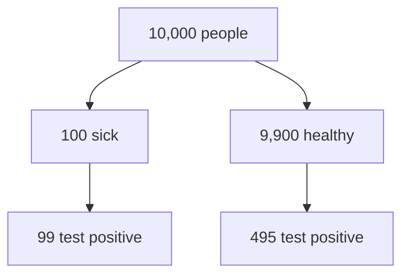

# MDlearn DSL — Specification v1.3

> **Status:** normative for `format 1` lesson files (`*.learn.md`). v1.1 adds companion lessons
> (`source:` and `::read`, §8.10); v1.2 adds visual blocks (`plot`, `formula`, `animate`, `sim`, §8.11);
> v1.3 adds games (`match`, `sort`, `speed`, §8.12), safe HTML in place (§8.13), sandboxed `:::html`
> blocks (§8.14) and Markdown animation frames (§8.11). Every earlier file is a valid v1.3 file.
> **Conformance:** every example in this document is compiled by the reference prototype
> (Stage 0 → remark → CourseAST) in the test suite: valid examples produce **0 errors**, invalid
> ones produce exactly the diagnostics shown. The diagnostics catalogue (§12) is generated from the
> same registry the compiler uses.
>
> Companion documents: [PEDAGOGICAL_SPEC.md](PEDAGOGICAL_SPEC.md) (why each construct exists),
> [ENGINE_ARCHITECTURE.md](ENGINE_ARCHITECTURE.md) (how it is parsed and rendered),
> [AGENT_SKILL.md](AGENT_SKILL.md) (how an LLM should write it).

---

## 1. Design principles

MDlearn is a thin layer over Markdown that an LLM can emit cheaply and a compiler can check strictly.
Eight rules shape every syntax decision below.

| # | Principle | Consequence |
|---|---|---|
| P1 | **Standard first.** Headings, lists, tables, code fences, links, images and `$` math stay plain CommonMark/GFM. | A lesson reads well on GitHub, Obsidian or VS Code with no tooling. |
| P2 | **Closed vocabulary.** 9 widgets (6 questions, 3 games), 5 visuals, 4 callouts, 1 hint directive, 1 blank syntax, a short list of attributes. | Fewer names to hallucinate; unknown names fail loudly (E103). |
| P3 | **Co-location, no cross-references.** Correctness lives on the option (`- [x]`), feedback under the option, the answer inside the blank. | No answer letters, indices or IDs for an LLM to get out of sync. |
| P4 | **No escaping hazards.** No JSON, JSX, YAML-quoted TeX or prose in attributes. | LaTeX passes through byte-for-byte. |
| P5 | **Structure by headings, not wrappers.** `##` starts a card; there is no `:::card`. | Zero unclosed-wrapper failures; every card has a title. |
| P6 | **Lenient reader, strict writer.** A Stage-0 scanner repairs predictable LLM drift and reports every repair (I8xx). | The skill teaches one canonical form; real-world output still compiles. |
| P7 | **Fail closed.** A widget that does not compile is locked, never shown raw. | A broken quiz cannot leak `[x]`, blank answers or hidden feedback. |
| P8 | **Measured token cost.** Syntax chosen by counting tokens (§1.2). | ~37 % fewer tokens than pretty JSON for the same content. |

### 1.1 Why not JSON (or YAML strings, or JSX)

LaTeX is the hardest payload in STEM notes, and every common structured format mangles it:

- **JSON / YAML double quotes.** `\nabla`, `\theta`, `\frac`, `\beta`, `\rho`, `\right`, `\text` begin
  with the escape sequences `\n \t \f \b \r`. An LLM that forgets to double every backslash produces a
  newline, a tab or a form feed in the middle of the formula, silently. YAML double quotes add `\a`
  (bell) and reject `\s`, `\p`. MDlearn therefore forbids TeX in quoted YAML (`macros` values use single
  quotes, checked by E101).
- **JSX / MDX.** `{…}` is a JavaScript expression, so `\text{sick}` outside math delimiters is code.
  Props need string escaping and the LLM must remember a component API.
- **Moodle GIFT.** `~ = # { } :` are syntax and must be backslash-escaped, which collides with nearly
  every TeX command.

Evidence on format and reliability is mixed: forcing JSON with a schema in the prompt hurt GSM8K
reasoning badly in one study (Tam et al., 2024), while a rebuttal found structured output can match free
text when prompts are held constant (Kurt, n.d.). MDlearn's choice rests on what is *not* contested:
escaping hazards and token cost.

### 1.2 Token cost (measured)

The same content — one 3-option quiz with per-option feedback and a hint, one cloze with two text blanks
and one math blank — written in five formats. Tokenizers: OpenAI `o200k_base` and `cl100k_base` via
`tiktoken` (Claude's tokenizer is not public offline; treat these as proxies).

| Format | Characters | o200k tokens | vs MDlearn | cl100k tokens | Notes |
|---|---:|---:|---:|---:|---|
| **MDlearn** | 725 | **214** | 1.00× | 216 | Everything below is expressible. |
| JSON (pretty-printed, as LLMs usually emit) | 1,180 | 340 | 1.59× | 339 | 266 tokens when minified; LaTeX needs `\\`. |
| MDX / JSX | 933 | 261 | 1.22× | 260 | Component API must be remembered. |
| Moodle GIFT | 641 | 175 | 0.82× | 175 | **Cannot** express the math blank; TeX braces escaped. |
| LiaScript | 722 | 170 | 0.79× | 170 | **No** per-option feedback; no math blank. |

GIFT and LiaScript are cheaper only because they drop features this spec requires. A complete
11-card lesson (§13) costs 1,866 o200k tokens.

### 1.3 Prior art and what MDlearn borrows

| Format | Borrowed | Avoided |
|---|---|---|
| GFM task lists, quizdown-js | `- [x]` marks the answer; an indented `>` under an option is its feedback. | quizdown's implicit single/multi choice switch (ordered vs unordered list). |
| Anki cloze | `{{…}}` blanks; `{{c1::a::hint}}` is accepted and normalised. | Anki's `}}`-inside-MathJax bug: MDlearn scans braces with a balanced counter. |
| Docusaurus admonitions, Pandoc fenced divs | `:::name` containers and `:::note` callouts. | Pandoc's attribute-heavy openers; remark-directive's equal-colon nesting trap (§7.1). |
| MyST, Quarto | Accepted as input (`:::{note}`, `::: {.callout-tip collapse="true"}`) and rewritten. | Label cross-references (`:::{solution} ex1`). |
| LiaScript | Hints as a first-class, ordered construct. | Bracket overloading (`[(X)]`, `[[ ]]`), JavaScript `@input` splicing. |
| mdbook-quiz | Answers identified by content, not by letter. | TOML files kept away from the prose. |
| Markdoc | — | Named closing tags (``) cost tokens for little gain once Stage 0 repairs fences. |

---

## 2. Files and identity

| Item | Rule |
|---|---|
| Lesson file | One lesson per file: `NN-slug.learn.md` (UTF-8; CRLF and a BOM are accepted and normalised). The `.learn.md` suffix keeps the file a valid Markdown document. |
| Lesson id | Frontmatter `id`, else the file name without `.learn.md` and without the numeric prefix (`02-bayes-theorem.learn.md` → `bayes-theorem`), so renumbering lessons keeps progress. |
| Course | A directory of lesson files plus an optional `course.md` whose frontmatter has `title`, `level` and `lessons: [bayes-theorem, …]` (default order: file name). |
| Card id | `## Title {#id}` (`[a-z0-9][a-z0-9-]*`) if given, else the GitHub slug of the title (`base-rate-neglect`), de-duplicated (`-1`, `-2`). |
| Widget id | `<card id>/<kind>-<fingerprint>`, where the fingerprint is FNV-1a of the normalised stem and answer key. Editing an unrelated widget never re-keys another one; editing a question's key re-keys it (reset beats attaching history to a different question). Identical widgets in one card get `-1`, `-2` suffixes. `:::kind{#id}` pins the id to `<card id>/<id>`. |

Authors (and LLMs) never write ids unless they need to pin one.

---

## 3. Frontmatter

YAML between `---` lines at the top of the file. Keys are mapped from common synonyms *before*
validation (I815). Unknown keys are ignored (I817); a key with the wrong type is reported (E101) and
ignored, so one bad key never takes the lesson down. Only a missing title (E102) or a truncated file
(E109) stops a lesson from rendering.

| Key | Type | Default | Meaning |
|---|---|---|---|
| `title` | string | first `#` heading (I816) | **Required** (E102 if neither exists). |
| `level` | `beginner` \| `intermediate` \| `advanced` | — | Selects the lesson blueprint and scaffolding (PEDAGOGICAL_SPEC §6). |
| `lang` | BCP-47 tag | `en` | Answer matching (diacritics, decimal comma), `<html lang>`. Write the lesson in the notes' language. |
| `time` | minutes (number, or `"12 min"`) | estimated | Author's estimate. The compiler estimates too and notes a >50 % drift (I607). |
| `prereq` | string or list | `[]` (the player adds the previous lesson in `course.md`) | Lesson ids (linked) or free text (shown as "you should know"). |
| `goals` | list of strings (≤ 6) | `[]` | 2–4 measurable objectives, Bloom verbs ("Compute…", "Explain…"). |
| `id` | `[a-z0-9][a-z0-9-]*` | from file name | Stable lesson id. |
| `macros` | map `\name: 'TeX'` | `{}` | KaTeX macros for the lesson. Values in **single quotes**; control characters are rejected. |
| `source` | path | — | Companion lessons: the curated document this lesson accompanies, relative to the lesson file (§8.10). |

Synonyms: `objectives`/`outcomes`/`learning_goals` → `goals`; `prerequisites`/`requires`/`prereqs` →
`prereq`; `duration`/`minutes`/`estimated_time` → `time`; `difficulty` → `level`; `language` → `lang`;
`name` → `title`.

```yaml
---
title: Bayes' Theorem
level: beginner
lang: en
time: 13
prereq: [conditional probability]
goals:
  - Compute a posterior for a diagnostic test
  - Explain why a low base rate keeps the posterior low
macros:
  \R: '\mathbb{R}'
---
```

---

## 4. Syntax profile

MDlearn is CommonMark 0.31 + the constructs below. Anything not listed is plain text.

| Construct | Status | Notes |
|---|---|---|
| GFM tables, task lists, strikethrough, autolinks | **enabled** | Task lists are meaningful only inside `:::quiz` (elsewhere their checked state is never rendered). |
| `$…$`, `$$…$$` math (remark-math) | **enabled** | §6. |
| Container directives `:::name` and leaf `::hint[…]` | **enabled** | §7. |
| **Text directives** `:name[…]` | **disabled** | micromark accepts any letter *or digit* after `:`, so `10:30`, `1:99`, `doi:10.1/x`, `localhost:3000` would silently become empty elements. MDlearn registers only the block half of the directive syntax. |
| HTML | **safe subset** (v1.3) | Inline tags and container blocks render; anything executable is removed and reported (E107). `<!-- … -->` comments are author annotations and stripped. §8.13. |
| Footnotes, link reference definitions | tolerated | Rendered as their text; avoid in lessons. |
| Setext headings and `---` / `***` thematic breaks | **removed by Stage 0** (I805) | A paragraph followed by `---` would otherwise become an H2 — a fake card. Thematic breaks carry no meaning in a lesson. |

---

## 5. Document structure

```
frontmatter
intro            ← optional text before the first card (one or two sentences)
## Card title    ← one card = one idea
…blocks…
## Next card
```

- The **intro** is prose only: a widget before the first `##` is locked (W609).
- A **card** is everything from a `##` heading to the next `##`. Its title is a short statement of the
  idea (signalling) and its id.
- Inside a card: any standard Markdown, at most a few widgets, callouts, diagrams.
- `#` H1: the first one becomes the title if frontmatter lacks it, otherwise it is dropped (I816).
- If a file has no `##` but has `###` headings, they are promoted to cards (W608).
- `###` inside a card is a plain subheading (a hint that the card holds more than one idea).

---

## 6. Math

| Form | Canonical | Notes |
|---|---|---|
| Inline | `$P(H \mid E)$` | Pandoc rule: the opening `$` is followed by a non-space, the closing `$` is preceded by a non-space and not followed by a digit, and the first `$` after an opener must be its closer. Anything else is a literal dollar (I808): `It costs $5 and $10` stays text. |
| Display | `$$` on its own line, TeX, `$$` on its own line | |
| Display, one line | `$$x^2$$` alone on a line | **Canonical** (cheapest). Stage 0 expands it, because remark-math would otherwise treat it as inline math. |
| Literal dollar | `\$` | Outside math. |
| `\(…\)`, `\[…\]` | accepted | Converted to `$…$` / `$$` (I807). |
| `$$\begin{aligned}…` on the fence line, `…\end{aligned}$$` | accepted | Content moved off the fence lines (I806); remark-math would otherwise drop it into the ignored `meta` field or swallow the rest of the file. |
| `|` inside math in a table row | accepted | Rewritten to `\vert` (I809) so the table survives. |

TeX is validated at compile time by KaTeX (E701). `\href`, `\url`, `\includegraphics` and `\html*` are
rejected (E703). `\\name` (a doubled backslash before a letter, a JSON-escaping habit) is flagged
(W702). Chemistry (`\ce{}`) needs the optional mhchem extension in the engine.

---

## 7. Directives and attributes

### 7.1 Containers

```
:::name[label]{attrs}
…Markdown…
:::
```

Canonical opener: three colons, the name, an optional `[label]`, optional `{attrs}`, nothing else on the
line. Closer: three colons alone. Containers follow **Pandoc fenced-div semantics**: an opener with a
name opens; a bare `:::` closes the innermost open container. Stage 0 then rewrites colon counts so the
underlying parser (which needs the outer fence to be strictly longer) sees the same tree (I813).
Accepted and rewritten (I803/I804): `::: quiz`, `:::quiz Title text`, `:::tip{fold}[Label]`,
`:::{note}`, `::: {.callout-tip collapse="true"}`, Docusaurus aliases (`info`, `danger`, `caution`),
GFM/Obsidian alerts `> [!TIP]-`.

### 7.2 Vocabulary

| Name | Kind | Purpose |
|---|---|---|
| `quiz` | widget | One single- or multiple-choice question with per-option feedback. |
| `cloze` | widget | Text or formula with blanks (`{{…}}`) to fill in — includes the **formula check**. |
| `order` | widget | Put items in sequence (processes, algorithm steps, Parsons problems). |
| `explain` | widget | Self-explanation / free-recall prompt with a model answer of idea units. |
| `steps` | widget | Worked example revealed step by step; a step containing a blank is a faded step. |
| `code` | widget | Code exercise with starter, tests and solution. |
| `match` | game | Match pairs (`left :: right`); with `{memory}`, a memory game over the same pairs. |
| `sort` | game | Sort items into 2–4 groups (a nested list). |
| `speed` | game | A true/false round, optionally timed (`{time=60}`). |
| `plot`, `formula`, `animate`, `sim`, `html` | visual | Never graded: plots, explained formulas, animations, simulations, sandboxed HTML (§8.11, §8.14). |
| `note`, `tip`, `important`, `warning` | callout | Side detail, intuition, key takeaway, misconception. |
| `::hint[…]` | leaf | One progressive hint inside a widget (single line). |
| `::read[§…]` | leaf | Companion lessons: link a card to source sections (§8.10). |

### 7.3 Attributes

Attributes are few and named; anything else is ignored.

| Attribute | On | Meaning |
|---|---|---|
| `{#id}` | widgets, `## Title {#id}` | Pin an id (§2). |
| `{fold}` | callouts | Collapsed by default; the `[label]` is the summary line — the "revealable intuition". |
| `{exact}` | `cloze`, `steps` | Math blanks are compared by form, not by value (for "simplify/expand/factor" tasks). |
| `{memory}` | `match` | Play the pairs as a memory game (v1.3). |
| `{time=60}` | `speed` | Seconds for the whole round (5–3600); without it the round is untimed (v1.3). |
| `{replace}` | `animate` | One frame at a time, crossfading, instead of frames accumulating (v1.3). |
| `{auto}`, `{height=…}`, `{x=log}`, `{y=log}` | visuals | §8.11, §8.14. |

Widgets never nest (E106: the inner widget is locked). Callouts may appear inside widgets.

---

## 8. Widgets

### 8.1 Common anatomy

```
:::kind
<prompt / stem blocks>          shown immediately
<kind-specific body>            options, blanks, steps, fences…
::hint[first hint]              0..n, revealed one at a time on request
::hint[second hint]
> trailing blockquote(s)        hidden until the learner has attempted
:::
```

**The reveal rule.** Only the *trailing* blockquotes of a widget (and, in a quiz, a blockquote nested
under an option) are hidden until the attempt. A blockquote elsewhere — a scenario or a quotation inside
a stem — is ordinary content. "Answer:" or "Solution:" paragraphs outside a hidden blockquote are
flagged (W606).

**Fail closed.** If a widget cannot compile (no correct option, no blanks, no steps…), the engine
renders a locked "exercise unavailable" card carrying the error code. Its content is never shown.

### 8.2 `quiz`

```markdown
:::quiz
A test is 99% sensitive and you test positive. Which statement is justified?
- [ ] You are about 99% likely to be sick.
  > That reads $P(+ \mid \text{sick})$ as $P(\text{sick} \mid +)$, the reverse conditional.
- [x] It depends on how common the disease is.
  > Right: the prior decides how many positives are true positives.
- [ ] The positive result tells you nothing.
  > It raised the probability from 1% to about 17%: real evidence, just not decisive.
::hint[Which conditional probability does "sensitivity" describe?]
:::
```

| Rule | Detail |
|---|---|
| Stem | Every block before the task list. |
| Options | One GFM task list, bullets `-` (or `1.`). `[x]`/`[X]` = correct, `[ ]` = distractor. **3 options** is the default (Rodriguez, 2005); more than 5 is flagged (W204). |
| Single vs multiple | Inferred: two or more `[x]` → "select all that apply". |
| Feedback | `> …` indented under the option (2 spaces for `- `, 3 for `1. `). Every distractor should have one (W205). A `>` placed directly under an option without indentation is re-indented (I812); after a blank line it is the general explanation. |
| Explanation | Trailing `>` block(s) after the list. |
| Order | Shuffled at runtime with a seed derived from the widget id (stable across reloads). If every option is a number, options are sorted instead. |
| Repairs | Several stem+list groups in one quiz are split into separate quizzes (I209). Trailing ✅ / "(correct)" markers become `[x]` (W208). |
| Item-writing lint | Correct option much longer than every distractor (W206); "all/none of the above" (W207). |

### 8.3 `cloze` and blanks

```markdown
:::cloze
Before seeing the evidence we hold the {{prior|prior probability}} $P(H)$; after seeing it we hold the {{posterior|posterior probability}} $P(H \mid E)$.
:::

:::cloze
Complete the law of total probability.

$$P(E) = P(E \mid H)\,P(H) + {{P(E \mid \neg H)\,P(\neg H)}}$$
:::
```

| Blank form | Kind | Checked by |
|---|---|---|
| `{{prior}}`, `{{prior\|prior probability}}` | text | Unicode-normalised, case- and diacritic-insensitive match against any alternative; one-edit typos accepted on answers of 6+ characters unless the edit produces another answer in the lesson (shown as a correction). |
| `{{0.0594}}`, `{{16.7%}}`, `{{1/6}}` | number (every alternative parses as a number) | Write keys at full precision with a decimal point. Integers exactly; decimals precision-aware: correct if the key rounded to the learner's precision equals the learner's value and the learner gives at least 2 significant figures (or the key's, if fewer). Learner input accepts `%`, fractions, `×10^n`, and the decimal comma when `lang` uses one. |
| `{{0.0594±0.0005}}`, `{{9.8±2%}}` | number with tolerance | Absolute or relative tolerance (`±`, `+-` or `+/-`). |
| inside `$…$` / `$$…$$`, e.g. `$$B = {{\frac{\mu_0 I}{2\pi r}}}$$` | math (unless numeric) | Numeric equivalence at random points, so `\mu_0 I/(2\pi r)` is accepted. Notation that cannot be evaluated (`P(H \mid E)`) falls back to normalised-TeX comparison (I704). `{exact}` on the widget compares form. |
| `{{c1::prior::before data}}` | Anki form | Normalised (I306); the trailing part becomes a per-blank hint. |

Rules:
- Blanks exist only in `cloze` and `steps`. Elsewhere `{{x}}` in text is rendered as an empty line and
  flagged (W305) — the answer is never shown. Inside math outside those widgets, `{{x}}` is plain TeX
  grouping and is left alone.
- Blank content is **never parsed as Markdown**: Stage 0 lifts it out before parsing, so `{{2*3*4}}`,
  `{{P(E|H)}}` and `{{10:30}}` arrive intact. `|` separates alternatives only at bracket depth 0 and only
  in text blanks.
- Braces inside a blank are counted, so `{{\frac{a}{b}}}` closes correctly.
- 1–4 blanks per widget (W303); a blank whose every alternative is a function word or a 1–2 letter token is flagged (W304);
  an empty or unbalanced blank is an error (E302); a cloze without blanks is locked (E301).
- Keep units outside number blanks: `{{9.81}} m/s²`.

### 8.4 `order`

```markdown
:::order
Put the steps of a Bayesian update in order.
1. State the prior $P(H)$.
2. Find the likelihoods $P(E \mid H)$ and $P(E \mid \neg H)$.
3. Compute the evidence $P(E)$.
4. Divide to get the posterior $P(H \mid E)$.
:::
```

Write the ordered list in the **correct** order; the engine shows a seeded shuffle. At least 3 items
(E210). Items may contain inline code or a short code block (Parsons problems).

### 8.5 `explain`

```markdown
:::explain
Without scrolling back, explain to a friend why a positive result on a 99%-sensitive test can still mean they are probably healthy.
> - The disease is rare: the prior is only 1%.
> - Healthy people vastly outnumber sick people, so their 5% false positives outnumber the true positives.
> - Bayes' theorem combines both: $P(\text{sick} \mid +) \approx 1/6$.
:::
```

The prompt asks the learner to explain, predict, compare or recall. The trailing `>` block is the model
answer, written as a list of **idea units** (W402 otherwise): after attempting, the learner ticks the
units they produced. A model answer is required (E401). Use `explain` before an exposition to ask for a
prediction.

### 8.6 `steps`

```markdown
:::steps
1% of people have a disease. The test detects 99% of sick people (sensitivity) and wrongly flags 5% of healthy people. You test positive. Find $P(\text{sick} \mid +)$.
1. Name the pieces: $P(\text{sick}) = 0.01$, $P(+ \mid \text{sick}) = 0.99$, $P(+ \mid \text{healthy}) = 0.05$.
2. Evidence term: $P(+) = 0.99 \cdot 0.01 + 0.05 \cdot 0.99 = 0.0594$.
3. Bayes: $P(\text{sick} \mid +) = \dfrac{0.0099}{0.0594} \approx$ {{0.167}}
> Only about 1 in 6 people who test positive is actually sick.
:::
```

Blocks before the ordered list state the problem; each list item is one step, revealed on request.
A step containing a blank is a **faded step** that the learner completes. Fade from the last step
backwards as a lesson progresses. At least 2 steps (E404). If an unindented block (often a `$$` formula)
splits the list, it is attached to the preceding step and the lists are merged (I405).

### 8.7 `code`

~~~~markdown
:::code
Write `posterior(prior, sens, fpr)` that returns $P(H \mid +)$ after one positive test.
```python
def posterior(prior, sens, fpr):
    ...
```
```python test
assert abs(posterior(0.01, 0.99, 0.05) - 1/6) < 1e-3
assert abs(posterior(0.5, 0.9, 0.1) - 0.9) < 1e-9
assert posterior(0.0, 0.99, 0.05) == 0
```
```python solution
def posterior(prior, sens, fpr):
    hit = sens * prior
    return hit / (hit + fpr * (1 - prior))
```
::hint[The denominator is $P(+)$ from the law of total probability.]
:::
~~~~

| Fence | Role |
|---|---|
| ` ```lang ` (no keyword) | Starter code shown in the editor. |
| ` ```lang test ` | Hidden tests (not shown, but not secret: the Studio runs them in the browser). Each top-level `assert` statement is one reported check. |
| ` ```lang solution ` | Reference solution, revealed after an attempt. |

All fences use one language (E503). In MDlearn Studio, **Python** tests run in the browser (Pyodide: numpy,
scipy, pandas, matplotlib and more are available) and the answer is graded by how many checks pass;
other languages run in **self-check mode** (I504): the tests become a checklist the learner verifies
against the solution (as do all languages in the terminal and the chat tutor). No test fence → W502.

### 8.8 Callouts

```markdown
:::warning
In court the same confusion is called the prosecutor's fallacy.
:::

:::tip[Why does counting help?]{fold}
Natural frequencies keep the base rate visible.
:::
```

| Callout | Use for |
|---|---|
| `note` | Side detail, context. |
| `tip` | Intuition, analogy, mnemonic. With `{fold}`: optional depth the learner opens on demand. |
| `important` | The key takeaway of a card. |
| `warning` | A common misconception or pitfall. |

### 8.9 Diagrams, images, annotations

- Images: ``; alt text is required (W604). Image URLs must be `https` or relative; link URLs
  `http(s)`, `mailto` or relative. Anything else (`javascript:`, `data:`) is removed.
- Diagrams: ` ```mermaid ` fences. Quote node labels that contain punctuation (`A["P(+) = 0.0594"]`).
  Explain the diagram in the adjacent text of the same card; the player uses the card title and that
  text as the diagram's accessible name and description (Mermaid `accTitle:`/`accDescr:` override them).
- `<!-- fix: … -->`, `<!-- added: … -->`: annotations for human reviewers (e.g. a corrected fact, content
  added beyond the notes). Never rendered. An unclosed `<!--` ends at its line (E108).

### 8.10 Companion lessons: `source` and `::read`

A curated document — a curriculum chapter with numbered sections, objectives and exercises — should
not be rewritten. A **companion lesson** leaves the prose in the source and adds the learning layer:
the learner reads the referenced section, then answers the card's widget.

```markdown
---
title: Speckle statistics
id: f04-04-polarimetry-basics
level: advanced
source: ../../../00_FOUNDATIONS/04_sar_physics_from_first_principles.md
goals:
  - Derive the speckle distribution and the ENL estimator
---

## Speckle is multiplicative

::read[§12.1, §12.2]

Look for why a coherent sum of random scatterers gives an exponential intensity law.

:::cloze
For single-look intensity the coefficient of variation is {{1}}; after $L$ looks it is $1/\sqrt{ {{L}} }$.
:::
```

| Rule | Detail |
|---|---|
| `source:` | Path of the curated document, relative to the lesson file. |
| `::read[§12.1]` | One or more references separated by `,` or `;`. A reference is a section number (`§12.1`, `A2`), an anchor, or a title fragment; prefix a path to reach another document (`::read[05_geodesy.md §3]`). Card level only (inside a widget: W113). |
| Resolution | The compiler resolves every reference against the real document; a missing section is E111, a reference without any document is W112. Resolved references carry the section title and word count into the CourseAST (`{ type: 'read', refs }`). |
| Rendering | The player shows a "Read §12.1 — title" panel with the exact section text; the tutor quotes from it after an attempt. |
| Retrieval gap | `read` panels are not widgets; W602 still asks for a widget at least every three cards. |

Lesson plans, ids, file paths and the `source:` value come from the importer (`mdlearn plan`,
`mdlearn new`, or the `plan_lessons` MCP tool), which reads the document's own section tree and
house-style front matter (title, time, difficulty → `level`, objectives → candidate `goals`).

### 8.11 Visual blocks: `plot`, `formula`, `animate`, `sim` (v1.2)

Visual blocks explain; they are never graded or scheduled. They may stand at card level, in the intro, or
anywhere in an ordinary document (inside a widget, callout or list they render as plain text: W918). They
**fail open-static**: on an error the caption, text and formulas still show, with the diagnostic.

Common anatomy: `:::kind[caption]{attrs}`, prose paragraphs (the description), display formulas `$$…$$`,
and a bullet list of **parameters**. A parameter starts with its symbol as inline math, then optional
value, range, `log`, `step`, unit, and a label after `—`:

| Item | Meaning |
|---|---|
| `- $P_t$ = 1000 in [10, 5000] W — transmit power` | a slider from 10 to 5000, starting at 1000 |
| `- $R$ in [100e3, 2000e3] m — slant range` | a range without a value: the plot's x axis |
| `- $\lambda$ = 0.055 m — wavelength` | a constant |
| `- $\sigma^0$ = 0.1 in [0.001, 1] log — backscatter` | a logarithmic slider; `\sigma^0` is a name, not a power |
| `- $G^2$ — gain, squared: transmit and receive` | a term (formula blocks): highlighted and explained |

Formulas are written in LaTeX and computed at compile time; every symbol must be declared (E903), and
only computable notation is accepted (E902: fractions, powers, roots, `\exp \ln \log \sin \cos \tan
\sinh … \max \min |x| \lfloor x\rfloor`, `\operatorname{sinc}`, sums `\sum_{k=1}^{n}`, `cases`). Attributes:
`{y=log}`, `{x=log}` (plot), `{height=360}` (plot, sim), `{auto}` (animate plays on its own), `{#id}`.

~~~markdown
---
title: Radar power
---

## How received power falls with range

:::plot[Received power falls as R⁻⁴]{y=log}
Drag the gain and the cross-section: the slope never changes.
$$P_r = \frac{P_t G^2 \lambda^2 \sigma}{(4\pi)^3 R^4}$$
- $R$ in [100e3, 2000e3] m — slant range
- $P_t$ = 1000 in [10, 5000] W — transmit power
- $G$ = 1000 in [10, 10000] log — antenna gain
- $\lambda$ = 0.055 m — wavelength
- $\sigma$ = 1 in [0.01, 100] log $\mathrm{m^2}$ — radar cross-section
:::

:::formula[The radar equation, term by term]
$$P_r = \frac{P_t G^2 \lambda^2 \sigma}{(4\pi)^3 R^4}$$
- $G^2$ — the same antenna transmits and receives
- $(4\pi)^3$ — spherical spreading, counted three times
- $R^4$ — two-way spreading: $R^2$ out and $R^2$ back
:::

:::animate[Where R⁴ comes from]
1. $$S_{tx} = \frac{P_t G}{4\pi R^2}$$ Power density at the target.
2. $$S_{rx} = \frac{P_t G\,\sigma}{(4\pi)^2 R^4}$$ Spread again on the way back: a second $R^2$.
:::

:::sim[Speckle as a random phasor sum]{height=320}
Each scatterer adds a unit phasor with a random phase; the pixel is their sum.
```js
const { ctx, width, height } = api
api.frame(() => {
  ctx.clearRect(0, 0, width, height)
  let x = width / 2, y = height / 2
  for (let i = 0; i < api.params.N; i++) {
    const a = api.random() * 2 * Math.PI
    ctx.beginPath(); ctx.moveTo(x, y); x += 12 * Math.cos(a); y += 12 * Math.sin(a); ctx.lineTo(x, y); ctx.stroke()
  }
})
```
- $N$ = 10 in [1, 200] — scatterers per pixel
:::
~~~

| Block | Content | Rules |
|---|---|---|
| `plot` | 1–4 formulas (each `lhs = rhs` is a curve) and parameters | one x variable (E905; extra ones start at their midpoint, W906); curves mostly undefined with the defaults: W907 |
| `formula` | one formula and its terms (and optionally values, which make it compute live) | every term must appear as written (E908); more than 6 terms, sliders or 4 curves: W910 |
| `animate` | an ordered list of 2–12 frames: `N. $$formula$$ caption`, or (v1.3) any Markdown — text, an image, a table, a diagram, safe HTML | E911 below 2 frames, W912 above 12, an empty frame E927; `{replace}` shows one frame at a time |
| `sim` | one ```` ```js ```` block (≤ 16 KB) and parameters | runs in a sandboxed frame with no network (W917); the code gets `api.ctx`, `api.width`, `api.height`, `api.params`, `api.frame(fn)`, `api.onParams(fn)`, `api.random()`, `api.theme`; syntax errors are E914 |

In the CourseAST each block carries its MathJSON (`curves[].expr`, `live.expr`), so a player evaluates
formulas with the small dependency-free evaluator (`@mdlearn/core/eval`) and never needs a TeX parser.
Terminal and chat surfaces show the caption and the formula.

### 8.12 Games: `match`, `sort`, `speed` (v1.3)

Games are widgets: graded on the server like a quiz, scheduled as cards in a lesson, practised in place in
a document. They are written in plain Markdown — no JavaScript — and the Studio plays them with motion
(connector lines, card flips, items gliding into groups, a countdown and a streak). The browser receives
them without their key and checks every move with a partial answer, so feedback is instant and the key
never leaves the server.

```markdown
:::match
Match each symbol with what it means.
- $\sigma^0$ :: backscatter coefficient
- $\lambda$ :: wavelength
- $B$ :: bandwidth
:::

:::match{memory}
Find the instrument of each mission.
- Sentinel-1 :: C-band SAR
- Sentinel-2 :: MultiSpectral Instrument
- Sentinel-3 :: ocean and land colour
:::

:::sort
Sort the sensors.
- Active
  - SAR
  - LiDAR
- Passive
  - multispectral camera
  - microwave radiometer
:::

:::speed[Radar basics]{time=45}
- [x] SAR is an active sensor.
- [ ] C-band has a longer wavelength than L-band.
  > L-band is about 24 cm, C-band about 5.6 cm.
- [x] Speckle is multiplicative noise.
:::
```

| Game | Body | Rules |
|---|---|---|
| `match` | a list of 3–8 pairs, `- left :: right` (split at the first ` :: ` in plain text, never inside code or math) | an item without ` :: ` is left out (W212); fewer than 3 pairs: E211; more than 8: W213. The right column is shown in a seeded shuffle. `{memory}`: the same pairs as a memory game (flip one card of each side; a pair stays face up). |
| `sort` | a nested list: each top item is a group label, its sub-items belong to it | 2–4 groups, 4–12 items in all, every group non-empty (E214; over the limits W215). Items are shown shuffled. |
| `speed` | a task list of 3–20 statements, `[x]` true and `[ ]` false; a `>` under a statement explains it | fewer than 3: E216; more than 20: W217; all true or all false: W218. `{time=N}` sets a countdown for the whole round. |

Prompt text before the list is shown above the game; `::hint[…]` and trailing `>` explanations work as in
every widget.

### 8.13 HTML in Markdown (v1.3)

A safe subset of HTML renders in documents and lessons; anything that could run code is removed before it
reaches the page and reported (E107). The Studio also sanitises again in the browser (DOMPurify) and its
content policy blocks inline scripts, so a missed case still cannot run.

```markdown
Inline tags render: <mark>highlight</mark>, <kbd>Ctrl</kbd>+<kbd>K</kbd>, H<sub>2</sub>O, 10<sup>-3</sup>,
<abbr title="Synthetic Aperture Radar">SAR</abbr> and <span style="color: #2c7a4b">colour</span>.

<div align="center">

**Markdown** between the tags stays Markdown.

</div>

<details>
<summary>Why <b>R⁴</b>?</summary>

Two-way spreading: $R^2$ out and $R^2$ back.

</details>
```

| Form | Rendering |
|---|---|
| Inline `<mark> <kbd> <sub> <sup> <u> <ins> <small> <abbr> <span> <b> <i> <s> <q> <cite> <dfn> <var> <samp> <time> <code> <a> <font>` with their closing tag | The element itself; Markdown, math and blanks inside it keep working. Attributes kept: `title`, `href` (same URL rules as Markdown links), and `style` limited to colour, background, font weight/style/size, text decoration and alignment, border and padding. |
| `<br>`, `<hr>`, `` | A line break, a rule, an image (alt text required, W604). |
| `<div> <section> <article> <aside> <figure> <figcaption> <center> <details>` opening on its own and closing after Markdown | A container around Markdown (`align` becomes `text-align`; `<details>` folds with its `<summary>`). |
| Any other complete HTML block (`<table>…</table>`, `<figure><svg>…</svg></figure>`) | Rendered after sanitising: HTML, SVG and SVG filters; `class` and `id` dropped (SVG ids are kept, renamed per block); SVG `animateTransform` / `animateMotion` animate without script. |
| An unknown or unclosed tag (`List<T>`) | Shown as written. |
| `<script> <style> <iframe> <object> <embed> <form>` and form fields, `on…=` handlers, `javascript:` URLs | Removed; E107. Put interactive HTML in an `:::html` block (§8.14). |

Terminal and chat surfaces show the text inside the HTML.

### 8.14 Sandboxed HTML: `:::html` (v1.3)

`:::html[caption]{attrs}` holds a description and one ```` ```html ```` block (≤ 64 KB) with your own HTML,
CSS and JavaScript — a small game, an interactive diagram, a CSS animation. It is a visual block: never
graded or scheduled, and it fails open-static.

~~~markdown
:::html[Pick the band]
Choose the radar band that fits the job.
```html
<style> button { color: var(--text); background: var(--raised); } </style>
<p>Map soil moisture under a forest canopy.</p>
<button id="l">L-band</button> <button id="x">X-band</button>
<script>
  document.getElementById('l').addEventListener('click', () => mdlearn.done({ score: 1, total: 1 }))
  document.getElementById('x').addEventListener('click', () => mdlearn.done({ score: 0, total: 1 }))
</script>
```
:::
~~~

| Rule | Detail |
|---|---|
| Sandbox | A frame with its own opaque origin: no cookies, no access to the page, the notes or the Studio API; its content policy allows inline scripts and styles but no network (`fetch`, external scripts and images do not load: W926). Images must be `data:` URLs. |
| Start | A Play button starts it; `{auto}` starts it at once. A block that stops responding is stopped (Run again). |
| Size | The frame fits its content; `{height=N}` fixes it (80–900 px). |
| API | `mdlearn.theme` (the Studio's colours and fonts, also as CSS variables: `var(--text)`, `var(--bg)`, `var(--good)`, `var(--font-read)`, …, following light/dark), `mdlearn.reducedMotion`, `mdlearn.done({ score, total })` (shown as "Score 3 / 4" under the block, never recorded), `mdlearn.resize()`. |
| Errors | Not exactly one `html` block: E924; over 64 KB: E925. Ordinary ```` ```html ```` fences elsewhere stay highlighted code and never run. |

---

## 9. Answer semantics (summary)

| Widget | Correct when | Recorded |
|---|---|---|
| quiz (single) | the chosen option is `[x]`; the learner may retry until correct (wrong options disable) | every attempt, Sure/Not sure, hints |
| quiz (multiple) | the selected set equals the `[x]` set | same |
| cloze / steps blank | §8.3 checkers | per blank |
| order | exact sequence; one adjacent swap is accepted as partial (rated Hard) | distance from the key |
| explain | self-scored against idea units after an attempt | ticked units, "Can't recall" |
| code | all tests pass (run mode) or self-check | runs, test results |
| match | every pair right; one swapped pair is partial (rated Hard) | the pairs chosen |
| match `{memory}` | every pair found; more misses than pairs is partial | the flips (the server counts the misses) |
| sort | every item in its group; one misplaced item is partial | the group chosen per item |
| speed | at least 80 % right (100 %: full, 80–99 %: partial); unanswered statements count as wrong when time runs out | the answers and the time |

Single moves of a game (a pair, a flip, one statement) are checked without being recorded; only the
finished round is. The mapping from these events to spaced-repetition ratings is defined once, in
PEDAGOGICAL_SPEC §9, and implemented in ENGINE_ARCHITECTURE §8.

---

## 10. Formal grammar

CommonMark itself is not context-free (indentation, lazy continuation, setext headings), so the
grammar is given in four layers: what Stage 0 recognises line by line (A), which Markdown constructs
the parser enables (B), the tree shape required after parsing (C), and the meaning of that tree (D).

### 10.1 Layer A — Stage-0 line grammar (W3C EBNF)

```ebnf
Lesson        ::= Wrapper? Frontmatter? Line*
Wrapper       ::= Preamble? Fence ('markdown' | 'md') EOL … Fence EOL   /* unwrapped, I801/I802 */
Frontmatter   ::= '---' EOL YamlLine* ('---' | '...') EOL
Line          ::= CardHeading | Opener | Closer | Hint | MathBlock | CodeBlock | Alert | Separator | TextLine

CardHeading   ::= Indent3 '##' SP+ Title (SP+ '{#' Id '}')? EOL          /* closes open containers (E105) */
Opener        ::= Indent ':::' Name Label? Attrs? EOL                    /* canonical */
Closer        ::= Indent ':::' WS EOL                                    /* closes the innermost container */
Name          ::= 'quiz' | 'cloze' | 'order' | 'explain' | 'steps' | 'code'
                | 'note' | 'tip' | 'important' | 'warning'
Label         ::= '[' [^#x5D#xA]* ']'
Attrs         ::= '{' Attr (SP+ Attr)* '}'
Attr          ::= '#' Id | 'fold' | 'exact'
Id            ::= [a-z0-9] [a-z0-9-]*
Hint          ::= Indent '::hint[' [^#xA]* ']' WS EOL                    /* label runs to the last ']' */

MathBlock     ::= Indent '$$' EOL TexLine* Indent '$$' EOL
                | Indent '$$' TexChar+ '$$' EOL                          /* one-line display, canonical */
CodeBlock     ::= Indent Fence Info? EOL CodeLine* Indent Fence EOL     /* opaque to every rule above */
Fence         ::= '```' '`'* | '~~~' '~'*
Alert         ::= Indent '>' WS '[!' Word ']' ('-' | '+')? Title? EOL ('>' Line)*   /* → callout, I811 */
Separator     ::= Indent3 ([-*_] WS) ([-*_] WS) ([-*_] WS)+ EOL          /* removed, I805 */

/* inside TextLine and TexLine */
Blank         ::= '{{' AnkiPrefix? Body Tolerance? AnkiHint? '}}'
AnkiPrefix    ::= 'c' [0-9]+ '::'
AnkiHint      ::= '::' [^}]*
Body          ::= Alt ('|' Alt)*            /* '|' splits at bracket depth 0, text blanks only */
Alt           ::= (BlankChar | Group)+
Group         ::= '{' (BlankChar | Group)* '}' /* balanced; '\{' and '\}' do not count */
BlankChar     ::= [^{}#xA] | '\' Char
Tolerance     ::= WS ('±' | '+-' | '+/-') WS Number '%'?
InlineMath    ::= '$' NonSpace (TexChar* NonSpace)? '$'   /* closer not followed by a digit (Pandoc) */
```

**Recognition regexes** (all linear-time, applied per line outside code blocks):

| Purpose | Pattern |
|---|---|
| Code fence open | `^(\s*)(\x60{3,}\|~{3,})(.*)$` (`\x60` = backtick) |
| Container closer | `^\s{0,3}:{3,}\s*$` |
| Container opener | `^\s*(:{3,})(.+)$`, then: MyST `^\{([A-Za-z][\w-]*)\}\s*(.*)$`, Pandoc/Quarto `^\{\.?([\w-]+)([^}]*)\}\s*(.*)$`, canonical `^([A-Za-z][\w-]*)(.*)$` |
| Hint | `^(\s*)::hint(?:\[(.*)\]\|[:\s]\s*(.+))\s*$` |
| One-line display math | `^(?:\$\$(.+)\$\$\|\\\[(.+)\\\])$` (trimmed line) |
| Card heading | `^\s{0,3}##(?!#)\s` |
| Separator | `^\s{0,3}([-*_])(?:\s*\1){2,}\s*$` |
| Alert | `^(\s*)>\s*\[!(\w+)\]([+-]?)\s*(.*)$` |
| Quiz option (for feedback re-indent) | `^(\s*(?:[-*+]\|\d+[.)])\s+)\[[ xX]\]` |

Blanks and inline math are *not* regex-matched: a single left-to-right scanner tracks escapes, code
spans, `$` pairing and brace depth, because balanced braces are not a regular language.

### 10.2 Layer B — construct profile

`remark-parse` (CommonMark) + `remark-gfm` + `remark-math` + the **flow half** of
`micromark-extension-directive` (container and leaf directives; text directives off). Raw HTML nodes are
dropped; `data.*` fields from plugins are discarded before rendering.

### 10.3 Layer C — tree grammar over mdast

Notation: `type(field=value)[children]`, `?` optional, `*`/`+` repetition, `{m,}` minimum count.

```
Lesson   = root[ IntroBlock* Card* ]
Card     = heading(depth=2) Block*
Block    = Prose | Callout | Widget
Prose    = paragraph | list | table | code | math | blockquote | heading(depth≥3) | image
Callout  = containerDirective(name∈{note,tip,important,warning})[ Label? Flow* ]
Widget   = Quiz | Cloze | Order | Explain | Steps | Code
Hint     = leafDirective(name=hint)[ Phrasing* ]
Reveal   = blockquote                                   -- only the maximal trailing run of a widget

Quiz     = containerDirective(name=quiz)[ Stem+ list[ Option{2,} ] Hint* Reveal* ]   ∃ Option.checked=true
Option   = listItem(checked∈{true,false})[ paragraph blockquote? ]
Cloze    = containerDirective(name=cloze)[ (Flow ∋ Blank){1,} Hint* Reveal* ]
Order    = containerDirective(name=order)[ Flow* list(ordered)[ listItem{3,} ] Hint* Reveal* ]
Explain  = containerDirective(name=explain)[ Flow+ Hint* Reveal+ ]        Reveal ∋ list → idea units
Steps    = containerDirective(name=steps)[ Flow* list(ordered)[ listItem{2,} ] Hint* Reveal* ]
Code     = containerDirective(name=code)[ Flow+ code(meta∌test,solution)? code(meta∋test)?
                                          code(meta∋solution)? Hint* Reveal* ]   one language
```

### 10.4 Layer D — semantics

| Concept | Definition |
|---|---|
| Card | A knowledge component: the unit of scheduling and mastery. |
| Visible on load | Prose, callouts (folded ones collapsed), widget stems/prompts, options, hint *buttons*. |
| Visible after attempt | Option feedback, trailing reveal blocks, model answers, solutions, blank keys. |
| Blank kind | `number` if every alternative parses as a number; else `math` if inside math; else `text`. |
| Correctness | §9; checkers in ENGINE_ARCHITECTURE §6. |
| Identity | §2. |

---

## 11. Normalisation and fail-closed rules

Stage 0 and Stage 2 repair the deviations LLMs actually produce. Each repair emits an info or warning
code, so `mdlearn fmt` can rewrite the file into canonical form.

| Input | Becomes | Code |
|---|---|---|
| Whole file inside ` ```markdown `, with or without a chat preamble | unwrapped | I801, I802 |
| `Here is your lesson:` before the frontmatter | removed | I802 |
| `::: quiz`, `:::quiz Title`, `:::tip{fold}[L]`, `:::{note}`, `::: {.callout-tip}` | canonical opener | I803 |
| `:::mcq`, `:::info`, `:::danger`, `:::example`… | canonical name | I804 |
| `---` / `***` lines | removed | I805 |
| `$$\begin{…}` / trailing `$$` | split | I806 |
| `\(…\)`, `\[…\]` | `$…$`, `$$` | I807 |
| currency `$` | `\$` | I808 |
| `\|` in table math | `\vert` | I809 |
| `[[x\|y]]`, `![[img]]`, `%%…%%` | `y`, ``, removed | I810 |
| `> [!TIP]- Title` + `>` lines | `:::tip[Title]{fold}` … `:::` | I811 |
| unindented `>` right under an option | indented feedback | I812 |
| nested containers, `:::` lines inside code | colon counts lengthened | I813 |
| stray `:::` | removed | I814 |
| `objectives:` … | `goals:` … | I815 |
| leading `#` title | title | I816 |
| several questions in one quiz | split | I209 |
| ✅ / "(correct)" after an option | `[x]` | W208 |
| unindented block splitting a step list | merged | I405 |
| `{{c1::x::h}}` | `{{x}}` + hint | I306 |
| `###` cards without `##` | promoted | W608 |
| widget left open at the next `##` / EOF | auto-closed | E105 |

**Fail-closed guarantees**

1. A widget that cannot compile (E103, E201–E203, E210, E301, E401, E403, E404, E501, W609) renders as a
   locked placeholder; none of its content is shown. A widget nested in another (E106) is removed. Defects
   that leave a widget usable (E302 on one blank, E503) are reported but do not lock it.
2. Task lists outside a quiz never render their checked state.
3. Blanks outside `cloze`/`steps` render as an empty line, never as their answer.
4. A file that ends inside code or display math is an error (E109): truncated LLM output is caught, not
   rendered.
5. Raw HTML, `javascript:`/`data:` URLs and untrusted TeX commands are removed.

---

## 12. Diagnostics catalogue

Format of the compact report (one line per diagnostic, designed for an agent to patch line by line):

```
02-bayes-theorem.learn.md:56:1 I704 math-key-tex-compare: P(E \mid \neg H)\,P(\neg H)
```

`E` = error (lesson or widget does not render), `W` = warning (renders; quality issue), `I` = info
(auto-repair or note). Pedagogy rules (W6xx) encode heuristics, not research thresholds.

**Structure & frontmatter**

| Code | Severity | Rule | Meaning |
|---|---|---|---|
| E101 | error | `frontmatter-invalid` | Frontmatter is not valid YAML, or a key has the wrong type (that key is ignored). |
| E102 | error | `title-missing` | No `title` in frontmatter and no leading `#` heading. |
| E103 | error | `unknown-container` | Unknown `:::name`; block is locked (fail-closed). Use quiz\|cloze\|order\|explain\|steps\|code (questions), match\|sort\|speed (games), plot\|formula\|animate\|sim\|html (visuals), note\|tip\|important\|warning (callouts). |
| E104 | error | `unknown-leaf` | Unknown `::name` leaf directive (only `::hint` exists); dropped. |
| E105 | error | `unclosed-container` | Container not closed; auto-closed at the next `##` or end of file. |
| E106 | error | `nested-widget` | A widget inside another widget; the inner one is locked. |
| E107 | error | `unsafe-html` | Unsafe HTML was removed: scripts, styles, frames, forms, `on…=` handlers and script URLs never render (other HTML does). Put interactive HTML, CSS and JavaScript in an `:::html` block; it runs in a sandbox. |
| E108 | error | `unclosed-comment` | `<!--` without `-->`; comment ended at end of line. |
| E109 | error | `eof-inside-block` | File ends inside a code fence or display math (truncated output?). |
| E111 | error | `read-unresolved` | `::read[§…]` points to a section that does not exist in the source document. |
| W112 | warning | `read-no-source` | `::read` needs a `source:` in frontmatter or a document path in its label. |
| W113 | warning | `read-in-widget` | `::read` belongs at card level; inside a widget it is ignored. |

**Quiz, order & games**

| Code | Severity | Rule | Meaning |
|---|---|---|---|
| E201 | error | `quiz-no-options` | Quiz has no task list (`- [x]` / `- [ ]`). |
| E202 | error | `quiz-no-correct` | No option is marked `[x]`. |
| E203 | error | `quiz-too-few-options` | Quiz needs at least 2 options. |
| W204 | warning | `quiz-too-many-options` | More than 5 options; 3 is the evidence-based default. |
| W205 | warning | `distractor-without-feedback` | A wrong option has no `  > feedback` explaining the misconception. |
| W206 | warning | `longest-option-correct` | Item-writing flaw: the correct option is much longer than every distractor. |
| W207 | warning | `all-none-of-the-above` | Item-writing flaw: "all/none of the above" option. |
| W208 | warning | `answer-marker` | Correctness marker (✅, "(correct)") converted to `[x]`. |
| I209 | info | `quiz-split` | A quiz with several questions was split into one widget per question. |
| E210 | error | `order-too-few` | `order` needs an ordered list with at least 3 items. |
| E211 | error | `match-too-few` | `match` needs a list of at least 3 pairs written `- left :: right`. |
| W212 | warning | `match-pair-malformed` | A `match` item has no ` :: ` between its two sides; it is left out. |
| W213 | warning | `match-too-many` | More than 8 pairs: split the match (memory games get slow beyond that). |
| E214 | error | `sort-too-few` | `sort` needs a nested list: at least 2 groups and 4 items in all, every group with at least one item. |
| W215 | warning | `sort-too-many` | More than 4 groups or 12 items: the sort becomes hard to see at once. |
| E216 | error | `speed-too-few` | `speed` needs a task list of at least 3 statements (`- [x]` true, `- [ ]` false). |
| W217 | warning | `speed-too-many` | More than 20 statements: split the round. |
| W218 | warning | `speed-one-sided` | Every statement is true (or every one is false): mix them, or answering by habit wins. |

**Cloze & blanks**

| Code | Severity | Rule | Meaning |
|---|---|---|---|
| E301 | error | `cloze-no-blanks` | A cloze has no `{{…}}` blank. |
| E302 | error | `blank-empty` | Empty or unbalanced `{{…}}`. |
| W303 | warning | `too-many-blanks` | More than 4 blanks in one widget. |
| W304 | warning | `trivial-blank` | Every alternative of the blank is a function word or a 1–2 letter token. |
| W305 | warning | `stray-blank` | `{{…}}` outside cloze/steps; rendered as an empty line, answer hidden. |
| I306 | info | `anki-cloze` | Anki form `{{c1::…}}` normalised. |

**Explain & steps**

| Code | Severity | Rule | Meaning |
|---|---|---|---|
| E401 | error | `explain-no-answer` | `explain` needs a trailing `>` model answer. |
| W402 | warning | `explain-not-idea-units` | Model answer should be a `> - idea unit` list. |
| E403 | error | `steps-no-list` | `steps` needs an ordered list of steps. |
| E404 | error | `steps-too-few` | `steps` needs at least 2 steps. |
| I405 | info | `steps-merged` | Ordered lists split by unindented blocks were merged into one step list. |

**Code**

| Code | Severity | Rule | Meaning |
|---|---|---|---|
| E501 | error | `code-no-fence` | `code` needs at least one code fence. |
| W502 | warning | `code-no-tests` | No `test` fence: the learner can only compare with the solution. |
| E503 | error | `code-lang-mismatch` | Starter/test/solution fences use different languages. |
| I504 | info | `code-self-check` | Only Python and JavaScript run in the browser: for this language the tests become a self-check list. |

**Pedagogy & item writing (heuristics)**

| Code | Severity | Rule | Meaning |
|---|---|---|---|
| W601 | warning | `card-too-long` | Card prose exceeds 150 words (heuristic). |
| W602 | warning | `retrieval-gap` | More than 3 consecutive cards without a widget (heuristic). |
| W603 | warning | `lesson-too-long` | More than 15 cards; split the lesson (heuristic). |
| W604 | warning | `image-no-alt` | Image without alt text. |
| I605 | info | `answer-in-exposition` | A blank answer appears in the same card’s text: the player hides that text during the check, but retrieval is stronger if the check moves one card later. |
| W606 | warning | `answer-label-visible` | "Answer:"/"Solution:" text outside a hidden `>` block. |
| I607 | info | `time-drift` | Declared `time` differs >50% from the compiler estimate (the player shows the estimate). |
| W608 | warning | `heading-promoted` | No `##` cards; `###` headings promoted to cards. |
| W609 | warning | `widget-in-intro` | Widgets belong in cards; a widget before the first `##` is locked. |

**Math**

| Code | Severity | Rule | Meaning |
|---|---|---|---|
| E701 | error | `katex-error` | KaTeX cannot render this TeX. |
| W702 | warning | `double-backslash` | `\\name` in math (JSON-escaping habit?). |
| E703 | error | `untrusted-tex` | `\href`, `\url`, `\includegraphics` or `\html*` are not allowed. |
| I704 | info | `math-key-tex-compare` | Math blank key is not numerically evaluable (e.g. `P(H\mid E)`); checked by normalised-TeX comparison. |

**Normalisation (auto-repairs)**

| Code | Severity | Rule | Meaning |
|---|---|---|---|
| I801 | info | `unwrapped-fence` | Whole file was wrapped in a ```markdown fence; unwrapped. |
| I802 | info | `preamble-removed` | Chat text before the frontmatter removed. |
| I803 | info | `fence-normalised` | Directive fence rewritten to canonical `:::name[label]{attrs}`. |
| I804 | info | `alias-mapped` | Directive alias mapped to its canonical name. |
| I805 | info | `separator-dropped` | `---`/`***` separator line dropped (setext-heading trap). |
| I806 | info | `display-math-split` | Content on a `$$` fence line (`$$\begin{…}`, trailing `$$`) moved to its own line. |
| I807 | info | `tex-delimiters` | `\(…\)` / `\[…\]` converted to `$…$` / `$$`. |
| I808 | info | `dollar-escaped` | Currency-like `$` escaped (Pandoc rule). |
| I809 | info | `table-math-pipe` | `\|` inside math in a table row rewritten as `\vert`. |
| I810 | info | `obsidian-syntax` | Obsidian syntax (`[[…]]`, `![[…]]`, `%%…%%`) converted. |
| I811 | info | `alert-to-callout` | GFM/Obsidian alert `> [!TYPE]` converted to a callout. |
| I812 | info | `feedback-reindented` | Option feedback `>` re-indented under its option. |
| I813 | info | `colons-adjusted` | Container fence lengthened so nesting/colon lines parse correctly. |
| I814 | info | `stray-closer` | `:::` without an open container removed. |
| I815 | info | `frontmatter-synonym` | Frontmatter key synonym mapped (e.g. objectives → goals). |
| I816 | info | `h1-title` | Leading `#` heading used as / dropped in favour of the title. |
| I817 | info | `frontmatter-unknown-key` | Unknown frontmatter key ignored. |
| I820 | info | `stray-display-math` | A `$$` that is never closed was kept as text (documents only), so the rest of the document still renders. |

**Visual blocks**

| Code | Severity | Rule | Meaning |
|---|---|---|---|
| E901 | error | `visual-no-formula` | A plot or formula needs a display formula (`$$…$$`). |
| E902 | error | `formula-unevaluable` | The formula uses something that cannot be computed (an unsupported function or notation). |
| E903 | error | `symbol-undeclared` | The formula uses a symbol with no value or range. Declare it as a list item, e.g. `- $c$ = 3e8 m/s — speed of light`. |
| E904 | error | `param-invalid` | A parameter is malformed: min ≥ max, value outside its range, a log range that includes 0, or an unreadable number. |
| E905 | error | `plot-no-x` | A plot needs one variable with a range and no value (the x axis), e.g. `- $R$ in [100, 2000] km — range`. |
| W906 | warning | `plot-many-x` | Several variables have a range and no value; the first is the x axis, the others start at their midpoint. |
| W907 | warning | `plot-empty` | Most points of the curve are not finite numbers (division by zero, log of a negative…) with the default values. |
| E908 | error | `term-not-found` | An explained term does not appear in the formula as written. Write the term exactly as in the formula, e.g. `- $G^2$ — …`. |
| I909 | info | `term-repeated` | An explained term appears more than once in the formula; every occurrence is highlighted. |
| W910 | warning | `visual-too-busy` | More than 6 sliders, 6 terms or 4 curves: the visual becomes hard to read. |
| E911 | error | `animate-too-few` | An animation needs at least 2 frames (an ordered list). |
| W912 | warning | `animate-too-many` | More than 12 frames; split the derivation. |
| E913 | error | `sim-code` | A simulation needs exactly one ```js code block. |
| E914 | error | `sim-syntax` | The simulation code has a syntax error. |
| E915 | error | `sim-too-large` | Simulation code is limited to 16 KB. |
| W916 | warning | `sim-no-description` | Say in one sentence what the simulation shows (for readers and screen readers). |
| W917 | warning | `sim-network-api` | Simulations run offline in a sandbox: network APIs (fetch, XMLHttpRequest, WebSocket, importScripts, import()) are blocked. |
| W918 | warning | `visual-misplaced` | Visual blocks belong at card level, not inside a question, callout or list. |
| I919 | info | `visual-attr-ignored` | An attribute is not used by this kind of visual block. |
| I920 | info | `param-normalised` | A parameter line was read in a looser form (e.g. `R: [100 .. 2000] km range`). |
| W921 | warning | `superscript-zero` | `\sigma^0` would be computed as a power (= 1); declare `$\sigma^0$` as a symbol to use it as a name. |
| I923 | info | `euler-e` | The undeclared symbol `e` is read as Euler's number 2.718… |
| E924 | error | `html-code` | An `:::html` block needs exactly one ```html code block. |
| E925 | error | `html-too-large` | An `:::html` block is limited to 64 KB. |
| W926 | warning | `html-network-api` | `:::html` runs offline in a sandbox: network requests, external scripts and external images do not load. |
| E927 | error | `animate-empty-frame` | An animate frame is empty. |

---

## 13. Before → after: messy notes to a lesson

### 13.1 Raw student notes (input)

<!-- invalid: E102 I807 I811 I808 -->
~~~~markdown
bayes thm — lec 7 (stats 201)

PROF SAID THIS IS ON THE MIDTERM!!! 

P(A|B) = P(B|A)P(A)/P(B)   <- memorize
- prior = what u believe before, posterior = after seeing evidence
- \(P(B)\) = total prob = P(B|A)P(A) + P(B|not A)P(not A)
- fun fact: Thomas Bayes was a presbyterian minister, published after he died (1763) by Richard Price lol

example from class: disease test
 - 1% of ppl have it
 - test catches 99% of sick ppl (sensitivity)
 - 5% false positive
 - u test positive, chance u actually sick??
 - everyone said 99% but its like 17%?? (0.99*0.01)/(0.99*0.01+0.05*0.99) = 0.0099/0.0594 = .1667
 - this is "base rate fallacy" / base rate neglect
 - also confusing P(A|B) w/ P(B|A) = prosecutors fallacy (?)
 - odds 1:99 before the test

> [!tip] trick
> imagine 10000 people instead of percentages

TODO: redo hw3 q4, costs $5 to print the solutions at the copy shop

python thing he showed:
def posterior(prior, sens, fpr):
    return sens*prior/(sens*prior + fpr*(1-prior))

- odds form?? posterior odds = prior odds * LR (LR = sens/fpr) -- didnt get this, check ch 2.3
- 2nd positive test -> use posterior as new prior!! (sequential updating)
~~~~

Pasted as-is into the compiler, the notes produce:

```
bayes-raw-notes.md:1:1 E102 title-missing
bayes-raw-notes.md:7:1 I807 tex-delimiters
bayes-raw-notes.md:20:1 I811 alert-to-callout
bayes-raw-notes.md:23:1 I808 dollar-escaped
```

The notes are not a lesson (no title, no cards), but nothing is lost silently: the `\(…\)` math, the
Obsidian alert, the currency dollar and the `1:99` odds all survive.

### 13.2 Compiled lesson (output of the agent skill)

File `02-bayes-theorem.learn.md` — 11 cards, 9 widgets, 1,866 o200k tokens:

~~~~markdown
---
title: Bayes' Theorem
level: beginner
lang: en
time: 13
prereq: [conditional probability]
goals:
  - State Bayes' theorem and name its terms
  - Compute a posterior for a diagnostic test
  - Explain why a low base rate keeps the posterior low
---

How should a test result change what you believe? Bayes' theorem gives the exact update.

## A surprising test result

:::quiz
A disease affects 1% of people. A test detects 99% of sick people and wrongly flags 5% of healthy people. You test positive. How likely are you to be sick?
- [ ] About 99%
  > 99% is the chance of a positive test *if* you are sick, not the chance of being sick *given* a positive test.
- [ ] About 50%
  > Closer, but most positives here come from the large healthy group.
- [x] About 17%
  > Most people guess 99%. This lesson shows why the answer is about 1 in 6.
:::

## Prior and posterior

Three quantities describe how evidence $E$ bears on a hypothesis $H$:

- **Prior** $P(H)$: how plausible $H$ is before seeing $E$.
- **Likelihood** $P(E \mid H)$: how probable $E$ is if $H$ is true.
- **Posterior** $P(H \mid E)$: how plausible $H$ is after seeing $E$.

## Bayes' theorem

$$P(H \mid E) = \frac{P(E \mid H)\,P(H)}{P(E)}$$

The numerator weighs how well $H$ predicts $E$ by how plausible $H$ was beforehand; dividing by $P(E)$ turns the result into a probability. The theorem reverses the conditional: from $P(E \mid H)$, which a test manual reports, to $P(H \mid E)$, which a patient wants.

:::cloze
Before seeing the evidence we hold the {{prior|prior probability}} $P(H)$; after seeing it we hold the {{posterior|posterior probability}} $P(H \mid E)$.
:::

## The evidence term

$P(E)$ counts every way to observe the evidence, whether $H$ is true or false:

$$P(E) = P(E \mid H)\,P(H) + P(E \mid \neg H)\,P(\neg H)$$

where $\neg H$ means "$H$ is false" and $P(\neg H) = 1 - P(H)$. This is the law of total probability.

:::cloze
Complete the law of total probability.

$$P(E) = P(E \mid H)\,P(H) + {{P(E \mid \neg H)\,P(\neg H)}}$$
:::

## Worked example: a positive test

:::steps
1% of people have a disease. The test detects 99% of sick people (sensitivity) and wrongly flags 5% of healthy people. You test positive. Find $P(\text{sick} \mid +)$.
1. Name the pieces: $P(\text{sick}) = 0.01$, $P(+ \mid \text{sick}) = 0.99$, $P(+ \mid \text{healthy}) = 0.05$.
2. Evidence term: $P(+) = 0.99 \cdot 0.01 + 0.05 \cdot 0.99 = 0.0594$.
3. Bayes: $P(\text{sick} \mid +) = \dfrac{0.0099}{0.0594} \approx$ {{0.167}}
> Only about 1 in 6 people who test positive is actually sick.
:::

## Counting people instead of percentages

Picture 10,000 people. 100 are sick and 99 of them test positive. Of the 9,900 healthy people, 5% (495) also test positive.



Only 99 of the 594 positives are sick: $99/594 = 1/6$. Counting people like this is a **natural frequency** format.

:::tip[Why does counting help?]{fold}
Natural frequencies keep the base rate visible: the huge healthy group produces most of the positives, which percentages hide.
:::

## Base-rate neglect

Reading $P(E \mid H)$ as if it were $P(H \mid E)$, and ignoring how rare $H$ is, is called **base-rate neglect**.

:::warning
In court the same confusion is called the prosecutor's fallacy: the chance of the evidence given innocence is not the chance of innocence given the evidence.
:::

:::quiz
A test is 99% sensitive and you test positive. Which statement is justified?
- [ ] You are about 99% likely to be sick.
  > That reads $P(+ \mid \text{sick})$ as $P(\text{sick} \mid +)$, the reverse conditional.
- [x] It depends on how common the disease is.
  > Right: the prior decides how many positives are true positives.
- [ ] The positive result tells you nothing.
  > It raised the probability from 1% to about 17%: real evidence, just not decisive.
::hint[Which conditional probability does "sensitivity" describe?]
:::

## Sequential updating

Today's posterior is tomorrow's prior. After a second, independent positive test, start from $P(\text{sick}) = 1/6$ instead of $0.01$.

:::cloze
With prior $1/6$, sensitivity $0.99$ and false-positive rate $0.05$, a second positive test gives $P(\text{sick} \mid +,+) \approx$ {{0.80}}.
::hint[Reuse the worked example with $0.01$ replaced by $1/6$.]
:::

## The odds form

<!-- added: odds form completed from standard probability; the notes flagged it as unclear (ch. 2.3) -->
In odds, Bayes' theorem is a single multiplication: posterior odds = prior odds × likelihood ratio.

$$\frac{P(H \mid E)}{P(\neg H \mid E)} = \frac{P(H)}{P(\neg H)} \cdot \frac{P(E \mid H)}{P(E \mid \neg H)}$$

For the test: prior odds are 1:99, the likelihood ratio is $0.99 / 0.05 = 19.8$, so the posterior odds are $19.8/99 = 1/5$, i.e. $P = 1/6$.

## Code check: posterior()

:::code
Write `posterior(prior, sens, fpr)` that returns $P(H \mid +)$ after one positive test.
```python
def posterior(prior, sens, fpr):
    ...
```
```python test
assert abs(posterior(0.01, 0.99, 0.05) - 1/6) < 1e-3
assert abs(posterior(0.5, 0.9, 0.1) - 0.9) < 1e-9
assert posterior(0.0, 0.99, 0.05) == 0
```
```python solution
def posterior(prior, sens, fpr):
    hit = sens * prior
    return hit / (hit + fpr * (1 - prior))
```
::hint[The denominator is $P(+)$ from the law of total probability.]
:::

## Recap

:::explain
Without scrolling back, explain to a friend why a positive result on a 99%-sensitive test can still mean they are probably healthy.
> - The disease is rare: the prior is only 1%.
> - Healthy people vastly outnumber sick people, so their 5% false positives outnumber the true positives.
> - Bayes' theorem combines both: $P(\text{sick} \mid +) \approx 1/6$.
:::

:::order
Put the steps of a Bayesian update in order.
1. State the prior $P(H)$.
2. Find the likelihoods $P(E \mid H)$ and $P(E \mid \neg H)$.
3. Compute the evidence $P(E)$.
4. Divide to get the posterior $P(H \mid E)$.
:::
~~~~

Compiler output: **0 errors, 0 warnings**, two notes:

```
02-bayes-theorem.learn.md:56:1 I704 math-key-tex-compare: P(E \mid \neg H)\,P(\neg H)
02-bayes-theorem.learn.md:126:1 I504 code-self-check: python
```

### 13.3 What the transformation did

| Raw notes | Lesson | Why (PEDAGOGICAL_SPEC) |
|---|---|---|
| "PROF SAID THIS IS ON THE MIDTERM!!!", "lol", TODO, copy-shop price | removed | Coherence: extraneous material costs working memory. |
| Bayes was a Presbyterian minister (1763) | removed | Seductive detail: interesting but off-goal. |
| "everyone said 99% but its like 17%??" | card 1: prediction quiz *before* any teaching | Pretesting and prediction-error effects. |
| prior / posterior defined in one line | card 2: three terms with symbols, tested in card 3 | Pre-training (isolated elements first); retrieval after a lag. |
| `P(A\|B) = P(B\|A)P(A)/P(B)` in ASCII | display formula + verbal gloss in the same card | Dual coding; spatial contiguity. |
| `\(P(B)\) = total prob…` | own card + formula blank (formula check) | One idea per card; generation. |
| the worked computation | `steps` with the final step faded | Worked example → completion problem. |
| "imagine 10000 people" | natural-frequency tree + folded tip | Dual coding; frequency formats (Gigerenzer & Hoffrage, 1995). |
| base-rate fallacy, prosecutor's fallacy "(?)" | misconception quiz with per-distractor feedback + warning callout | Elaborated feedback on misconceptions. |
| "didnt get this, check ch 2.3" (odds form) | completed, flagged `<!-- added: … -->` | Fidelity: added content is visible to reviewers. |
| python snippet | `code` widget with tests | Doing beats reading. |
| — | recap: free-recall `explain` + `order` | Retrieval practice at the end of the lesson. |

---

## 14. Versioning and extension

- This document defines `format 1`, revision 1.1 (companion lessons). Additive revisions keep
  `format 1` and every earlier file stays valid; an incompatible change adds `format: 2`.
- New constructs are added as **new names**; existing names never change meaning. A proposal must
  state the learning mechanism (PEDAGOGICAL_SPEC §7), the tree grammar, the fail-closed behaviour, the
  diagnostics and the token cost of the canonical form.
- Repairs (I8xx) may be added at any time: they never change what canonical input means.

## References

Gigerenzer, G., & Hoffrage, U. (1995). How to improve Bayesian reasoning without instruction: Frequency
formats. *Psychological Review, 102*(4), 684–704. https://doi.org/10.1037/0033-295X.102.4.684

Kurt, W. (n.d.). *Say what you mean: A response to "Let me speak freely"*. .txt blog.
https://blog.dottxt.ai/say-what-you-mean.html

Rodriguez, M. C. (2005). Three options are optimal for multiple-choice items: A meta-analysis of 80
years of research. *Educational Measurement: Issues and Practice, 24*(2), 3–13.
https://doi.org/10.1111/j.1745-3992.2005.00006.x

Tam, Z. R., Wu, C.-K., Tsai, Y.-L., Lin, C.-Y., Lee, H.-Y., & Chen, Y.-N. (2024). Let me speak freely? A
study on the impact of format restrictions on large language model performance. In *Proceedings of
EMNLP 2024: Industry Track* (pp. 1218–1236). https://doi.org/10.18653/v1/2024.emnlp-industry.91
