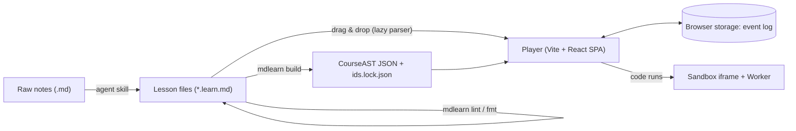
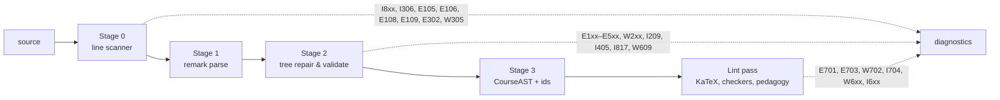

# MDlearn — Engine Architecture

> **Scope.** The compiler that turns `*.learn.md` into a validated CourseAST, and the web player that
> renders it, checks answers, schedules reviews and stores progress in the browser.
> **Verification.** Every code block marked *verified* is copied from the reference prototype, which
> passes 79 tests (Vitest 5, jsdom) with 87 % statement / 95 % line coverage and typechecks under
> TypeScript 7.0 `strict`. Versions below were checked against the npm registry on 2026-09-30.
>
> Syntax: [DSL_SPECIFICATION.md](DSL_SPECIFICATION.md) · Learning rules: [PEDAGOGICAL_SPEC.md](PEDAGOGICAL_SPEC.md)

---

## 1. Goals and quality attributes

| Goal | Measure |
|---|---|
| **Safe with untrusted content** — course packs and LLM output are hostile until proven otherwise | No raw HTML, no `data.h*` injection, sanitised before math rendering, sandboxed code (§10) |
| **Fail closed** | A broken widget never reveals answers (DSL §11) |
| **Offline-first, no backend** | Static hosting; all progress in browser storage; export/import |
| **Deterministic** | Same source → same CourseAST, ids, shuffles and math verdicts (seeded) |
| **Accessible** | WCAG 2.2 AA (§11) |
| **Fast** | Initial player JS ≤ 180 KB gz; heavy features in lazy chunks (§12) |

Non-goals for v1 (M0–M2): accounts and sync, authoring UI, server-side grading, Python execution (M3).

---

## 2. System context



The same DOM-free `@mdlearn/core` package runs in the CLI (Node) and, lazily, in the browser.

---

## 3. Technology stack

| Concern | Choice (version) | Why | Rejected |
|---|---|---|---|
| Build / dev | Vite 8.3 (Rolldown, Oxc) + `@vitejs/plugin-react` 6 | SPA, fast, static output | Next.js: no server need, SSR complicates KaTeX/MathLive/Workers |
| UI | React 19.3 | `<Fragment ref>` focus management, custom-element props | — |
| Language | TypeScript 7.0 (native `tsc`) | Set `types` explicitly; tools needing the TS API use the `@typescript/typescript6` alias until 7.1 | — |
| Styling | Tailwind CSS 4.3 via `@tailwindcss/vite`, tokens in `@theme` | CSS-first config, dark mode variant | — |
| Markdown | unified 11, remark-parse 11, remark-gfm 4, remark-math 6, micromark-extension-directive 4 (**flow half only**), mdast-util-directive 3 | Standard CommonMark tree; no custom tokenizer except Stage 0 | Custom lexer (maintenance); markdown-it (no mdast) |
| mdast → React | mdast-util-to-hast **≥ 13.2.1** (CVE-2025-66400), hast-util-sanitize 5, hast-util-to-jsx-runtime 2 | Only `element`/`text` nodes reach React | react-markdown (re-parses strings; we already have a tree) |
| Math display | KaTeX **0.18.10** called directly | `htmlAndMathml`, fast, `trust:false` | rehype-katex 7 (pins katex ^0.16, missing GHSA-238p-pmpm-9mq7 fix); MathJax (size) |
| Math input | MathLive ≥ 0.110 (CVE-2026-54705 fixed), lazy | Native `\placeholder[id]{}` fill-in prompts inside a formula | Separate input boxes under the formula |
| Math checking | `@cortex-js/compute-engine/latex-syntax` (≈113 KB gz; pin the exact version, it releases almost daily) + own evaluator | LaTeX → MathJSON; we control equivalence | Full Compute Engine (1 MB gz, `isEqual` is not equivalence, unit-bearing `\mu_0`); math.js (no LaTeX input) |
| Validation | Zod 4.6 | Frontmatter, CourseAST, storage, imports; exports JSON Schema | — |
| State | Pure reducer (§8) + Zustand 5.0.15 `persist` | 0 KB state machine, serialisable, testable | XState 5 (14.6 KB gz, unneeded) |
| Spaced repetition | ts-fsrs 5.4.2 (FSRS-6, MIT, 7.2 KB gz; pin exactly, 6.0 is in beta) | Current best open scheduler | SM-2; BKT for mastery (PEDAGOGICAL §9) |
| Code editor | CodeMirror 6 (≈119 KB gz), lazy | Mobile + screen readers | Monaco (no mobile, ~1 MB gz) |
| Syntax highlighting | Shiki 4 fine-grained (`shiki/core` + JS regex engine) at compile time; lazy in browser | Zero runtime cost for built courses | highlight.js full bundle |
| Diagrams | Mermaid 12, lazy, `securityLevel:'strict'`, `layout:'dagre'` | LLMs write Mermaid fluently | ELK default layout (507 KB gz chunk) |
| Tests | Vitest 5 + Testing Library + jsdom; Playwright 1.63 (`page.localStorage`) | Unit, component, e2e | — |
| Workspace | npm workspaces (the owner's default) | — | — |

---

## 4. Repository layout

```
mdlearn/
├── package.json                    # npm workspaces: packages/*, apps/*
├── docs/                           # these four specifications
├── .claude/skills/mdlearn-course/  # SKILL.md → docs/AGENT_SKILL.md, DSL_SPECIFICATION.md → docs/ (symlinks)
├── packages/
│   ├── core/                       # @mdlearn/core — DOM-free, runs in Node and browsers
│   │   ├── src/
│   │   │   ├── registry.ts         # diagnostic codes (single source; generates DSL §12)
│   │   │   ├── stage0.ts           # line scanner: repairs, fence stack, blank/hint extraction
│   │   │   ├── compile.ts          # remark parse → tree repair → CourseAST
│   │   │   ├── ast.ts              # Zod schemas + types, mdast augmentation, JSON Schema export
│   │   │   ├── checkers.ts         # text / number / math answer checking
│   │   │   ├── importer.ts         # house-style outline, exact sections, lesson plans (companion lessons)
│   │   │   ├── tutor.ts            # study queue, question posing without answers, checking, ratings, report
│   │   │   ├── md.ts               # CourseAST prose → Markdown for chat/terminal
│   │   │   ├── node.ts             # @mdlearn/core/node: fs workspace, source resolver, progress file
│   │   │   ├── learn/session.ts    # session reducer + rating table
│   │   │   ├── learn/srs.ts        # event log → FSRS cards
│   │   │   └── learn/streak.ts
│   │   └── test/                   # hazard fixtures, golden CourseAST snapshots
│   ├── cli/                        # @mdlearn/cli → mdlearn lint|build|status|outline|section|plan|new|queue|review|report
│   └── mcp/                        # @mdlearn/mcp → mdlearn-mcp: curriculum, authoring and tutor tools (docs/TOOLING.md)
└── apps/
    └── player/                     # Vite + React SPA
        ├── public/sandbox.html     # opaque-origin code runner (srcdoc template)
        └── src/
            ├── routes/             # Library, Course, Lesson, Review
            ├── prose/              # Prose, TeX, CodeBlock, Mermaid, Callout
            ├── widgets/            # Quiz, Cloze, TextBlank, MathBlank, Order, Explain, Steps, CodeCheck, Hints
            ├── runtime/            # sandbox client, js/py workers, lazy math checker
            ├── state/              # progress-store (persist), session-store, migrations
            └── import/             # drag-and-drop → lazy core compile
```

---

## 5. Compilation pipeline



| Stage | Input → output | Responsibilities |
|---|---|---|
| 0 | text → text + side tables + line map | Unwrap/preamble, frontmatter split, code/math tracking, Pandoc fence semantics and colon rewriting, `$`/`$$`/`\(` repairs, alerts → callouts, Obsidian syntax, feedback re-indent, **blank and hint extraction** into side tables with Private-Use-Area placeholders (`U+E000 b3 U+E001`). Linear time. |
| 1 | text → mdast | `remark-parse` + `remark-gfm` + `remark-math` + block-only directives. |
| 2 | mdast → typed blocks | Cards by `##`, widgets compiled per kind, multi-question quiz split, answer markers, step-list merge, fail-closed placeholders, URL allowlist, `data.*` stripped. |
| 3 | blocks → CourseAST | Frontmatter synonyms + Zod, ids and fingerprints, time estimate, final `LessonSchema` validation (the compiler throws if it ever emits an invalid AST). |

Diagnostics carry the **original** line number through Stage 0's line map. The CLI prints them as
`path:line:col CODE rule: message` and exits 1 on any error.

### 5.1 Block-only directives (verified)

Text directives are disabled because micromark turns `10:30`, `1:99` or `doi:10.1/x` into empty
elements. Registering only the flow half keeps containers and `::hint` working:

```ts
/** remark plugin: only the *flow* half of micromark-extension-directive (no text directives). */
export function remarkBlockDirectives(this: Processor) {
  const data = this.data()
  ;(data.micromarkExtensions ??= []).push({ flow: directive().flow })
  ;(data.fromMarkdownExtensions ??= []).push(directiveFromMarkdown())
}
export const processor = unified().use(remarkParse).use(remarkGfm).use(remarkMath).use(remarkBlockDirectives)
```

### 5.2 CourseAST (verified)

Prose stays standard mdast (a sanitised subset) so it can be rendered by the unified ecosystem; widgets
are typed objects. Positions and every `data` field are stripped.

```ts
// CourseAST — the JSON contract between compiler and player (astVersion 1).
import { z } from 'zod'

/** mdast node types allowed inside Prose (no html, no definitions, no directives). */
export const PROSE_TYPES = [
  'paragraph', 'heading', 'list', 'listItem', 'blockquote', 'table', 'tableRow', 'tableCell', 'code',
  'math', 'inlineMath', 'text', 'emphasis', 'strong', 'delete', 'inlineCode', 'break', 'link', 'image',
  'blank', 'strayBlank', 'callout',
] as const
export interface MdNode { type: (typeof PROSE_TYPES)[number]; children?: MdNode[]; [k: string]: unknown }

const MdNodeSchema: z.ZodType<MdNode> = z.lazy(() =>
  z.looseObject({ type: z.enum(PROSE_TYPES), children: z.array(MdNodeSchema).optional() }),
) as z.ZodType<MdNode>
const Flow = z.array(MdNodeSchema)
const Phrasing = z.array(MdNodeSchema)

export const BlankSchema = z.object({
  id: z.string(), kind: z.enum(['text', 'number', 'math']), answers: z.array(z.string()).min(1),
  tol: z.object({ abs: z.number().optional(), rel: z.number().optional() }).optional(),
  hint: z.string().optional(),
})
const base = { id: z.string(), hints: z.array(Phrasing), reveal: Flow.optional() }
export const WidgetSchema = z.discriminatedUnion('type', [
  z.object({ type: z.literal('quiz'), ...base, stem: Flow, multi: z.boolean(), sortNumeric: z.boolean(),
    options: z.array(z.object({ id: z.string(), correct: z.boolean(), content: Phrasing, feedback: Flow.optional() })).min(2) }),
  z.object({ type: z.literal('cloze'), ...base, body: Flow, blanks: z.array(BlankSchema).min(1), exact: z.boolean() }),
  z.object({ type: z.literal('order'), ...base, prompt: Flow, items: z.array(Flow).min(3) }),
  z.object({ type: z.literal('explain'), ...base, prompt: Flow, ideas: z.array(Flow).min(1) }),
  z.object({ type: z.literal('steps'), ...base, problem: Flow, steps: z.array(Flow).min(2), blanks: z.array(BlankSchema), exact: z.boolean() }),
  z.object({ type: z.literal('code'), ...base, prompt: Flow, lang: z.string(), starter: z.string(),
    tests: z.string().optional(), solution: z.string().optional(), mode: z.enum(['run', 'self']) }),
  z.object({ type: z.literal('unavailable'), id: z.string(), kind: z.string(), codes: z.array(z.string()) }),
])
export const BlockSchema = z.union([
  z.object({ type: z.literal('prose'), node: MdNodeSchema }),
  z.object({ type: z.literal('callout'), kind: z.enum(['note', 'tip', 'important', 'warning']), fold: z.boolean(),
    summary: Phrasing.optional(), children: Flow }),
  WidgetSchema,
])
export const CardSchema = z.object({ id: z.string(), title: z.string(), blocks: z.array(BlockSchema) })
export const LessonSchema = z.object({
  astVersion: z.literal(1),
  id: z.string(), title: z.string(),
  level: z.enum(['beginner', 'intermediate', 'advanced']).optional(),
  lang: z.string(), prereq: z.array(z.string()), goals: z.array(z.string()),
  time: z.number().optional(), timeEstimate: z.number(),
  macros: z.record(z.string(), z.string()),
  intro: z.array(BlockSchema), cards: z.array(CardSchema),
})
export type Blank = z.infer<typeof BlankSchema>
export type Widget = z.infer<typeof WidgetSchema>
export type Block = z.infer<typeof BlockSchema>
export type Card = z.infer<typeof CardSchema>
export type Lesson = z.infer<typeof LessonSchema>

/** Frontmatter: synonyms are mapped *before* strict validation. */
export const FRONTMATTER_SYNONYMS: Record<string, string> = {
  objectives: 'goals', outcomes: 'goals', learning_goals: 'goals',
  prerequisites: 'prereq', requires: 'prereq', prereqs: 'prereq',
  duration: 'time', minutes: 'time', estimated_time: 'time',
  difficulty: 'level', language: 'lang', name: 'title',
}
export const FrontmatterSchema = z.strictObject({
  title: z.string().min(1).optional(),
  id: z.string().regex(/^[a-z0-9][a-z0-9-]*$/).optional(),
  level: z.enum(['beginner', 'intermediate', 'advanced']).optional(),
  lang: z.string().default('en'),
  prereq: z.union([z.string(), z.array(z.string())]).transform((v) => (Array.isArray(v) ? v : [v])).default([]),
  goals: z.array(z.string()).max(6).default([]),
  time: z.union([z.number(), z.string()]).transform((v) => (typeof v === 'number' ? v : parseFloat(v))).pipe(z.number().positive()).optional(),
  macros: z.record(z.string().regex(/^\\[A-Za-z]+$/), z.string().refine((s) => !/[\u0000-\u001f]/.test(s), 'control character (use single quotes for TeX)')).default({}),
})

// Custom mdast nodes produced by the compiler (blanks and callouts inside prose).
declare module 'mdast' {
  interface BlankNode extends Node { type: 'blank'; id: string }
  interface StrayBlankNode extends Node { type: 'strayBlank' }
  interface CalloutNode extends Parent { type: 'callout'; kind: string; fold: boolean; children: BlockContent[] }
  interface PhrasingContentMap { blank: BlankNode; strayBlank: StrayBlankNode }
  interface BlockContentMap { callout: CalloutNode }
  interface RootContentMap { blank: BlankNode; strayBlank: StrayBlankNode; callout: CalloutNode }
}
```

Excerpt of real compiler output for the "Base-rate neglect" quiz (DSL §13), feedback shortened:

```json
{
 "type": "quiz",
 "id": "base-rate-neglect/quiz-25244bb4",
 "hints": [
  [
   {
    "type": "text",
    "value": "Which conditional probability does \"sensitivity\" describe?"
   }
  ]
 ],
 "stem": [
  {
   "type": "paragraph",
   "children": [
    {
     "type": "text",
     "value": "A test is 99% sensitive and you test positive. Which statement is justified?"
    }
   ]
  }
 ],
 "multi": false,
 "sortNumeric": false,
 "options": [
  {
   "id": "o0",
   "correct": false,
   "content": [
    {
     "type": "text",
     "value": "You are about 99% likely to be sick."
    }
   ],
   "feedback": [
    "…"
   ]
  },
  {
   "id": "o1",
   "correct": true,
   "content": [
    {
     "type": "text",
     "value": "It depends on how common the disease is."
    }
   ],
   "feedback": [
    "…"
   ]
  },
  {
   "id": "o2",
   "correct": false,
   "content": [
    {
     "type": "text",
     "value": "The positive result tells you nothing."
    }
   ],
   "feedback": [
    "…"
   ]
  }
 ]
}
```

A formula blank compiles to a MathLive placeholder in the TeX and a typed blank:

```json
{
 "type": "cloze",
 "id": "the-evidence-term/cloze-14c9dd96",
 "hints": [],
 "body": [
  {
   "type": "paragraph",
   "children": [
    {
     "type": "text",
     "value": "Complete the law of total probability."
    }
   ]
  },
  {
   "type": "math",
   "value": "P(E) = P(E \\mid H)\\,P(H) + \\placeholder[b2]{}",
   "blanks": [
    "b2"
   ]
  }
 ],
 "blanks": [
  {
   "id": "b2",
   "kind": "math",
   "answers": [
    "P(E \\mid \\neg H)\\,P(\\neg H)"
   ]
  }
 ],
 "exact": false
}
```

---

## 6. Answer checking (verified)

All checkers are pure and deterministic (math sampling uses a seeded PRNG), so the player, the lint pass
and tests agree. Highlights:

| Kind | Algorithm |
|---|---|
| text | NFKD, strip diacritics, locale lower-case, trim punctuation; one-edit Damerau–Levenshtein for answers ≥ 6 chars, refused if the edit equals another blank's answer in the lesson. |
| number | Keys are read with a decimal point; learner input accepts `%`, fractions, `\frac{a}{b}`, `×10^n`, and thousands/decimal separators by `lang`. Integers exact; decimals: `\|x − key\| ≤ max(ulp(x), ulp(key))` with at least 2 significant figures (or the key's, if fewer) — i.e. the key rounded to the learner's precision. Explicit `±abs` / `±rel%`. |
| math | Normalise TeX (`\dfrac`, `\varepsilon`, `\left`, spacing, `\mid`); parse both sides with the Compute Engine LaTeX syntax (physics and units dictionaries **removed**, so `\mu_0` is a symbol, not a unit-bearing constant); evaluate at up to 24 seeded random points in [−2.5, 2.5] (|v| ≥ 0.2), skip non-finite results, require ≥ 4 valid points and relative agreement 1e-9; equations compare right-hand sides or `lhs − rhs`; non-evaluable notation falls back to normalised TeX; `{exact}` compares structure. |
| code (JS, M2) | Tests run after the learner's code in a Worker; each top-level `assert(...)` is reported. |

```ts
export function checkNumber(input: string, blank: Pick<Blank, 'answers' | 'tol'>, lang = 'en'): Verdict {
  const x = parseNumber(input, lang)
  if (!x) return { ok: false, reason: 'unparsed' }
  for (const key of blank.answers) {
    const k = parseNumber(key, 'en') // keys are always written with a decimal point
    if (!k) continue
    if (blank.tol?.abs !== undefined) { if (Math.abs(x.value - k.value) <= blank.tol.abs + 1e-12) return { ok: true }; continue }
    if (blank.tol?.rel !== undefined) { if (Math.abs(x.value - k.value) <= blank.tol.rel * Math.abs(k.value) + 1e-12) return { ok: true }; continue }
    if (isIntegerKey(key)) { if (Math.abs(x.value - k.value) < 1e-9) return { ok: true }; continue }
    if (x.sig < Math.min(2, k.sig)) return { ok: false, reason: 'imprecise' }
    // accept when the key, rounded to the learner's precision, equals the learner's value
    if (Math.abs(x.value - k.value) <= Math.max(x.ulp, k.ulp) * (1 + 1e-9) + 1e-15) return { ok: true }
  }
  return { ok: false }
}
```

```ts
export function mathEquivalent(a: MJ, b: MJ, seed = 1): boolean | 'unknown' {
  const vars = [...new Set([...freeSymbols(a), ...freeSymbols(b)])]
  const rnd = mulberry32(seed)
  let valid = 0
  for (let k = 0; k < 24 && valid < 6; k++) {
    const env = Object.fromEntries(vars.map((v) => { let x = 0; while (Math.abs(x) < 0.2) x = rnd() * 5 - 2.5; return [v, x] }))
    let x: number, y: number
    try { x = evaluate(a, env); y = evaluate(b, env) } catch { return 'unknown' }
    if (!Number.isFinite(x) || !Number.isFinite(y)) continue
    if (Math.abs(x - y) > 1e-9 * Math.max(1, Math.abs(x), Math.abs(y))) return false
    valid++
  }
  return valid >= 4 ? true : 'unknown'
}

export function checkMath(input: string, key: string, exact = false): Verdict {
  if (normTex(input) === normTex(key)) return { ok: true }
  if (exact) {
    const a = parseTex(input), b = parseTex(key)
    return a && b && JSON.stringify(a) === JSON.stringify(b) ? { ok: true } : { ok: false }
  }
  const a = parseTex(input), b = parseTex(key)
  if (!a || !b) return { ok: false, reason: a ? undefined : 'unparsed' }
  const [la, ra] = sides(a), [lb, rb] = sides(b)
  const lhsA = la ?? lb, lhsB = lb
  // learner may type only the right-hand side of an equation key
  const left = la ? (['Subtract', lhsA, ra] as MJ) : ra
  const right = la && lhsB ? (['Subtract', lhsB, rb] as MJ) : rb
  const eq = mathEquivalent(left, right)
  return eq === true ? { ok: true, note: 'equivalent-form' } : { ok: false, reason: eq === 'unknown' ? 'unparsed' : undefined }
}
```

Verified behaviour (from the test suite): `x+x ≡ 2x`, `x^2+2x+1 ≡ (x+1)^2`,
`\mu_0 I/(2\pi r) ≡ \frac{\mu_0 I}{2\pi r}`, `x ≢ \sqrt{x^2}`, `\epsilon_0 ≡ \varepsilon_0`;
`0.059` and `5.94%` accepted for `0.0594`, `0.06` rejected as imprecise, `1780 ≠ 1763`, `0,0594` with
`lang: it`, `1,000` = 1000 in English and `1.000` = 1000 in Italian.

---

## 7. Rendering

### 7.1 Prose

`MdNode[] → mdast-util-to-hast (custom handlers) → hast-util-sanitize → hast-util-to-jsx-runtime`.
Custom handlers turn `math`/`inlineMath`, `strayBlank` and `callout` into `mdl-*` elements that the
sanitiser schema allows and the `components` map renders. Math is typeset by KaTeX **after**
sanitising, with `trust:false`, finite `maxSize`, `maxExpand: 1000` and a fresh *copy of the lesson's*
`macros` per formula (KaTeX's `\gdef` mutates the object it is given). KaTeX failures render the TeX source as text
(React escapes it).

### 7.2 Widgets

| Widget | Component contract | Emits |
|---|---|---|
| Quiz | Native `<fieldset>`/`<legend>` + radio (or checkbox when `multi`), seeded order (numeric options sorted), **Sure** / **Not sure** submit buttons, wrong options disabled with their feedback, `role="status"` region | `ATTEMPT {correct, sure}` per submit; `final: true` when every distractor is eliminated; `HINT` (author hint) or `HINT {revealsAnswer}` (eliminate an option) |
| Cloze | Text and number blanks are inline `<input>`s (`inputmode="decimal"` for numbers); math blanks render the formula in a read-only `<math-field>` with `\placeholder[bN]{}` prompts; grading via `getPromptValue` → checker → `setPromptState(id, 'correct' \| 'incorrect', locked)`. One submit grades all blanks | `ATTEMPT {correct: all blanks, partial: typo accepted}`; `HINT {revealsAnswer}` for first-letter / word-bank hints; **Show answer** → `REVEAL` |
| Order | Reorder list (drag and keyboard "move up/down"), seeded shuffle | `ATTEMPT {correct: exact or one adjacent swap, partial: one adjacent swap, final: true}`; `HINT`; **Show answer** → `REVEAL` |
| Explain | `<textarea>` (min. 15 characters), then idea units as checkboxes; **Can't recall** reveals immediately | `ATTEMPT {correct: ≥ 50 % of units, partial: < 100 %, final: true}`; "Can't recall" → `REVEAL`; `HINT` |
| Steps | Steps revealed one at a time. A `steps` without blanks is a fully worked example: it is exposition, emits nothing and is not rated. Faded steps require their blank before the next step | one `ATTEMPT {correct: all faded blanks, partial: typo}` when the last faded step is answered; `HINT`; **Show answer** → `REVEAL` |
| Code | CodeMirror editor; **Run** is free experimentation, **Submit** runs the hidden tests (JS) or opens the self-check list (other languages); solution after a submit | `ATTEMPT` per submit (`final` on self-check); `HINT`; **Show solution** → `REVEAL`; **Skip** → `SKIP` |
| Unavailable | Locked card with the error code; content never rendered | — |

Until the MathLive chunk loads, a math blank renders through KaTeX with `\boxed{?}` in place of the
placeholder (progressive enhancement).

### 7.3 Code runner

```
Player ──postMessage──▶ <iframe sandbox="allow-scripts" srcdoc="…">   (opaque origin "null")
                           └─ new Worker(blob:…)   ← terminate() on timeout (2 s) → respawn
```

- The iframe has no access to the player's DOM, cookies or storage; the Worker can be killed even in an
  infinite loop. Messages are accepted only when `event.source === iframe.contentWindow`.
- stdout is capped (64 KB) and batched; results are `{ status, results:[{ name, pass, message }], stdout }`.
- `srcdoc` iframes inherit the parent CSP, so the player CSP must allow `worker-src blob:` and the
  runner's inline script (hash). The iframe `csp` attribute is Chromium-only and is not relied on.
- Python (M3): Pyodide 314 (~6.2 MB) in a module Worker served from a **separate static origin**
  (own HTTP cache; COOP/COEP headers enable `setInterruptBuffer`, otherwise terminate + respawn).

---

## 8. Learning state

### 8.1 Session reducer (verified)

A lesson session is a pure function of `(lesson, session, event)`. It is serialisable, so resuming a
lesson is just persisting it. Transitions:

| State | Event | Next |
|---|---|---|
| `expose` (card has prose and widgets) | `NEXT` | `check` — the exposition collapses |
| `expose` (no widgets) | `NEXT` | next queue entry |
| `check` | `ATTEMPT` correct | widget done |
| `check` | `ATTEMPT` wrong (first miss) | widget stays open (unless `final`); a `retry` entry is inserted with ≥ 2 other entries in between, or the widget is deferred to the first review |
| `check` | `LOOK_BACK` | open widgets get `help: look-back` (rated Hard) |
| `check` | `HINT` | help raised to `author-hint` or `answer-hint` |
| `check` | `REVEAL` / `SKIP` | widget done, revealed (rated Again); a retry is scheduled if it had not already failed |
| `retry` entry | `ATTEMPT` | recorded in its own run (`<id>#retry`) and gated like any check; the card keeps the first attempt's rating |
| `check` | `NEXT` while a widget is not done (correct, `final`, revealed or skipped) | no-op — progress is gated on finishing an attempt, never on being right |
| last entry | `NEXT` | `complete` → card ratings → event log |

```ts
// Session reducer — pure, framework-agnostic, serialisable (persist it to resume a lesson).
import type { Lesson } from '../ast.js'

export type Rating = 1 | 2 | 3 // FSRS Again | Hard | Good (Easy is never assigned automatically)
export type Help = 'none' | 'author-hint' | 'look-back' | 'answer-hint'
/** shaky = succeeded with doubt or partially ("Not sure", typo accepted, some idea units missing). */
export interface WidgetRun { failed: boolean; shaky: boolean; help: Help; done: boolean; revealed: boolean }
export type Entry = { kind: 'card'; cardId: string } | { kind: 'retry'; cardId: string; widgetId: string }
export interface Session {
  lessonId: string
  queue: Entry[]; pos: number
  phase: 'expose' | 'check' | 'complete'
  runs: Record<string, WidgetRun>
  deferred: string[] // missed widgets with no room for a spaced retry → first review
}
export type Event =
  | { type: 'NEXT' }
  | { type: 'LOOK_BACK' }
  | { type: 'HINT'; widgetId: string; revealsAnswer: boolean }
  | { type: 'ATTEMPT'; widgetId: string; correct: boolean; sure?: boolean; partial?: boolean; final?: boolean }
  | { type: 'REVEAL'; widgetId: string }
  | { type: 'SKIP'; widgetId: string }

const MIN_GAP = 2 // a retry needs ≥2 other items in between (spacing within the session)
const rank: Record<Help, number> = { none: 0, 'author-hint': 1, 'look-back': 1, 'answer-hint': 2 }

export function start(lesson: Lesson): Session {
  return { lessonId: lesson.id, queue: lesson.cards.map((c) => ({ kind: 'card', cardId: c.id })), pos: 0, phase: phaseFor(lesson, { kind: 'card', cardId: lesson.cards[0]?.id }), runs: {}, deferred: [] }
}
/** Widgets the learner must attempt on an entry. A fully worked `steps` (no blanks) is exposition. */
const widgetsOf = (lesson: Lesson, e: Entry): string[] =>
  e.kind === 'retry' ? [retryKey(e.widgetId)] : (lesson.cards.find((c) => c.id === e.cardId)?.blocks ?? [])
    .filter((b) => b.type !== 'prose' && b.type !== 'callout' && b.type !== 'unavailable' && !(b.type === 'steps' && b.blanks.length === 0))
    .map((b) => (b as { id: string }).id)
/** A retry is a real check with its own run, so the first attempt's history stays intact. */
const retryKey = (widgetId: string) => `${widgetId}#retry`
function phaseFor(lesson: Lesson, e: Entry | undefined): Session['phase'] {
  if (!e?.cardId) return 'complete'
  if (e.kind === 'retry') return 'check'
  const blocks = lesson.cards.find((c) => c.id === e.cardId)!.blocks
  const hasProse = blocks.some((b) => b.type === 'prose' || b.type === 'callout')
  return hasProse ? 'expose' : 'check'
}
const run = (s: Session, id: string): WidgetRun => s.runs[id] ?? { failed: false, shaky: false, help: 'none', done: false, revealed: false }

export function reduce(lesson: Lesson, s: Session, ev: Event): Session {
  if (s.phase === 'complete') return s
  const entry = s.queue[s.pos]
  const patch = (id: string, p: Partial<WidgetRun>): Session => ({ ...s, runs: { ...s.runs, [id]: { ...run(s, id), ...p } } })
  const key = (widgetId: string) => (entry.kind === 'retry' && entry.widgetId === widgetId ? retryKey(widgetId) : widgetId)
  switch (ev.type) {
    case 'NEXT': {
      const ids = widgetsOf(lesson, entry)
      if (s.phase === 'expose' && ids.length) return { ...s, phase: 'check' } // exposition collapses before the check
      if (s.phase === 'check' && ids.some((id) => !run(s, id).done)) return s // attempt-gated, not correctness-gated
      const pos = s.pos + 1
      return { ...s, pos, phase: phaseFor(lesson, s.queue[pos]) }
    }
    case 'LOOK_BACK': {
      if (s.phase !== 'check') return s
      let next: Session = s
      for (const id of widgetsOf(lesson, entry)) if (!run(s, id).done && rank[run(s, id).help] < 1) next = { ...next, runs: { ...next.runs, [id]: { ...run(next, id), help: 'look-back' } } }
      return next
    }
    case 'HINT': {
      const k = key(ev.widgetId), r = run(s, k)
      const help: Help = ev.revealsAnswer ? 'answer-hint' : 'author-hint'
      return patch(k, { help: rank[help] > rank[r.help] ? help : r.help })
    }
    case 'ATTEMPT': {
      const k = key(ev.widgetId), r = run(s, k)
      if (r.done) return s
      const firstMiss = !ev.correct && !r.failed
      let next = patch(k, { failed: r.failed || !ev.correct, shaky: r.shaky || ev.sure === false || !!ev.partial, done: ev.correct || !!ev.final })
      if (firstMiss && entry.kind === 'card') next = scheduleRetry(next, entry.cardId, ev.widgetId)
      return next
    }
    case 'REVEAL': case 'SKIP': {
      const k = key(ev.widgetId), r = run(s, k)
      let next = patch(k, { revealed: true, done: true })
      if (!r.failed && entry.kind === 'card') next = scheduleRetry(next, entry.cardId, ev.widgetId)
      return next
    }
  }
}
function scheduleRetry(s: Session, cardId: string, widgetId: string): Session {
  const at = s.pos + 1 + MIN_GAP
  if (at > s.queue.length) return { ...s, deferred: [...s.deferred, widgetId] }
  const queue = [...s.queue]; queue.splice(at, 0, { kind: 'retry', cardId, widgetId })
  return { ...s, queue }
}

/** Event → FSRS rating (shared table with PEDAGOGICAL_SPEC). */
export function rate(r: WidgetRun): Rating {
  if (r.failed || r.revealed || r.help === 'answer-hint') return 1
  if (r.shaky || r.help !== 'none') return 2
  return 3
}
/** One FSRS item per card (= knowledge component): the weakest widget decides. Call at `complete`;
 *  a widget never finished counts as skipped (Again). Retries do not raise the rating of a first miss. */
export function cardRatings(lesson: Lesson, s: Session): Record<string, Rating> {
  const out: Record<string, Rating> = {}
  for (const c of lesson.cards) {
    const ids = widgetsOf(lesson, { kind: 'card', cardId: c.id })
    if (ids.length) out[c.id] = Math.min(...ids.map((id) => (run(s, id).done ? rate(run(s, id)) : 1))) as Rating
  }
  return out
}
```

### 8.2 Ratings and FSRS (verified)

The rating table is PEDAGOGICAL_SPEC §9; `rate()` above implements it, and `cardRatings()` takes the
weakest widget per card (call it at `complete`; an unfinished widget counts as Again). Progress is an
append-only log of rating events; FSRS state is derived by replaying it, which makes merging two tabs
(or an imported backup) a union by event id:

```ts
// Progress = append-only event log; FSRS state is *derived* by replaying it (multi-tab merge = union by id).
import { fsrs, generatorParameters, createEmptyCard, type Card, type Grade } from 'ts-fsrs'

export interface ReviewEvent { id: string; t: number; key: string /* lessonId/cardId */; rating: 1 | 2 | 3 | 4 }
const scheduler = fsrs(generatorParameters({ request_retention: 0.9, enable_fuzz: true, maximum_interval: 365 }))

export function mergeLogs(...logs: ReviewEvent[][]): ReviewEvent[] {
  const byId = new Map<string, ReviewEvent>()
  for (const log of logs) for (const e of log) byId.set(e.id, e)
  return [...byId.values()].sort((a, b) => a.t - b.t || a.id.localeCompare(b.id))
}
export function deriveCards(log: ReviewEvent[]): Map<string, Card> {
  const cards = new Map<string, Card>()
  for (const e of log) {
    const card: Card = cards.get(e.key) ?? createEmptyCard<Card>(new Date(e.t))
    cards.set(e.key, scheduler.next(card, new Date(e.t), e.rating as Grade).card)
  }
  return cards
}
export const due = (cards: Map<string, Card>, now = Date.now()) => [...cards].filter(([, c]) => c.due.getTime() <= now).map(([k]) => k)
/** Mastery shown to the learner = current recall probability (FSRS retrievability). */
export const retrievability = (c: Card, now = new Date()) => scheduler.get_retrievability(c, now, false) as number
```

Alongside rating events the player appends **attempt events** — `{ id, t, widget, kind: 'attempt' | 'hint' | 'reveal', correct?, optionId?, sure?, help?, ms }` — to a second log with the same merge rules. They feed the item statistics of PEDAGOGICAL_SPEC §10 (first-try accuracy, distractor counts, calibration, time on card) and are compacted to per-widget counters after 90 days.

Reviews: due cards across the course are interleaved (no two adjacent cards from the same lesson when
avoidable), capped at 20 per session; each review shows one of the card's widgets, rotating and
preferring recall formats (`cloze`, `explain`) once stability exceeds 7 days.

### 8.3 Study streak (verified)

The tutor computes the same rule directly from the review log (`reviewStreakFromLog`); this is the
day-summary form used by the player:

```ts
// Study streak over a day summary: a day counts when you studied and cleared what was due; a day with
// nothing due and no study is neutral; a day with cards left due breaks the streak.
export interface Day { date: string /* YYYY-MM-DD, local */; due: number; cleared: boolean; studied?: number }
export function reviewStreak(days: Day[]): number {
  let streak = 0
  for (const d of [...days].sort((a, b) => b.date.localeCompare(a.date))) {
    const active = (d.studied ?? 0) > 0
    if (!d.due && !active) continue // neutral
    if (active && (d.cleared || !d.due)) { streak++; continue }
    break
  }
  return streak
}
```

---

## 9. Persistence and identity

### 9.1 Progress store (verified)

Zustand `persist` hydrates synchronously from localStorage but does no validation, and it does not
sync tabs. The adapter below validates with Zod (corrupt or foreign data is ignored, not trusted), and
a `storage` listener rehydrates other tabs; merging is safe because the log is idempotent.

```ts
// Persisted progress: an append-only event log (source of truth) validated on every read.
import { create } from 'zustand'
import { persist, type PersistStorage, type StorageValue } from 'zustand/middleware'
import { z } from 'zod'
import { mergeLogs, type ReviewEvent } from '../learn/srs.js'

const Event = z.object({ id: z.string(), t: z.number(), key: z.string(), rating: z.union([z.literal(1), z.literal(2), z.literal(3), z.literal(4)]) })
const Persisted = z.object({ log: z.array(Event), lastLesson: z.string().nullable() })
type PersistedState = z.infer<typeof Persisted>

interface ProgressState extends PersistedState {
  record: (e: Omit<ReviewEvent, 'id' | 't'> & Partial<Pick<ReviewEvent, 'id' | 't'>>) => void
  importLog: (log: unknown) => number
}
export const STORAGE_KEY = 'mdlearn:progress'

/** localStorage adapter that validates with Zod; corrupt or foreign data is ignored, never trusted. */
const validatingStorage: PersistStorage<PersistedState> = {
  getItem: (name) => {
    const raw = globalThis.localStorage?.getItem(name)
    if (!raw) return null
    try {
      const parsed = JSON.parse(raw) as StorageValue<unknown>
      const state = Persisted.safeParse(parsed.state)
      return state.success ? { state: state.data, version: parsed.version } : null
    } catch { return null }
  },
  setItem: (name, value) => globalThis.localStorage?.setItem(name, JSON.stringify(value)),
  removeItem: (name) => globalThis.localStorage?.removeItem(name),
}

export const useProgress = create<ProgressState>()(
  persist(
    (set, get) => ({
      log: [], lastLesson: null,
      record: (e) => set({ log: mergeLogs(get().log, [{ id: e.id ?? crypto.randomUUID(), t: e.t ?? Date.now(), key: e.key, rating: e.rating }]) }),
      importLog: (log) => {
        const parsed = z.array(Event).safeParse(log)
        if (!parsed.success) return 0
        const before = get().log.length
        set({ log: mergeLogs(get().log, parsed.data) })
        return get().log.length - before
      },
    }),
    {
      name: STORAGE_KEY, version: 1, storage: validatingStorage,
      partialize: (s) => ({ log: s.log, lastLesson: s.lastLesson }),
      migrate: (old, from) => (from === 0 ? { log: [], lastLesson: null, ...(old as object) } : old) as PersistedState,
    },
  ),
)

/** Multi-tab: another tab wrote progress → merge its log into ours (idempotent by event id). */
export function syncAcrossTabs() {
  const onStorage = (e: StorageEvent) => { if (e.key === STORAGE_KEY) void useProgress.persist.rehydrate() }
  globalThis.addEventListener?.('storage', onStorage)
  return () => globalThis.removeEventListener?.('storage', onStorage)
}
```

| Concern | Decision |
|---|---|
| Storage budget | localStorage ≈ 5 MiB per origin; a rating event is ~90 bytes → ~50k events. The adapter is swappable for IndexedDB (idb-keyval, < 1 KB gz) when logs grow. |
| Safari | Script-writable storage is deleted after 7 days of Safari use without visiting the site; home-screen web apps are exempt. The player offers PWA install, calls `navigator.storage.persist()`, and nudges an export after each week of use. |
| Schema changes | `version` + `migrate` in `persist`; the CourseAST carries `astVersion` with its own migrations. |
| Export / import | JSON download/upload, validated with the same Zod schema, merged by event id. |
| Session resume | The serialised session reducer state is stored per lesson under its own key. |

### 9.2 Identity

| Id | Source | Stability |
|---|---|---|
| Lesson | `id` or file name minus `NN-` | survives renumbering |
| Card | `{#id}` or slug of the title | survives edits to content; a reworded title starts a new FSRS item |
| Widget | `card/kind-fnv1a(stem + key)` | survives edits elsewhere; changing its key re-keys it |
| Lock file | `mdlearn build` writes `ids.lock.json` (id → fingerprint). On re-generation it keeps an id only when the widget's stem and key are unchanged after normalisation (e.g. it moved to another card or its feedback was reworded); a changed key always gets a new id | |

Rule: **reset beats misattribution** — a review history is never attached to a different question.

---

## 10. Security

| Threat | Vector | Mitigation |
|---|---|---|
| XSS via Markdown | raw HTML, `javascript:` / `data:` URLs | HTML nodes dropped; URL allowlist (`http(s)`, `mailto`, relative — the react-markdown `defaultUrlTransform` policy); hast-util-sanitize with an explicit `mdl-*` schema |
| XSS via plugin data | `data.hName` / `hProperties` / `hChildren` on mdast nodes | All `data` fields stripped in Stage 2; mdast-util-to-hast ≥ 13.2.1 |
| XSS / DoS via TeX | `\href`, `\html*`, huge `\rule`, macro bombs, prototype pollution | KaTeX ≥ 0.18.2, `trust:false` (violations linted as E703), finite `maxSize`, `maxExpand: 1000`, fresh `macros` per render |
| XSS via diagrams | Mermaid label injection (several 2025–2026 advisories) | Mermaid 12, `securityLevel:'strict'` (`'sandbox'` for third-party packs), DOMPurify ≥ 3.4.16, lazy |
| Hostile code | starter/tests from a course pack; infinite loops | opaque-origin sandbox iframe + terminable Worker, timeout, stdout cap |
| Corrupt or forged progress | edited localStorage, malicious import | Zod validation on read and import; append-only log |
| Prompt injection | instructions hidden in the notes | The agent skill treats notes as data; added content is flagged with `<!-- added: … -->` |
| ReDoS / huge input | pathological lines | linear scanners; file size cap 1 MB; ≤ 200 widgets per lesson |
| Frontmatter tricks | YAML tags, `__proto__`, control characters | `yaml` with default schema, Zod `strictObject`, control characters rejected |

Player CSP: `default-src 'self'; script-src 'self' 'wasm-unsafe-eval' 'sha256-<runner>'; worker-src blob:;
style-src 'self' 'unsafe-inline'; img-src 'self' https:; frame-src 'self'; connect-src 'self'`
(KaTeX needs inline styles).

---

## 11. Accessibility (WCAG 2.2 AA)

- Quizzes use native `fieldset`/`legend`/radio inputs (keyboard behaviour for free) and are graded only
  on an explicit button, never on selection change.
- Feedback appears in a `role="status"` region that exists before it is filled.
- Newly revealed steps and the check phase receive focus (React 19 `<Fragment ref>` `focus()`).
- Correct/incorrect is shown by text and icon as well as colour.
- KaTeX output includes MathML; MathLive fields carry an `aria-label` ("Blank 1 of 2").
- Mermaid diagrams get an accessible name from the card title and a description from the adjacent text
  (authors may add Mermaid `accTitle:`/`accDescr:` lines to override).
- Reorder widgets support keyboard "move up/down"; drag is optional.
- `prefers-reduced-motion` disables transitions; `lang` from frontmatter sets `<html lang>`.

---

## 12. Performance budget

| Chunk | Loaded when | Size (gz) |
|---|---|---|
| Player shell (React, router, Zustand, prose renderer, KaTeX JS) | always | ≤ 180 KB target (KaTeX 77 KB) |
| KaTeX CSS + fonts | first formula | ~4 KB CSS + fonts on demand |
| Compiler (unified + micromark + core) | drag-and-drop import only | ~70 KB est. |
| MathLive + CE latex-syntax | first math blank | 228 KB + 113 KB |
| CodeMirror 6 + language | first `code` widget | ~119 KB + 20–40 KB |
| Mermaid core (dagre) | first diagram | ~172 KB |
| Pyodide (M3) | first Python run | ~6.2 MB, cached |

Built courses ship pre-highlighted code (Shiki at build time) and pre-compiled CourseAST JSON, so the
parser never loads for them. Compiling the 11-card example lesson takes about 8.4 ms in Node 26 (warm).

---

## 13. Testing strategy

| Layer | Tool | What |
|---|---|---|
| Stage 0–3 | Vitest | One fixture per hazard (DSL §11), golden CourseAST snapshots, every doc example compiled (CI extracts them) |
| Checkers | Vitest | Equivalence and precision tables (§6), property tests with random expressions |
| Reducer / FSRS | Vitest | Transition table, rating table, log merge |
| Components | Testing Library + jsdom | Feedback, disabling, hints, fail-closed, sanitising |
| End-to-end | Playwright 1.63 | Lesson flow, resume after reload (`page.localStorage`), review session, keyboard-only run |
| Accessibility | axe-core in Playwright | No violations on the example course |
| Coverage | `@vitest/coverage-v8` | ≥ 80 % lines (prototype: 95 %) |

Note: with Node ≥ 25, Node's own `localStorage` can shadow jsdom's; Vitest 5 handles this, otherwise run
workers with `--no-experimental-webstorage`.

---

## 14. Proof of concept: `LessonPreview.tsx` (verified)

Compiles DSL source with the core compiler and renders prose with KaTeX, quizzes with feedback and
hints, folded callouts, and the fail-closed placeholder. Other widgets render a stub in the PoC.

```tsx
// PoC: DSL source → CourseAST (core compiler) → React. Prose is rendered through
// mdast → hast → sanitize → JSX; math is typeset by KaTeX *after* sanitising.
import { createContext, useContext, useId, useMemo, useState, type ReactNode } from 'react'
import { Fragment, jsx, jsxs } from 'react/jsx-runtime'
import katex from 'katex'
import { toHast, type Handlers } from 'mdast-util-to-hast'
import { sanitize, defaultSchema } from 'hast-util-sanitize'
import { toJsxRuntime } from 'hast-util-to-jsx-runtime'
import type { Nodes as MdastNodes } from 'mdast'
import type { Element, ElementContent, Properties } from 'hast'
import { compile } from '../compile.js'
import type { Block, MdNode } from '../ast.js'

type Quiz = Extract<Block, { type: 'quiz' }>

// ---- math ------------------------------------------------------------------------------
const Macros = createContext<Record<string, string>>({})
export function TeX({ tex, display }: { tex: string; display: boolean }) {
  const lessonMacros = useContext(Macros)
  const html = useMemo(() => {
    try {
      return katex.renderToString(tex.replace(/\\placeholder\[\w+\]\{\}/g, '\\boxed{\\,?\\,}'), {
        displayMode: display, throwOnError: true, trust: false, maxSize: 10, maxExpand: 1000,
        macros: { ...lessonMacros }, // fresh copy per render: \gdef must not leak between formulas
      })
    } catch { return null }
  }, [tex, display, lessonMacros])
  if (html === null) return <code className="math-error">{tex}</code> // React escapes the source
  return <span className={display ? 'math-display' : 'math-inline'} dangerouslySetInnerHTML={{ __html: html }} />
}

// ---- prose -----------------------------------------------------------------------------
const el = (tagName: string, properties: Properties, children: ElementContent[] = []): Element =>
  ({ type: 'element', tagName, properties, children })
const handlers: Handlers = {
  math: (_s, n) => el('mdl-math', { dataTex: (n as { value: string }).value, dataDisplay: 'true' }),
  inlineMath: (_s, n) => el('mdl-math', { dataTex: (n as { value: string }).value }),
  strayBlank: () => el('mdl-stray', {}),
  callout: (s, n) => el('mdl-callout', { dataKind: n.kind }, s.all(n)),
}
const schema = {
  ...defaultSchema,
  tagNames: [...(defaultSchema.tagNames ?? []), 'mdl-math', 'mdl-stray', 'mdl-callout'],
  attributes: { ...defaultSchema.attributes, 'mdl-math': ['dataTex', 'dataDisplay'], 'mdl-callout': ['dataKind'] },
}
const components = {
  'mdl-math': (p: Record<string, string>) => <TeX tex={p['data-tex']} display={p['data-display'] === 'true'} />,
  'mdl-stray': () => <span aria-label="hidden blank">_____</span>,
  'mdl-callout': (p: { 'data-kind': string; children?: ReactNode }) => <aside className={`callout callout-${p['data-kind']}`}>{p.children}</aside>,
}
export function Prose({ nodes }: { nodes: MdNode[] }) {
  const root = { type: 'root', children: nodes } as unknown as MdastNodes
  const hast = sanitize(toHast(root, { handlers }), schema)
  return toJsxRuntime(hast, { Fragment, jsx, jsxs, components: components as never, passKeys: true })
}

// ---- quiz ------------------------------------------------------------------------------
/** Seeded shuffle: the same widget shows the same order after a reload (no position cues). */
function seededOrder<T>(items: T[], seed: string): T[] {
  let h = 2166136261
  for (const ch of seed) h = Math.imul(h ^ ch.charCodeAt(0), 16777619)
  const rnd = () => ((h = Math.imul(h ^ (h >>> 15), 2246822507) ^ Math.imul(h ^ (h >>> 13), 3266489909)) >>> 0) / 2 ** 32
  const a = [...items]
  for (let i = a.length - 1; i > 0; i--) { const j = Math.floor(rnd() * (i + 1)); [a[i], a[j]] = [a[j], a[i]] }
  return a
}
export type QuizEvent = { widgetId: string; correct: boolean; sure: boolean; attempt: number }

export function QuizView({ quiz, onAttempt }: { quiz: Quiz; onAttempt?: (e: QuizEvent) => void }) {
  const name = useId()
  const options = useMemo(() => (quiz.sortNumeric ? quiz.options : seededOrder(quiz.options, quiz.id)), [quiz])
  const [picked, setPicked] = useState<string | null>(null)
  const [wrong, setWrong] = useState<string[]>([])
  const [done, setDone] = useState(false)
  const [hints, setHints] = useState(0)
  const last = options.find((o) => o.id === picked)
  const submit = (sure: boolean) => {
    if (!last) return
    onAttempt?.({ widgetId: quiz.id, correct: last.correct, sure, attempt: wrong.length + 1 })
    if (last.correct) setDone(true)
    else {
      const nowWrong = [...wrong, last.id]
      setWrong(nowWrong)
      if (options.filter((o) => !o.correct && !nowWrong.includes(o.id)).length === 0) setDone(true)
    }
  }
  return (
    <form className="quiz" onSubmit={(e) => e.preventDefault()}>
      <fieldset disabled={done}>
        <legend><Prose nodes={quiz.stem} /></legend>
        {options.map((o) => (
          <label key={o.id} className={wrong.includes(o.id) ? 'opt wrong' : done && o.correct ? 'opt correct' : 'opt'}>
            <input type="radio" name={name} value={o.id} disabled={wrong.includes(o.id)}
              checked={picked === o.id} onChange={() => setPicked(o.id)} />
            <Prose nodes={o.content} />
            {wrong.includes(o.id) && <span className="sr-tag"> (incorrect)</span>}
          </label>
        ))}
        <button type="button" disabled={!picked} onClick={() => submit(true)}>Sure</button>
        <button type="button" disabled={!picked} onClick={() => submit(false)}>Not sure</button>
        {quiz.hints.length > hints && <button type="button" onClick={() => setHints(hints + 1)}>Hint</button>}
      </fieldset>
      {quiz.hints.slice(0, hints).map((h, i) => <p key={i} className="hint"><Prose nodes={h} /></p>)}
      <div role="status" aria-live="polite">
        {last && (last.correct || wrong.includes(last.id)) && last.feedback && <Prose nodes={last.feedback} />}
        {done && quiz.reveal && <Prose nodes={quiz.reveal} />}
      </div>
    </form>
  )
}

// ---- lesson ----------------------------------------------------------------------------
function BlockView({ block }: { block: Block }) {
  switch (block.type) {
    case 'prose': return <Prose nodes={[block.node]} />
    case 'callout':
      return block.fold
        ? <details className={`callout callout-${block.kind}`}><summary>{block.summary ? <Prose nodes={block.summary} /> : block.kind}</summary><Prose nodes={block.children} /></details>
        : <aside className={`callout callout-${block.kind}`}><Prose nodes={block.children} /></aside>
    case 'quiz': return <QuizView quiz={block} />
    case 'unavailable': return <div role="note" className="locked">This exercise is unavailable ({block.codes.join(', ')}).</div>
    default: return <div className="todo">[{block.type} widget]</div> // other widgets are out of PoC scope
  }
}
export function LessonPreview({ source }: { source: string }) {
  const { lesson, diagnostics } = useMemo(() => compile(source), [source])
  if (!lesson) return <pre role="alert">{diagnostics.map((d) => `${d.line} ${d.code}`).join('\n')}</pre>
  return (
    <Macros.Provider value={lesson.macros}>
    <article lang={lesson.lang}>
      <h1>{lesson.title}</h1>
      {lesson.intro.map((b, i) => <BlockView key={i} block={b} />)}
      {lesson.cards.map((c) => (
        <section key={c.id} id={c.id} aria-labelledby={`${c.id}-h`}>
          <h2 id={`${c.id}-h`}>{c.title}</h2>
          {c.blocks.map((b, i) => <BlockView key={i} block={b} />)}
        </section>
      ))}
    </article>
    </Macros.Provider>
  )
}
```

Its tests (excerpt):

```tsx
// @vitest-environment jsdom
import { resolve } from 'node:path'
import { describe, it, expect, afterEach } from 'vitest'
import { render, screen, fireEvent, within, cleanup } from '@testing-library/react'
import { readFileSync } from 'node:fs'
import { LessonPreview } from '../src/react/LessonPreview'

const bayes = readFileSync(resolve(__dirname, '../examples/02-bayes-theorem.learn.md'), 'utf8')

afterEach(cleanup)
describe('LessonPreview', () => {
  it('renders LaTeX with KaTeX (HTML + MathML)', () => {
    const { container } = render(<LessonPreview source={bayes} />)
    expect(container.querySelectorAll('.katex').length).toBeGreaterThan(10)
    expect(container.querySelector('.math-display math')).not.toBeNull() // MathML for screen readers
  })
  it('a wrong option shows its own feedback and is disabled; the right one shows feedback too', () => {
    render(<LessonPreview source={bayes} />)
    const section = screen.getByRole('region', { name: 'Base-rate neglect' })
    fireEvent.click(within(section).getByLabelText(/about 99% likely/))
    fireEvent.click(within(section).getByRole('button', { name: 'Sure' }))
    expect(within(section).getByRole('status').textContent).toMatch(/reverse conditional/)
    expect((within(section).getByLabelText(/about 99% likely/) as HTMLInputElement).disabled).toBe(true)
    fireEvent.click(within(section).getByLabelText(/how common the disease is/))
    fireEvent.click(within(section).getByRole('button', { name: 'Not sure' }))
    expect(within(section).getByRole('status').textContent).toMatch(/prior decides/)
  })
  it('hints are revealed on demand', () => {
    render(<LessonPreview source={bayes} />)
    const section = screen.getByRole('region', { name: 'Base-rate neglect' })
    expect(within(section).queryByText(/does "sensitivity" describe/)).toBeNull()
    fireEvent.click(within(section).getByRole('button', { name: 'Hint' }))
    expect(within(section).getByText(/does "sensitivity" describe/)).toBeTruthy()
  })
  it('fails closed: a broken quiz never leaks its options', () => {
    render(<LessonPreview source={'---\ntitle: T\n---\n## C\n:::quiz\nQ?\n- [ ] secret A\n- [ ] secret B\n:::'} />)
    expect(screen.getByRole('note').textContent).toMatch(/unavailable \(E202\)/)
    expect(screen.queryByText(/secret/)).toBeNull()
  })
  it('sanitises: javascript: links are dropped and raw HTML never renders', () => {
    const { container } = render(<LessonPreview source={'---\ntitle: T\n---\n## C\n[x](javascript:alert(1)) '} />)
    expect(container.querySelector('a')?.getAttribute('href') ?? '').toBe('')
    expect(container.querySelector('img')).toBeNull()
  })
})
```

---

> **Status (2026-10-02).** The browser player described in this document now exists as **MDlearn Studio**
> (`packages/studio`, see [STUDIO.md](STUDIO.md)): a local server plus web app that also reads any Markdown,
> keeps notes, renders the DSL v1.2 visual blocks, and runs AI jobs. The sections above remain the reference
> for the compiler, checkers, learning state and persistence it uses.

## 15. Roadmap

| Milestone | Scope | Exit criterion |
|---|---|---|
| **M0 Core** ✅ | `@mdlearn/core` (Stage 0–3, registry, checkers, importer, tutor), `mdlearn` CLI, `mdlearn-mcp` server, three skills — see [TOOLING.md](TOOLING.md) | Done: all DSL examples and hazard fixtures pass; companion lessons for a real curriculum's foundations track lint clean |
| **M1 Player MVP** | Prose, KaTeX, quiz, cloze (text/number), callouts, session reducer, progress store; other widgets as locked stubs | The Bayes lesson runs end to end (stubs for M2/M3 widgets), keyboard-only, offline |
| **M2 Retention (v1 release)** | FSRS reviews, streak, explain, order, steps, math blanks (MathLive), JS code runner, attempt-event log, test-out mode (take a lesson's checks first; ≥ 80 % first-try correct marks it mastered and skips worked examples) | Review session across two lessons; resume after reload; all widgets except Python live |
| **M3 Python & diagrams** | Pyodide on a sandbox origin, CodeMirror language packs, Mermaid | Python code widgets run tests with timeouts |
| **M4 Authoring loop** | Live preview while editing, `ids.lock.json`, item statistics from exported attempt logs | Re-generating a lesson keeps progress |

---

## 16. Decision log

| Decision | Alternatives | Reason |
|---|---|---|
| Headings delimit cards | `:::card` wrappers | No closing fences to forget; titles double as signals and ids |
| Stage-0 line scanner before remark | Custom micromark tokenizers | Repairs need line context (fences, code, math); stays linear and testable |
| Text directives off | Restoring unknown directives from source offsets | Simpler and total: nothing in prose can turn into a directive |
| Blanks extracted before parsing | Scanning mdast text nodes | Markdown would already have mangled `2*3*4`, `P(E\|H)`, table pipes |
| Own math evaluator over CE syntax | Full Compute Engine | Size, churn, and its equality API is not an equivalence test |
| FSRS per card, mastery = retrievability | FSRS per widget; BKT | One idea = one memory; BKT is noise with 1–3 observations |
| Event log as source of truth | Mutable per-item state | Multi-tab and import merges become trivial and lossless |
| Fail closed | Render what parsed | A broken quiz would leak its answer key |
