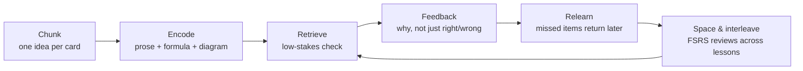

# MDlearn — Pedagogical Specification

> **Purpose.** This document states which findings from learning science MDlearn relies on, what each
> one implies for the data model and the interface, and where the evidence stops. Every design rule in
> [DSL_SPECIFICATION.md](DSL_SPECIFICATION.md) and [ENGINE_ARCHITECTURE.md](ENGINE_ARCHITECTURE.md)
> that has a pedagogical reason points back here.
>
> **Labels used throughout.** **[E]** = supported by experimental or meta-analytic evidence (cited).
> **[H]** = an engineering heuristic chosen to apply that evidence; reasonable, but its exact number is
> not a research finding and should be tuned with data (§10).
> Effect sizes are as reported by the cited meta-analyses; numbers that could only be confirmed from
> secondary sources are marked *(secondary)*.

---

## 1. The learning loop

Each lesson runs the same loop, and each construct exists to serve one step of it.

| Step | Constructs | Principle (section) |
|---|---|---|
| Chunk | `##` cards, intro, `goals` | Cognitive load (§2) |
| Encode | prose, `$$` + verbal gloss, mermaid, images, callouts | Dual coding (§5), signalling (§2) |
| Retrieve | `quiz`, `cloze`, `order`, `explain`, `steps` (faded), `code` | Retrieval practice (§3) |
| Feedback | option feedback, reveal blocks, idea units, solutions | Feedback research (§3.3) |
| Relearn | in-session re-queue, "Look back" counted as help | Successive relearning (§3.4) |
| Space & interleave | FSRS-6 per card, mixed reviews within a course | Desirable difficulties (§4) |

---

## 2. Cognitive load theory (Sweller)

### 2.1 Claims

- Working memory holds only about four chunks of new information at once **[E]** (Cowan, 2001); long-term
  memory holds schemas without that limit. Learning means building schemas without overloading
  working memory (Sweller, 1988; Sweller, van Merriënboer, & Paas, 2019).
- **Intrinsic load** comes from *element interactivity*: how many elements must be processed together to
  understand the material. **Extraneous load** comes from how the material is presented. *Germane load*
  is now treated not as a third additive load but as the working-memory resources devoted to intrinsic
  load (Sweller, 2010) **[E]**.
- Instruction should keep intrinsic load manageable (sequence and chunk), remove extraneous load, and
  free resources for schema building.

### 2.2 Effects MDlearn applies

| Effect | Evidence | Design consequence |
|---|---|---|
| **Segmenting**: learner-paced segments beat a continuous presentation | Retention *d* = 0.32, transfer *d* = 0.36, load reduced *d* = 0.23 (Rey et al., 2019) **[E]** | One idea per card; the learner advances (no auto-play). |
| **Pre-training**: learn the parts' names first | Mayer, Mathias, & Wetzell (2002) **[E]** | A terms/symbols card before the first card that combines them. |
| **Isolated → interacting elements** | Pollock, Chandler, & Sweller (2002) **[E]** | Concepts appear alone before the card where they interact (prior, likelihood → Bayes' formula). |
| **Split attention / spatial contiguity** | Chandler & Sweller (1991); *g* = 0.63 (Schroeder & Cenkci, 2018); spatial *d* = 0.72, temporal *d* = 0.87 (Ginns, 2006, *secondary*) **[E]** | A formula's "where …" legend, a diagram and its explanation live in the **same card**; never "see the figure above". |
| **Coherence / seductive details** | Harp & Mayer (1998); Sundararajan & Adesope (2020): interesting but irrelevant material hurts (retention *g* ≈ −0.37, *secondary*) **[E]** | The agent strips anecdotes, exam chatter, TODOs, repetition (AGENT_SKILL "bloat list"). |
| **Signalling** | Retention *g* = 0.53, transfer *g* = 0.33 (Schneider, Beege, Nebel, & Rey, 2018) **[E]** | Card titles state the idea; **bold** marks a key term at first use; `important` callout for the takeaway. |
| **Worked examples** | Sweller & Cooper (1985) **[E]** | `steps`: novices study solutions before solving. |
| **Fading** | Renkl & Atkinson (2003); Renkl, Atkinson, Maier, & Staley (2002); fading + self-explanation prompts improve transfer (Atkinson, Renkl, & Merrill, 2003) **[E]** | A step with a blank is a faded step; fade from the last step backwards across a lesson. |
| **Transient information** | Leahy & Sweller (2011) **[E]** | Nothing disappears on a timer; earlier cards stay reachable. |
| **Expertise reversal**: guidance that helps novices hurts experts | Kalyuga, Ayres, Chandler, & Sweller (2003) **[E]** | `level` changes the blueprint (§6); a test-out mode (engine milestone M2) lets experts skip worked examples. |
| **Redundancy** | Chandler & Sweller (1991); Mayer (2020) **[E]** | Do not restate a diagram verbatim in text; explain what it shows. |

### 2.3 Card budgets **[H]**

| Budget | Default | Rationale |
|---|---|---|
| Words of prose per card | ≤ 150 (W601) | About 40–60 s of reading: one segment. |
| New terms or symbols per card | ≤ 3 | Stays under the ~4-chunk limit, leaving room to relate them. |
| Display formulas per card | 1 (a tightly related pair at most) | Each formula carries high element interactivity. |
| Cards per lesson | 8–15 (W603 above 15) | 10–15 minutes; one sitting. |

---

## 3. Retrieval practice (Roediger & Karpicke)

### 3.1 Claims

- Retrieving information strengthens memory more than restudying it: restudy wins at 5 minutes, testing
  wins at 2 days and 1 week (Roediger & Karpicke, 2006a); testing is a learning event, not only an
  assessment (Roediger & Karpicke, 2006b) **[E]**.
- Retrieval beat elaborative concept mapping on both verbatim and inference questions (Karpicke & Blunt,
  2011) **[E]**.
- Meta-analyses: *g* = 0.50 overall; **0.73 with feedback vs 0.39 without**; **cued recall 0.61 vs
  recognition 0.29** as the practice format (Rowland, 2014). In real classrooms *g* = 0.499 across 222
  studies and 48,478 students (Yang, Luo, Vadillo, Yu, & Shanks, 2021); see also Agarwal, Nunes, & Blunt
  (2021) and Adesope, Trevisan, & Sundararajan (2017) **[E]**. Benefits transfer to new questions
  under conditions reviewed by Pan & Rickard (2018) **[E]**.
- Practice testing and distributed practice are the two techniques rated "high utility" by Dunlosky,
  Rawson, Marsh, Nathan, & Willingham (2013) **[E]**. Students rarely choose them on their own (Karpicke,
  Butler, & Roediger, 2009) **[E]** — so the tool must schedule them, not merely offer them.

### 3.2 Embedding checks in the reading flow

Short tests *between* lecture segments reduced mind-wandering and improved final scores (Szpunar, Khan,
& Schacter, 2013) **[E]**. MDlearn therefore:

- never lets more than 3 cards pass without a widget (W602) **[H]**, rather than a quiz at the end;
- shows a card's widgets in a **check phase** after its exposition collapses, so the answer cannot be
  copied from the screen — retrieval, not lookup. "Look back" stays available (§2: transient
  information) but counts as help. Effortful but successful retrieval helps memory more (Pyc & Rawson,
  2009) **[E]**, and judging one's knowledge while the answer is visible inflates confidence (Koriat &
  Bjork, 2005) **[E]**;
- keeps stakes low: no grades, no penalties, progress gated on *attempting*, not on being right.

### 3.3 Feedback

| Finding | Evidence | Consequence |
|---|---|---|
| Feedback matters most after errors | Pashler, Cepeda, Wixted, & Rohrer (2005) **[E]** | Every distractor carries its own feedback (W205). |
| Elaborated feedback beats showing the answer, which beats right/wrong | 0.49 vs 0.32 vs 0.05 (Van der Kleij, Feskens, & Eggen, 2015) **[E]** | Feedback explains *why* the option is wrong — the misconception — not just "incorrect". |
| Feedback should be about the task and process, not the person | Hattie & Timperley (2007); Shute (2008) **[E]** | No "Great job!"; feedback names the idea. |
| MC exposure to lures can plant errors… | Roediger & Marsh (2005) **[E]** | Feedback after every MC attempt; few options. |
| …and feedback removes most of that harm | Butler & Roediger (2008) **[E]** | Answer-until-correct: wrong options are disabled with their explanation. |
| Plausible, competitive options make MC questions do retrieval work | Little, Bjork, Bjork, & Angello (2012) **[E]** | Distractors come from real misconceptions (§8). |
| Recall formats beat recognition when feedback is given | Kang, McDermott, & Roediger (2007); Rowland (2014) **[E]** | Prefer `cloze`/`explain` for facts and terms; use `quiz` to discriminate misconceptions. |
| Timing (immediate vs delayed) | Mixed (Kulik & Kulik, 1988) **[E]** | Immediate feedback in the lesson; delayed re-exposure comes from spaced review. |

### 3.4 Errors, confidence and relearning

- **Hypercorrection.** Errors made with high confidence are the most likely to be corrected after
  feedback (Butterfield & Metcalfe, 2001; Metcalfe, 2017) **[E]**. The quiz submit buttons are **Sure**
  and **Not sure**: one tap, no extra step. A confident error gets its feedback emphasised; a correct
  but unsure answer is rated Hard, which stops lucky guesses (a 3-option item is a 33 % guess) from
  inflating the schedule.
- **Successive relearning.** Practise to a criterion, then relearn in spaced sessions (Rawson &
  Dunlosky, 2011) **[E]**. A missed item returns later in the same lesson with at least two other items in
  between **[H]**, and its card is scheduled for an early review.
- **Pretesting and prediction.** Unsuccessful retrieval attempts before learning improve later learning
  (Richland, Kornell, & Kao, 2009; Kornell, Hays, & Bjork, 2009) **[E]**; generating a prediction makes
  the surprise of being wrong drive learning (Brod, Hasselhorn, & Bunge, 2018) **[E]**. Lessons with a
  counter-intuitive result open with a prediction `quiz` or `explain` before any teaching.

---

## 4. Desirable difficulties and interleaving (Bjork)

### 4.1 Claims

- Conditions that make practice feel slower or harder can make learning more durable: spacing,
  interleaving, testing and generation (Bjork, 1994; Bjork & Bjork, 2011) **[E]**. Performance during
  practice is a poor guide to learning (Soderstrom & Bjork, 2015) **[E]**.
- **Generation**: items the learner produces are remembered better than items they read; *d* ≈ 0.40
  (Slamecka & Graf, 1978; Bertsch, Pesta, Wiscott, & McDaniel, 2007) **[E]**.
- **Spacing**: the best gap grows with the retention interval (Cepeda, Pashler, Vul, Wixted, & Rohrer,
  2006); equally spaced retrieval beats expanding schedules for long-term retention (Karpicke &
  Roediger, 2007); spacing out retrieval episodes helps (Latimier, Peyre, & Ramus, 2021); review in
  Carpenter, Pan, & Butler (2022) **[E]**.
- **Interleaving**: overall *g* = 0.42, but strongly moderated — paintings 0.67, mathematics 0.34, word
  lists **−0.39**, expository texts not significant (Brunmair & Richter, 2019) **[E]**. It helps when the
  learner must *discriminate* similar categories or choose a method (Kornell & Bjork, 2008; Rohrer &
  Taylor, 2007) and when the interleaved topics are related (Sana & Yan, 2022) **[E]**.
- **Self-explanation**: prompting learners to explain improves understanding; *g* = 0.55 (Chi, de Leeuw,
  Chiu, & LaVancher, 1994; Bisra, Liu, Nesbit, Salimi, & Winne, 2018) **[E]**. People overrate their
  understanding until they try to explain (Rozenblit & Keil, 2002) **[E]**; expecting to teach improves
  organisation of recall (Nestojko, Bui, Kornell, & Bjork, 2014) **[E]**. The popular "Feynman technique"
  is a folk name for this; MDlearn grounds `explain` in the self-explanation and free-recall research,
  not in the label.

### 4.2 Design consequences

| Difficulty | Mechanism in MDlearn |
|---|---|
| Generation | Blanks, `explain` (typing is required, or "Can't recall"), faded steps, code. |
| Spacing | FSRS-6 schedules each card for review at ~90 % predicted recall (Ye, Su, & Cao, 2022). |
| Interleaving | Review sessions mix due cards **from related lessons of the same course**, never two cards in a row from the same lesson when avoidable; recap questions make the learner *choose* the method. Vocabulary-like material is not artificially interleaved inside a lesson. |
| Varied formats | A card's review rotates among its widgets, moving from recognition (`quiz`) to recall (`cloze`, `explain`) as stability grows. |

### 4.3 Boundary conditions

Difficulty is desirable only if the learner can respond successfully (McDaniel & Butler, 2011) **[E]**.
With high element-interactivity material, added difficulty can become extraneous load (Chen,
Castro-Alonso, Paas, & Sweller, 2018); van Gog & Sweller (2015) argue the testing effect shrinks with
complex material, Karpicke & Aue (2015) dispute this **[E]**. Yeo & Fazio (2019) show the best strategy
depends on the knowledge type: retrieval for stable facts, worked examples for learning a new procedure
when the test is immediate **[E]**. §4.4 shows how MDlearn reconciles these.

### 4.4 Tensions and how MDlearn resolves them

| Tension | Resolution |
|---|---|
| CLT says reduce load; desirable difficulties say add difficulty. | Difficulty is added only where element interactivity is low or the schema exists: facts and terms are retrieved early (`cloze`); new procedures are first studied as worked examples (`steps`) and faded gradually (Chen et al., 2018; Yeo & Fazio, 2019). `level` decides how fast guidance fades (expertise reversal). |
| The testing effect may shrink for complex material (van Gog & Sweller, 2015) vs. it does not (Karpicke & Aue, 2015). | Complex material is broken into cards before it is tested, and tests of complex procedures come *after* a worked example. Either reading of the debate is then satisfied. |
| Multiple choice can plant errors (Roediger & Marsh, 2005). | Few options, misconception-based distractors, feedback on every attempt, answer-until-correct (Butler & Roediger, 2008). |
| Immediate vs delayed feedback (Kulik & Kulik, 1988). | Immediate, elaborated feedback in the lesson; the delayed re-exposure comes from spaced review. |
| Revisiting earlier cards helps understanding (transient information) but turns a check into lookup. | "Look back" is always allowed and simply rated Hard. |
| Gamification raises engagement but performance rewards can backfire (Deci, Koestner, & Ryan, 1999). | Reward review consistency (streak of cleared review days), never scores. |
| Interleaving helps discrimination but hurts word-list learning (Brunmair & Richter, 2019). | Interleave across related lessons and in recap method-choice questions only. |

---

## 5. Dual coding (Paivio)

### 5.1 Claims

- Verbal and non-verbal (imagery) information are processed in separate but connected systems; material
  encoded in both is better remembered (Paivio, 1986; Clark & Paivio, 1991) **[E]**.
- Words plus well-designed graphics beat words alone, provided the graphic is relevant, integrated and
  not redundant (Mayer, 2020; Mayer & Moreno, 2003) **[E]**.
- Representation format can change reasoning itself: natural frequencies ("99 of 594 positives")
  improve Bayesian reasoning over probabilities (Gigerenzer & Hoffrage, 1995; McDowell & Jacobs, 2017)
  **[E]**. Moving from concrete to abstract representations helps (concreteness fading; Fyfe, McNeil,
  Son, & Goldstone, 2014) **[E]**.

### 5.2 Design consequences

| Rule | Construct |
|---|---|
| Every display formula has, in the same card, a verbal gloss naming each new symbol (typically "where $P(H)$ is …"). | `$$` + prose |
| Diagrams (mermaid, images) sit next to the sentence that explains them; labels inside the diagram. | mermaid fence, `` |
| Prefer a structural picture (tree, flow, timeline) over a box of text. | mermaid |
| Concrete before abstract: example numbers, then the general formula. | blueprint (§6) |
| Formulas are typeset (KaTeX) with MathML for screen readers; a formula is not an image. | `$…$` |
| Optional depth is folded away so it adds no load until requested. | `:::tip[…]{fold}` |

---

## 6. Lesson blueprint

The agent builds every lesson from this sequence, adjusted by `level` (expertise reversal). It follows
Merrill's (2002) cycle — activate, demonstrate, apply, integrate — and aligns each check with a goal
(constructive alignment; Biggs, 1996; goals phrased with the revised Bloom verbs of Anderson &
Krathwohl, 2001).

| Stage | Beginner | Intermediate | Advanced |
|---|---|---|---|
| Activate | Intro + optional prediction | Prediction `quiz`/`explain` | Problem first (`cloze` number or `code`) |
| Pre-train | Terms/symbols card | Terms card if > 3 new terms | Skip |
| Concepts | One idea per card; never > 3 cards without a widget | Same | Shorter cards, more `explain` |
| Demonstrate | `steps` fully worked | `steps`, last step faded | Faded `steps` or none |
| Apply | Faded `steps` → `cloze` number | Problem (`cloze`/`code`) | Problems, `order`, `code` |
| Misconceptions | `quiz` with misconception distractors + `warning` | Same | Same |
| Integrate | Recap: free-recall `explain` + 1–2 mixed questions | + `order` / method-choice question | Mixed questions only |

Lesson-level budgets **[H]**: 8–15 cards; 10–15 minutes; never more than 3 cards without a widget; 3 options per
quiz; 1–4 blanks per cloze; 2–5 idea units per `explain`; 3–6 steps per `steps`.

---

## 7. Primitive → mechanism matrix

ICAP: Interactive > Constructive > Active > Passive engagement (Chi & Wylie, 2014). Doing activities
was associated with about six times the learning gain of reading or watching in a MOOC (Koedinger,
Kim, Jia, McLaughlin, & Bier, 2015; correlational) **[E]**.

| Primitive | Mechanisms | ICAP | Use when the notes contain… | Key defaults |
|---|---|---|---|---|
| `quiz` | retrieval (recognition), discrimination, elaborated feedback, hypercorrection | Active → Constructive with feedback | confusable concepts, misconceptions | 3 options; feedback per option; answer-until-correct; Sure/Not sure; seeded shuffle |
| `cloze` | cued recall, generation | Constructive | key terms, facts, formula parts, numeric results | 1–4 blanks; precision-aware numbers; math equivalence |
| `order` | retrieval of procedures, sequence schemas (Parsons problems; Ericson, Margulieux, & Rick, 2017) | Constructive | processes, algorithms, derivation steps | ≥ 3 items, seeded shuffle |
| `explain` | self-explanation, free recall, prediction | Constructive | causal "why" knowledge, integration | typing or "Can't recall" required; idea-unit self-scoring |
| `steps` | worked examples, fading, completion | Active → Constructive | procedures, derivations, calculations | revealed one step at a time; faded steps |
| `code` | doing, generation, immediate test feedback | Constructive / Interactive | programming skills | tests per assertion; solution after an attempt |
| `match` | paired-associate retrieval (recognition), discrimination between similar terms | Active → Constructive | symbols and meanings, terms and definitions, causes and effects | 3–8 pairs; seeded shuffle; one swap rated Hard |
| `match{memory}` | the same pairs with a spatial-memory layer; a low-stakes warm-up **[H]** | Active | a first pass over new vocabulary | misses counted by the server; many misses rated Hard |
| `sort` | categorisation; comparing items across categories, as in interleaved practice (Kornell & Bjork, 2008) | Constructive | classes, families, "which of these is…" | 2–4 groups, 4–12 items; one misplaced rated Hard |
| `speed` | fast true/false retrieval with immediate feedback per statement **[H]** | Active | facts with common false versions (misconceptions) | untimed unless `{time}`; ≥ 80 % passes; feedback under false statements |
| `::hint` | scaffolding; the assistance dilemma (Wood, Bruner, & Ross, 1976; Koedinger & Aleven, 2007) | — | a known stumbling block | progressive; author hints rate Hard |
| callouts | signalling (`important`), misconception warning, optional elaboration (`tip{fold}`) | Passive | key point, pitfall, intuition | — |

**Games are questions with motion, not rewards.** Match, sort and speed rounds are graded and scheduled
exactly like the other widgets; their animation shows what happened (a pair joined, an item placed, a
statement judged) and never stands in for feedback. No points, badges or leaderboards: extrinsic
rewards for an activity people already find interesting can lower their interest in it (Deci, Koestner,
& Ryan, 1999) **[E]**. A timer is opt-in (`{time}`) because time pressure helps fluency practice on
known facts but hurts first learning and anxious learners **[H]**. Sandboxed `:::html` games and visual
blocks are never graded: their score is self-reported by the page and cannot be checked.

**Self-scoring with idea units.** Learners overrate their own recall; showing the correct answer split
into idea units reduces that overconfidence (Lipko et al., 2009) but does not remove it (Dunlosky &
Rawson, 2012) **[E]**. Hence `explain` requires an attempt before revealing, scores by ticked units, and
its ratings are capped at Good.

---

## 8. Item-writing rules for quizzes

From Haladyna, Downing, & Rodriguez (2002) and the LLM evidence below; enforced by the agent skill and,
where detectable, by lint (a rule-based checker found 91 % of item-writing flaws vs 79 % for GPT-4;
Moore et al., 2023).

1. **Three options** — one key, two distractors (Rodriguez, 2005) **[E]**; never "all/none of the above"
   (W207).
2. **Distractors are misconceptions**, each with feedback naming the misconception (Sadler, 1998) **[E]**.
   LLMs produce valid distractors but anticipate real student errors poorly (Feng et al., 2024) **[E]**, so
   the skill takes misconceptions from the notes ("everyone said 99 %") or from well-known errors in the
   domain.
3. **Options alike in length and grammar**; the key must not be the longest by far (W206).
4. **Shuffle at runtime.** Human item writers favour middle positions (Attali & Bar-Hillel, 2003) and
   LLMs show their own position biases when writing MCQs (Tang, Duan, & Cai, 2026) **[E]**. The seed is the
   widget id, so the order is stable for a learner.
5. **Audit the key.** GPT-4-written items often had wrong keys (Wu et al., 2025) **[E]**: the skill
   re-derives every key before writing it down. GPT-4 items can be clear and aligned when checked
   (Doughty et al., 2024) **[E]**.
6. **Stem is a complete question**; no negative stems unless the negation is the point.

---

## 9. Event → rating table (shared with the engine)

Ratings feed FSRS-6 (Ye, Su, & Cao, 2022). One FSRS item per **card** (the knowledge component, in the
sense of the KLI framework; Koedinger, Corbett, & Perfetti, 2012). A card's rating after a lesson is the
**minimum** over its widgets. A retry later in the lesson is practice: it is required, but it does not
raise the card's rating. A fully worked `steps` (no blanks) is exposition and is not rated.

| What happened on the widget | Rating |
|---|---|
| Any wrong attempt; answer revealed or skipped; an answer-revealing hint (first letter, word bank, eliminate an option); "Can't recall"; < 50 % of idea units; a widget left unfinished | **Again** (1) |
| Correct, but after an author hint, or "Not sure", or after looking back at the card, or partially (typo accepted, 50–99 % of idea units, `order` off by one adjacent swap) | **Hard** (2) |
| Correct on the first try, "Sure", no help (all idea units; `order` exact) | **Good** (3) |
| — | **Easy** (4) is never assigned automatically |

**Mastery** shown to the learner is FSRS retrievability — labelled "memory", the model's predicted
probability of recalling a card now — always next to the learner's own first-try accuracy, so a
prediction is never mistaken for performance. Bayesian Knowledge Tracing (Corbett & Anderson, 1995) was considered and rejected: with one to
three observations per card, default BKT parameters are noise and would contradict the FSRS estimate.

**Motivation.** Gamification shows moderate effects on learning — cognitive *g* = 0.49 (Sailer &
Homner, 2020) **[E]** — but rewards for performance can undermine intrinsic motivation (Deci, Koestner, &
Ryan, 1999) **[E]** and would push learners away from desirable difficulties and honest "Not sure"
answers. MDlearn rewards the *behaviour* that the evidence supports: the streak counts days on which
the learner studied and cleared what was due (days with nothing due and no study neither extend nor
break it). Mastery
learning — not advancing until mastered — has a mean effect of 0.52 (Kulik, Kulik, & Bangert-Drowns,
1990) **[E]**; MDlearn applies it softly: lessons do not lock, but a lesson counts as mastered only when
all its cards have been recalled at Good in a spaced review.

---

## 10. Measurement (local only)

All learning data stays in the learner's browser. The engine records enough to evaluate and improve the
content without any server:

| Signal | Used for |
|---|---|
| First-try correctness, attempts, hint use per widget | Item difficulty; flag items everyone misses or nobody misses. |
| Distractor choice counts | Flag distractors nobody picks (not plausible) or that most pick (key may be wrong). |
| Sure/Not sure vs correctness | Calibration feedback to the learner; hypercorrection emphasis. |
| Review outcomes over days | Retention per card; tune the [H] budgets and FSRS retention target. |
| Time on card | Estimate check for `time` (I607); flag overlong cards. |

Export is explicit (a JSON file the learner downloads). An author dashboard aggregating exports is a
roadmap item, not part of v1.

---

## 11. Limits and open questions

- Most evidence comes from laboratory or classroom studies with human-written materials; MDlearn lessons
  are written by an LLM from student notes. Content errors are a larger risk than design errors, which is
  why the skill audits keys and flags additions (`<!-- added: … -->`) for human review.
- The [H] budgets (150 words, 3-card gap, 8–15 cards) are starting points to be tuned with the data in
  §10.
- Self-scored `explain` ratings remain optimistic even with idea units; they are capped at Good.
- Interleaving across lessons assumes the course groups related topics; across unrelated courses it is
  not applied.

---

## References

Adesope, O. O., Trevisan, D. A., & Sundararajan, N. (2017). Rethinking the use of tests: A meta-analysis of practice testing. *Review of Educational Research, 87*(3), 659–701. https://doi.org/10.3102/0034654316689306

Agarwal, P. K., Nunes, L. D., & Blunt, J. R. (2021). Retrieval practice consistently benefits student learning: A systematic review of applied research in schools and classrooms. *Educational Psychology Review, 33*(4), 1409–1453. https://doi.org/10.1007/s10648-021-09595-9

Anderson, L. W., & Krathwohl, D. R. (Eds.). (2001). *A taxonomy for learning, teaching, and assessing: A revision of Bloom's taxonomy of educational objectives* (Complete ed.). Longman.

Atkinson, R. K., Renkl, A., & Merrill, M. M. (2003). Transitioning from studying examples to solving problems: Effects of self-explanation prompts and fading worked-out steps. *Journal of Educational Psychology, 95*(4), 774–783. https://doi.org/10.1037/0022-0663.95.4.774

Attali, Y., & Bar-Hillel, M. (2003). Guess where: The position of correct answers in multiple-choice test items as a psychometric variable. *Journal of Educational Measurement, 40*(2), 109–128. https://doi.org/10.1111/j.1745-3984.2003.tb01099.x

Bertsch, S., Pesta, B. J., Wiscott, R., & McDaniel, M. A. (2007). The generation effect: A meta-analytic review. *Memory & Cognition, 35*(2), 201–210. https://doi.org/10.3758/BF03193441

Biggs, J. (1996). Enhancing teaching through constructive alignment. *Higher Education, 32*(3), 347–364. https://doi.org/10.1007/BF00138871

Bisra, K., Liu, Q., Nesbit, J. C., Salimi, F., & Winne, P. H. (2018). Inducing self-explanation: A meta-analysis. *Educational Psychology Review, 30*(3), 703–725. https://doi.org/10.1007/s10648-018-9434-x

Bjork, E. L., & Bjork, R. A. (2011). Making things hard on yourself, but in a good way: Creating desirable difficulties to enhance learning. In M. A. Gernsbacher, R. W. Pew, L. M. Hough, & J. R. Pomerantz (Eds.), *Psychology and the real world: Essays illustrating fundamental contributions to society* (pp. 56–64). Worth Publishers.

Bjork, R. A. (1994). Memory and metamemory considerations in the training of human beings. In J. Metcalfe & A. P. Shimamura (Eds.), *Metacognition: Knowing about knowing* (pp. 185–205). MIT Press. https://doi.org/10.7551/mitpress/4561.003.0011

Brod, G., Hasselhorn, M., & Bunge, S. A. (2018). When generating a prediction boosts learning: The element of surprise. *Learning and Instruction, 55*, 22–31. https://doi.org/10.1016/j.learninstruc.2018.01.013

Brunmair, M., & Richter, T. (2019). Similarity matters: A meta-analysis of interleaved learning and its moderators. *Psychological Bulletin, 145*(11), 1029–1052. https://doi.org/10.1037/bul0000209

Butler, A. C., & Roediger, H. L., III. (2008). Feedback enhances the positive effects and reduces the negative effects of multiple-choice testing. *Memory & Cognition, 36*(3), 604–616. https://doi.org/10.3758/MC.36.3.604

Butterfield, B., & Metcalfe, J. (2001). Errors committed with high confidence are hypercorrected. *Journal of Experimental Psychology: Learning, Memory, and Cognition, 27*(6), 1491–1494. https://doi.org/10.1037/0278-7393.27.6.1491

Carpenter, S. K., Pan, S. C., & Butler, A. C. (2022). The science of effective learning with spacing and retrieval practice. *Nature Reviews Psychology, 1*(9), 496–511. https://doi.org/10.1038/s44159-022-00089-1

Cepeda, N. J., Pashler, H., Vul, E., Wixted, J. T., & Rohrer, D. (2006). Distributed practice in verbal recall tasks: A review and quantitative synthesis. *Psychological Bulletin, 132*(3), 354–380. https://doi.org/10.1037/0033-2909.132.3.354

Chandler, P., & Sweller, J. (1991). Cognitive load theory and the format of instruction. *Cognition and Instruction, 8*(4), 293–332. https://doi.org/10.1207/s1532690xci0804_2

Chen, O., Castro-Alonso, J. C., Paas, F., & Sweller, J. (2018). Undesirable difficulty effects in the learning of high-element interactivity materials. *Frontiers in Psychology, 9*, Article 1483. https://doi.org/10.3389/fpsyg.2018.01483

Chi, M. T. H., de Leeuw, N., Chiu, M.-H., & LaVancher, C. (1994). Eliciting self-explanations improves understanding. *Cognitive Science, 18*(3), 439–477. https://doi.org/10.1207/s15516709cog1803_3

Chi, M. T. H., & Wylie, R. (2014). The ICAP framework: Linking cognitive engagement to active learning outcomes. *Educational Psychologist, 49*(4), 219–243. https://doi.org/10.1080/00461520.2014.965823

Clark, J. M., & Paivio, A. (1991). Dual coding theory and education. *Educational Psychology Review, 3*(3), 149–210. https://doi.org/10.1007/BF01320076

Corbett, A. T., & Anderson, J. R. (1995). Knowledge tracing: Modeling the acquisition of procedural knowledge. *User Modeling and User-Adapted Interaction, 4*(4), 253–278. https://doi.org/10.1007/BF01099821 (often cited as 1994)

Cowan, N. (2001). The magical number 4 in short-term memory: A reconsideration of mental storage capacity. *Behavioral and Brain Sciences, 24*(1), 87–114. https://doi.org/10.1017/S0140525X01003922

Deci, E. L., Koestner, R., & Ryan, R. M. (1999). A meta-analytic review of experiments examining the effects of extrinsic rewards on intrinsic motivation. *Psychological Bulletin, 125*(6), 627–668. https://doi.org/10.1037/0033-2909.125.6.627

Doughty, J., Wan, Z., Bompelli, A., Qayum, J., Wang, T., Zhang, J., Zheng, Y., Doyle, A., Sridhar, P., Agarwal, A., Bogart, C., Keylor, E., Kultur, C., Savelka, J., & Sakr, M. (2024). A comparative study of AI-generated (GPT-4) and human-crafted MCQs in programming education. In *Proceedings of the 26th Australasian Computing Education Conference* (pp. 114–123). ACM. https://doi.org/10.1145/3636243.3636256

Dunlosky, J., & Rawson, K. A. (2012). Overconfidence produces underachievement: Inaccurate self evaluations undermine students' learning and retention. *Learning and Instruction, 22*(4), 271–280. https://doi.org/10.1016/j.learninstruc.2011.08.003

Dunlosky, J., Rawson, K. A., Marsh, E. J., Nathan, M. J., & Willingham, D. T. (2013). Improving students' learning with effective learning techniques: Promising directions from cognitive and educational psychology. *Psychological Science in the Public Interest, 14*(1), 4–58. https://doi.org/10.1177/1529100612453266

Ericson, B. J., Margulieux, L. E., & Rick, J. (2017). Solving Parsons problems versus fixing and writing code. In *Proceedings of the 17th Koli Calling International Conference on Computing Education Research* (pp. 20–29). ACM. https://doi.org/10.1145/3141880.3141895

Feng, W., Lee, J., McNichols, H., Scarlatos, A., Smith, D., Woodhead, S., Ornelas, N., & Lan, A. (2024). Exploring automated distractor generation for math multiple-choice questions via large language models. In *Findings of the Association for Computational Linguistics: NAACL 2024* (pp. 3067–3082). https://doi.org/10.18653/v1/2024.findings-naacl.193

Fyfe, E. R., McNeil, N. M., Son, J. Y., & Goldstone, R. L. (2014). Concreteness fading in mathematics and science instruction: A systematic review. *Educational Psychology Review, 26*(1), 9–25. https://doi.org/10.1007/s10648-014-9249-3

Gigerenzer, G., & Hoffrage, U. (1995). How to improve Bayesian reasoning without instruction: Frequency formats. *Psychological Review, 102*(4), 684–704. https://doi.org/10.1037/0033-295X.102.4.684

Ginns, P. (2006). Integrating information: A meta-analysis of the spatial contiguity and temporal contiguity effects. *Learning and Instruction, 16*(6), 511–525. https://doi.org/10.1016/j.learninstruc.2006.10.001

Haladyna, T. M., Downing, S. M., & Rodriguez, M. C. (2002). A review of multiple-choice item-writing guidelines for classroom assessment. *Applied Measurement in Education, 15*(3), 309–333. https://doi.org/10.1207/S15324818AME1503_5

Harp, S. F., & Mayer, R. E. (1998). How seductive details do their damage: A theory of cognitive interest in science learning. *Journal of Educational Psychology, 90*(3), 414–434. https://doi.org/10.1037/0022-0663.90.3.414

Hattie, J., & Timperley, H. (2007). The power of feedback. *Review of Educational Research, 77*(1), 81–112. https://doi.org/10.3102/003465430298487

Kalyuga, S., Ayres, P., Chandler, P., & Sweller, J. (2003). The expertise reversal effect. *Educational Psychologist, 38*(1), 23–31. https://doi.org/10.1207/S15326985EP3801_4

Kang, S. H. K., McDermott, K. B., & Roediger, H. L., III. (2007). Test format and corrective feedback modify the effect of testing on long-term retention. *European Journal of Cognitive Psychology, 19*(4–5), 528–558. https://doi.org/10.1080/09541440601056620

Karpicke, J. D., & Aue, W. R. (2015). The testing effect is alive and well with complex materials. *Educational Psychology Review, 27*(2), 317–326. https://doi.org/10.1007/s10648-015-9309-3

Karpicke, J. D., & Blunt, J. R. (2011). Retrieval practice produces more learning than elaborative studying with concept mapping. *Science, 331*(6018), 772–775. https://doi.org/10.1126/science.1199327

Karpicke, J. D., Butler, A. C., & Roediger, H. L., III. (2009). Metacognitive strategies in student learning: Do students practise retrieval when they study on their own? *Memory, 17*(4), 471–479. https://doi.org/10.1080/09658210802647009

Karpicke, J. D., & Roediger, H. L., III. (2007). Expanding retrieval practice promotes short-term retention, but equally spaced retrieval enhances long-term retention. *Journal of Experimental Psychology: Learning, Memory, and Cognition, 33*(4), 704–719. https://doi.org/10.1037/0278-7393.33.4.704

Koedinger, K. R., & Aleven, V. (2007). Exploring the assistance dilemma in experiments with cognitive tutors. *Educational Psychology Review, 19*(3), 239–264. https://doi.org/10.1007/s10648-007-9049-0

Koedinger, K. R., Corbett, A. T., & Perfetti, C. (2012). The Knowledge-Learning-Instruction framework: Bridging the science-practice chasm to enhance robust student learning. *Cognitive Science, 36*(5), 757–798. https://doi.org/10.1111/j.1551-6709.2012.01245.x

Koedinger, K. R., Kim, J., Jia, J. Z., McLaughlin, E. A., & Bier, N. L. (2015). Learning is not a spectator sport: Doing is better than watching for learning from a MOOC. In *Proceedings of the Second ACM Conference on Learning @ Scale* (pp. 111–120). ACM. https://doi.org/10.1145/2724660.2724681

Koriat, A., & Bjork, R. A. (2005). Illusions of competence in monitoring one's knowledge during study. *Journal of Experimental Psychology: Learning, Memory, and Cognition, 31*(2), 187–194. https://doi.org/10.1037/0278-7393.31.2.187

Kornell, N., & Bjork, R. A. (2008). Learning concepts and categories: Is spacing the "enemy of induction"? *Psychological Science, 19*(6), 585–592. https://doi.org/10.1111/j.1467-9280.2008.02127.x

Kornell, N., Hays, M. J., & Bjork, R. A. (2009). Unsuccessful retrieval attempts enhance subsequent learning. *Journal of Experimental Psychology: Learning, Memory, and Cognition, 35*(4), 989–998. https://doi.org/10.1037/a0015729

Kulik, C.-L. C., Kulik, J. A., & Bangert-Drowns, R. L. (1990). Effectiveness of mastery learning programs: A meta-analysis. *Review of Educational Research, 60*(2), 265–299. https://doi.org/10.3102/00346543060002265

Kulik, J. A., & Kulik, C.-L. C. (1988). Timing of feedback and verbal learning. *Review of Educational Research, 58*(1), 79–97. https://doi.org/10.3102/00346543058001079

Latimier, A., Peyre, H., & Ramus, F. (2021). A meta-analytic review of the benefit of spacing out retrieval practice episodes on retention. *Educational Psychology Review, 33*(3), 959–987. https://doi.org/10.1007/s10648-020-09572-8

Leahy, W., & Sweller, J. (2011). Cognitive load theory, modality of presentation and the transient information effect. *Applied Cognitive Psychology, 25*(6), 943–951. https://doi.org/10.1002/acp.1787

Lipko, A. R., Dunlosky, J., Hartwig, M. K., Rawson, K. A., Swan, K., & Cook, D. (2009). Using standards to improve middle school students' accuracy at evaluating the quality of their recall. *Journal of Experimental Psychology: Applied, 15*(4), 307–318. https://doi.org/10.1037/a0017599

Little, J. L., Bjork, E. L., Bjork, R. A., & Angello, G. (2012). Multiple-choice tests exonerated, at least of some charges: Fostering test-induced learning and avoiding test-induced forgetting. *Psychological Science, 23*(11), 1337–1344. https://doi.org/10.1177/0956797612443370

Mayer, R. E. (2020). *Multimedia learning* (3rd ed.). Cambridge University Press. https://doi.org/10.1017/9781316941355

Mayer, R. E., Mathias, A., & Wetzell, K. (2002). Fostering understanding of multimedia messages through pre-training: Evidence for a two-stage theory of mental model construction. *Journal of Experimental Psychology: Applied, 8*(3), 147–154. https://doi.org/10.1037/1076-898X.8.3.147

Mayer, R. E., & Moreno, R. (2003). Nine ways to reduce cognitive load in multimedia learning. *Educational Psychologist, 38*(1), 43–52. https://doi.org/10.1207/S15326985EP3801_6

McDaniel, M. A., & Butler, A. C. (2011). A contextual framework for understanding when difficulties are desirable. In A. S. Benjamin (Ed.), *Successful remembering and successful forgetting: A Festschrift in honor of Robert A. Bjork* (pp. 175–198). Psychology Press. https://doi.org/10.4324/9780203842539-14

McDowell, M., & Jacobs, P. (2017). Meta-analysis of the effect of natural frequencies on Bayesian reasoning. *Psychological Bulletin, 143*(12), 1273–1312. https://doi.org/10.1037/bul0000126

Merrill, M. D. (2002). First principles of instruction. *Educational Technology Research and Development, 50*(3), 43–59. https://doi.org/10.1007/BF02505024

Metcalfe, J. (2017). Learning from errors. *Annual Review of Psychology, 68*, 465–489. https://doi.org/10.1146/annurev-psych-010416-044022

Moore, S., Nguyen, H. A., Chen, T., & Stamper, J. (2023). Assessing the quality of multiple-choice questions using GPT-4 and rule-based methods. In *Responsive and Sustainable Educational Futures: EC-TEL 2023*. Springer. Preprint: https://arxiv.org/abs/2307.08161

Nestojko, J. F., Bui, D. C., Kornell, N., & Bjork, E. L. (2014). Expecting to teach enhances learning and organization of knowledge in free recall of text passages. *Memory & Cognition, 42*(7), 1038–1048. https://doi.org/10.3758/s13421-014-0416-z

Paivio, A. (1986). *Mental representations: A dual coding approach*. Oxford University Press.

Pan, S. C., & Rickard, T. C. (2018). Transfer of test-enhanced learning: Meta-analytic review and synthesis. *Psychological Bulletin, 144*(7), 710–756. https://doi.org/10.1037/bul0000151

Pashler, H., Cepeda, N. J., Wixted, J. T., & Rohrer, D. (2005). When does feedback facilitate learning of words? *Journal of Experimental Psychology: Learning, Memory, and Cognition, 31*(1), 3–8. https://doi.org/10.1037/0278-7393.31.1.3

Pollock, E., Chandler, P., & Sweller, J. (2002). Assimilating complex information. *Learning and Instruction, 12*(1), 61–86. https://doi.org/10.1016/S0959-4752(01)00016-0

Pyc, M. A., & Rawson, K. A. (2009). Testing the retrieval effort hypothesis: Does greater difficulty correctly recalling information lead to higher levels of memory? *Journal of Memory and Language, 60*(4), 437–447. https://doi.org/10.1016/j.jml.2009.01.004

Rawson, K. A., & Dunlosky, J. (2011). Optimizing schedules of retrieval practice for durable and efficient learning: How much is enough? *Journal of Experimental Psychology: General, 140*(3), 283–302. https://doi.org/10.1037/a0023956

Renkl, A., & Atkinson, R. K. (2003). Structuring the transition from example study to problem solving in cognitive skill acquisition: A cognitive load perspective. *Educational Psychologist, 38*(1), 15–22. https://doi.org/10.1207/S15326985EP3801_3

Renkl, A., Atkinson, R. K., Maier, U. H., & Staley, R. (2002). From example study to problem solving: Smooth transitions help learning. *The Journal of Experimental Education, 70*(4), 293–315. https://doi.org/10.1080/00220970209599510

Rey, G. D., Beege, M., Nebel, S., Wirzberger, M., Schmitt, T. H., & Schneider, S. (2019). A meta-analysis of the segmenting effect. *Educational Psychology Review, 31*(2), 389–419. https://doi.org/10.1007/s10648-018-9456-4

Richland, L. E., Kornell, N., & Kao, L. S. (2009). The pretesting effect: Do unsuccessful retrieval attempts enhance learning? *Journal of Experimental Psychology: Applied, 15*(3), 243–257. https://doi.org/10.1037/a0016496

Rodriguez, M. C. (2005). Three options are optimal for multiple-choice items: A meta-analysis of 80 years of research. *Educational Measurement: Issues and Practice, 24*(2), 3–13. https://doi.org/10.1111/j.1745-3992.2005.00006.x

Roediger, H. L., III, & Karpicke, J. D. (2006a). Test-enhanced learning: Taking memory tests improves long-term retention. *Psychological Science, 17*(3), 249–255. https://doi.org/10.1111/j.1467-9280.2006.01693.x

Roediger, H. L., III, & Karpicke, J. D. (2006b). The power of testing memory: Basic research and implications for educational practice. *Perspectives on Psychological Science, 1*(3), 181–210. https://doi.org/10.1111/j.1745-6916.2006.00012.x

Roediger, H. L., III, & Marsh, E. J. (2005). The positive and negative consequences of multiple-choice testing. *Journal of Experimental Psychology: Learning, Memory, and Cognition, 31*(5), 1155–1159. https://doi.org/10.1037/0278-7393.31.5.1155

Rohrer, D., & Taylor, K. (2007). The shuffling of mathematics problems improves learning. *Instructional Science, 35*(6), 481–498. https://doi.org/10.1007/s11251-007-9015-8

Rowland, C. A. (2014). The effect of testing versus restudy on retention: A meta-analytic review of the testing effect. *Psychological Bulletin, 140*(6), 1432–1463. https://doi.org/10.1037/a0037559

Rozenblit, L., & Keil, F. (2002). The misunderstood limits of folk science: An illusion of explanatory depth. *Cognitive Science, 26*(5), 521–562. https://doi.org/10.1207/s15516709cog2605_1

Sadler, P. M. (1998). Psychometric models of student conceptions in science: Reconciling qualitative studies and distractor-driven assessment instruments. *Journal of Research in Science Teaching, 35*(3), 265–296. https://doi.org/10.1002/(SICI)1098-2736(199803)35:3<265::AID-TEA3>3.0.CO;2-P

Sailer, M., & Homner, L. (2020). The gamification of learning: A meta-analysis. *Educational Psychology Review, 32*(1), 77–112. https://doi.org/10.1007/s10648-019-09498-w

Sana, F., & Yan, V. X. (2022). Interleaving retrieval practice promotes science learning. *Psychological Science, 33*(5), 782–788. https://doi.org/10.1177/09567976211057507

Schneider, S., Beege, M., Nebel, S., & Rey, G. D. (2018). A meta-analysis of how signaling affects learning with media. *Educational Research Review, 23*, 1–24. https://doi.org/10.1016/j.edurev.2017.11.001

Schroeder, N. L., & Cenkci, A. T. (2018). Spatial contiguity and spatial split-attention effects in multimedia learning environments: A meta-analysis. *Educational Psychology Review, 30*(3), 679–701. https://doi.org/10.1007/s10648-018-9435-9

Shute, V. J. (2008). Focus on formative feedback. *Review of Educational Research, 78*(1), 153–189. https://doi.org/10.3102/0034654307313795

Slamecka, N. J., & Graf, P. (1978). The generation effect: Delineation of a phenomenon. *Journal of Experimental Psychology: Human Learning and Memory, 4*(6), 592–604. https://doi.org/10.1037/0278-7393.4.6.592

Soderstrom, N. C., & Bjork, R. A. (2015). Learning versus performance: An integrative review. *Perspectives on Psychological Science, 10*(2), 176–199. https://doi.org/10.1177/1745691615569000

Sundararajan, N., & Adesope, O. (2020). Keep it coherent: A meta-analysis of the seductive details effect. *Educational Psychology Review, 32*(3), 707–734. https://doi.org/10.1007/s10648-020-09522-4

Sweller, J. (1988). Cognitive load during problem solving: Effects on learning. *Cognitive Science, 12*(2), 257–285. https://doi.org/10.1207/s15516709cog1202_4

Sweller, J. (2010). Element interactivity and intrinsic, extraneous, and germane cognitive load. *Educational Psychology Review, 22*(2), 123–138. https://doi.org/10.1007/s10648-010-9128-5

Sweller, J., & Cooper, G. A. (1985). The use of worked examples as a substitute for problem solving in learning algebra. *Cognition and Instruction, 2*(1), 59–89. https://doi.org/10.1207/s1532690xci0201_3

Sweller, J., van Merriënboer, J. J. G., & Paas, F. (2019). Cognitive architecture and instructional design: 20 years later. *Educational Psychology Review, 31*(2), 261–292. https://doi.org/10.1007/s10648-019-09465-5

Szpunar, K. K., Khan, N. Y., & Schacter, D. L. (2013). Interpolated memory tests reduce mind wandering and improve learning of online lectures. *Proceedings of the National Academy of Sciences, 110*(16), 6313–6317. https://doi.org/10.1073/pnas.1221764110

Tang, X., Duan, X., & Cai, Z. G. (2026). *Do large language models plan answer positions? Position bias in multiple-choice question generation* (arXiv:2605.01846). arXiv. https://arxiv.org/abs/2605.01846

Van der Kleij, F. M., Feskens, R. C. W., & Eggen, T. J. H. M. (2015). Effects of feedback in a computer-based learning environment on students' learning outcomes: A meta-analysis. *Review of Educational Research, 85*(4), 475–511. https://doi.org/10.3102/0034654314564881

van Gog, T., & Sweller, J. (2015). Not new, but nearly forgotten: The testing effect decreases or even disappears as the complexity of learning materials increases. *Educational Psychology Review, 27*(2), 247–264. https://doi.org/10.1007/s10648-015-9310-x

Wood, D., Bruner, J. S., & Ross, G. (1976). The role of tutoring in problem solving. *Journal of Child Psychology and Psychiatry, 17*(2), 89–100. https://doi.org/10.1111/j.1469-7610.1976.tb00381.x

Wu, H., Zerner, T., Lee, D., Court-Kowalski, S., Devitt, P., & Palmer, E. (2025). GPT-4 versus human authors in clinically complex MCQ creation: A blinded analysis of item quality. *Medical Teacher, 47*(12), 1961–1974. https://doi.org/10.1080/0142159X.2025.2505122

Yang, C., Luo, L., Vadillo, M. A., Yu, R., & Shanks, D. R. (2021). Testing (quizzing) boosts classroom learning: A systematic and meta-analytic review. *Psychological Bulletin, 147*(4), 399–435. https://doi.org/10.1037/bul0000309

Ye, J., Su, J., & Cao, Y. (2022). A stochastic shortest path algorithm for optimizing spaced repetition scheduling. In *Proceedings of the 28th ACM SIGKDD Conference on Knowledge Discovery and Data Mining* (pp. 4381–4390). ACM. https://doi.org/10.1145/3534678.3539081

Yeo, D. J., & Fazio, L. K. (2019). The optimal learning strategy depends on learning goals and processes: Retrieval practice versus worked examples. *Journal of Educational Psychology, 111*(1), 73–90. https://doi.org/10.1037/edu0000268
