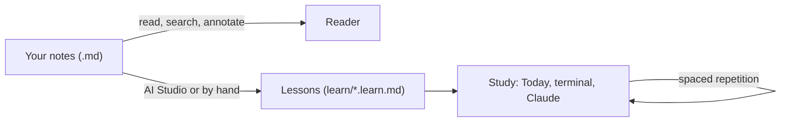

# Start here — how MDlearn works

MDlearn turns a folder of Markdown notes into something you can study. Read this page once, try the
small questions as you go, then open the [feature tour](feature-tour.md) to see everything your
notes can contain. Nothing you do here changes your notes.

## 1. The idea in one picture

- **Notes** are your own `.md` files. MDlearn reads them as they are and never rewrites them.
- **Lessons** sit next to them in a `learn/` folder: short cards, each with a question. You can write
  them yourself, or let AI Studio write them from a note.
- **Study** shows each card again just before you would forget it (spaced repetition), so a few
  minutes a day is enough.

:::quiz
Where does MDlearn keep the questions it schedules for review?
- [ ] Inside your original notes, at the end of each file.
  > Your notes are never rewritten; questions written *in* a note are for practice in place.
- [x] In lesson files in the `learn/` folder.
  > Right: `learn/**/*.learn.md`, mirroring your folder layout.
- [ ] Online, in your Claude account.
  > Everything stays in your folder; nothing is uploaded unless you start an AI job.
:::

## 2. Reading

Open any note from **Files** in the sidebar.

- The **outline** (right panel) follows you as you scroll; numbered sections keep their numbers.
- **Select text** and a small toolbar appears: **Note** (a note beside the passage), **Card** (a quick
  question from it), **Ask** and **Explain** (the local AI model), **Visualise** (a plot or an animation
  of a formula).
- Words that your notes define are underlined: hover them for the definition. Links to other notes
  show a preview.
- <kbd>Ctrl</kbd>+<kbd>K</kbd> searches every note; <kbd>Ctrl</kbd>+<kbd>\</kbd> hides the sidebar.

## 3. Today and Study

**Today** is your daily page. It counts the cards that are due, adds a few new ones, and **Start**
runs the session.

1. Answer the card (type, pick, drag, play).
2. Say whether you were sure — asked *before* the answer, so lucky guesses come back sooner.
3. See the feedback, then press <kbd>Enter</kbd> for the next card.

Cards you get right come back later and later (days, then weeks); missed cards come back soon, and
again before the session ends. **Progress** shows what you have seen and how well the model thinks
you remember it.

:::order
Put one study card in order.
1. Answer the question.
2. Say whether you were sure.
3. Read the feedback.
4. Go on to the next card.
:::

:::cloze
A card you answer correctly comes back {{later}}; a card you miss comes back {{sooner|soon}}.
:::

## 4. Your folder as a knowledge base

- **Formulas** — every display formula in the folder, searchable by words or TeX.
- **Glossary** — terms your notes define ("**SAR** is …", "**SAR**: …", or a *Term | Meaning* table),
  with where each comes from.
- **Map** — which notes build on which (from their prerequisites). Drag to move around.
- **Ask** — a question about the whole folder, answered by the local model from your own passages.
- **Cheat sheet** (a note's `…` menu) — its formulas and terms on one printable page.

:::match
Match each page with what it is for.
- Today :: your daily study session
- Glossary :: the terms your notes define
- Map :: which notes build on which
- Ask :: a question about the whole folder
:::

## 5. Making your own lessons

Most courses start from a class: a few PDFs, slides and handouts. On the first page, choose **Make a course
from my class files**, give it the files, and pick who writes the lessons:

- **Claude, from here**, which starts at once.
- **Your coding assistant** (Claude Code, Codex, OpenCode or Pi): MDlearn gets the folder ready and gives you
  one command to run.
- **A chat** such as ChatGPT or Gemini: attach your files, paste the MDlearn prompt, and bring the answer back
  with **Import**.

Lessons appear as they are written, and then you study them like any other.

**AI Studio** uses Claude Code (your own subscription) to write lessons from a note: *Create a course*
for one document, *Whole folder* for many, *Improve a lesson* to fix one. Every change is checked by
the compiler and can be undone. A course for a long note uses a fair share of your Claude usage, so
start with the note you are studying this week.

**Ask**, **Explain** and **Visualise** use a local model through Ollama instead: free, private, and
offline.

## 6. Writing and importing

- The pencil on a note opens the **editor**, with a live preview and history.
- **Import…** brings in a web page, a PDF, an Anki deck or a Jupyter notebook as a new note.
- Lessons and notes can hold questions, games, animations and sandboxed HTML: the
  [feature tour](feature-tour.md) shows every one with its Markdown.

## 7. On your phone, and where your data lives

`mdlearn studio --lan` prints a private link and a QR code: read, study and take notes from your phone
on the same network.

| Where | What |
|---|---|
| your `.md` files | your notes, untouched |
| `learn/` | lessons |
| `learn/.mdlearn/progress.json` | your answers and reviews — personal |
| `.mdlearn/` | notes beside the text, AI history, search index |

:::sort
Which of these are personal (keep them out of a shared repository)?
- Personal
  - your answers and reviews
  - your notes beside the text
- Fine to share
  - the lesson files
  - the original notes
:::

## 8. Keyboard

| Keys | Where | Does |
|---|---|---|
| <kbd>Ctrl</kbd>+<kbd>K</kbd> | anywhere | search and commands |
| <kbd>Ctrl</kbd>+<kbd>\</kbd> | anywhere | show or hide the sidebar |
| <kbd>?</kbd> | anywhere | help |
| <kbd>A</kbd>–<kbd>E</kbd> | a question | pick an option |
| <kbd>Enter</kbd> | study | check, then next card |
| <kbd>Y</kbd> / <kbd>N</kbd> | study | sure / not sure |
| <kbd>T</kbd> / <kbd>F</kbd> | speed round | true / false |
| <kbd>←</kbd> / <kbd>→</kbd> | an animation | previous / next step |

You can replay the welcome tour and reopen this tutorial from **Help** in the sidebar.
