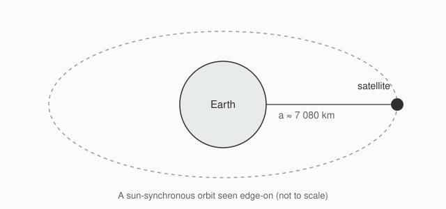
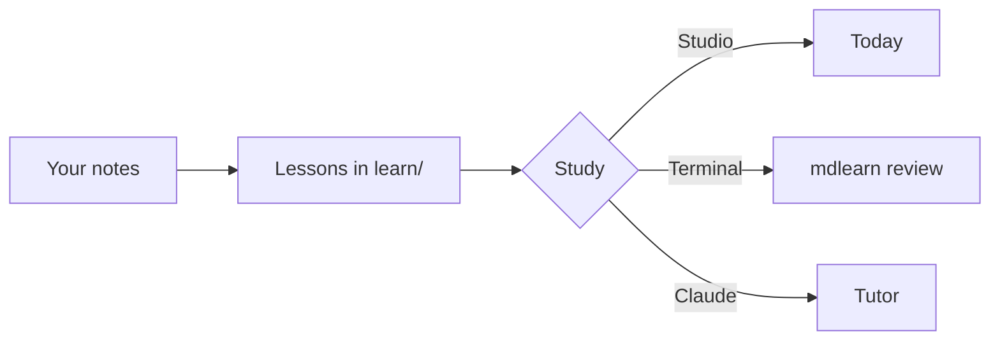

# MDlearn feature tour

Everything on this page is live: try the questions, play the games, drag the sliders. Under each
feature, **Markdown source** shows exactly what was written, ready to copy into your own notes.
[Start here](00-start-here.md) explains how the app itself works.

## 1. Text and structure

Plain Markdown reads the way you expect: **bold**, *italic*, ~~struck~~, `inline code` and
[links](https://www.esa.int). Numbered `##` sections get their number in the margin and in the outline.

- Lists, nested
  - as deep as you need
- [Links to other notes](00-start-here.md) open inside the app, with a preview on hover.

| Band | Wavelength | Typical use |
|---|---:|---|
| X | 3.1 cm | high-resolution imaging |
| C | 5.6 cm | Sentinel-1, sea ice, floods |
| L | 24 cm | soil moisture, forests |



<details>
<summary>Markdown source</summary>

~~~~markdown
Plain Markdown: **bold**, *italic*, ~~struck~~, `inline code` and [links](https://www.esa.int).

| Band | Wavelength | Typical use |
|---|---:|---|
| X | 3.1 cm | high-resolution imaging |


~~~~

</details>

## 2. Math

Inline math such as $P_r \propto R^{-4}$ sits in the sentence; display math gets its own line:

$$P_r = \frac{P_t G^2 \lambda^2 \sigma}{(4\pi)^3 R^4}$$

Aligned derivations work too, and frontmatter macros save typing ($x \in \R^3$):

$$
\begin{aligned}
v &= \sqrt{\mu / a} \\
T &= 2\pi \sqrt{a^3 / \mu}
\end{aligned}
$$

<details>
<summary>Markdown source</summary>

~~~~markdown
---
macros:
  \R: '\mathbb{R}'
---
Inline math such as $P_r \propto R^{-4}$, display math on its own line:

$$P_r = \frac{P_t G^2 \lambda^2 \sigma}{(4\pi)^3 R^4}$$
~~~~

</details>

## 3. Callouts and folding

:::note
Side detail or context.
:::

:::tip[Why does C-band see through clouds?]{fold}
Cloud droplets are about a thousand times smaller than a 5.6 cm wavelength, so they barely scatter it.
:::

:::important
The key takeaway of a section.
:::

> [!WARNING]
> A common misconception: SAR resolution in range does **not** depend on the distance to the target.

<details>
<summary>A folded block written in HTML</summary>

`<details>` folds anything, Markdown included: **bold**, $\lambda$, lists.

</details>

<details>
<summary>Markdown source</summary>

~~~~markdown
:::tip[Why does C-band see through clouds?]{fold}
Cloud droplets are much smaller than the wavelength.
:::

> [!WARNING]
> Obsidian and GitHub alerts become callouts too.

<details>
<summary>A folded block written in HTML</summary>

Markdown inside it still works.

</details>
~~~~

</details>

## 4. Diagrams and code



Code is highlighted, and Python runs in your browser — press **Run**:

```python
import math
mu = 398600.4418          # km^3/s^2
a = 6378.137 + 786        # Sentinel-2 semi-major axis, km
period = 2 * math.pi * math.sqrt(a**3 / mu)
print(f"Orbital period: {period / 60:.1f} minutes")
```

<details>
<summary>Markdown source</summary>

~~~~markdown


```python
print("Python blocks get a Run button")
```
~~~~

</details>

## 5. HTML inside Markdown

Inline HTML renders: <mark>highlighted text</mark>, keys like <kbd>Ctrl</kbd>+<kbd>K</kbd>,
H<sub>2</sub>O and 10<sup>-3</sup>, an <abbr title="Synthetic Aperture Radar">SAR</abbr> with a tooltip,
and <span style="color: #2c7a4b; font-weight: 600">coloured words</span>. Markdown keeps working inside
the tags: <mark>**bold** and $\lambda/2$</mark>.

<div align="center">

**A centred block.** Markdown between `<div>` and `</div>` stays Markdown.

</div>

<figure>
<svg viewBox="0 0 320 170" width="320" role="img" aria-label="A satellite circling the Earth">
  <circle cx="160" cy="85" r="34" fill="none" stroke="currentColor" stroke-width="1.5"/>
  <text x="160" y="90" text-anchor="middle" font-size="12" fill="currentColor">Earth</text>
  <ellipse cx="160" cy="85" rx="130" ry="55" fill="none" stroke="currentColor" stroke-opacity="0.35" stroke-dasharray="4 4"/>
  <g>
    <circle r="6" fill="currentColor"/>
    <animateMotion dur="6s" repeatCount="indefinite" path="M290,85 A130,55 0 1,1 30,85 A130,55 0 1,1 290,85"/>
  </g>
</svg>
<figcaption>An animated SVG: declarative animation, no script needed.</figcaption>
</figure>

<table>
  <tr><th>Mission</th><th>Band</th><th>Launched</th></tr>
  <tr><td>Sentinel-1</td><td>C</td><td>2014</td></tr>
  <tr><td>BIOMASS</td><td>P</td><td>2025</td></tr>
</table>

Anything that could run code is removed before it reaches the page — `<script>`, `<style>`, frames,
forms, `onclick=` handlers and `javascript:` links — and `mdlearn lint` reports it (E107). Interactive
HTML belongs in an `:::html` block (section 9), which runs in a sandbox.

<details>
<summary>Markdown source</summary>

~~~~markdown
Inline: <mark>highlight</mark>, <kbd>Ctrl</kbd>, H<sub>2</sub>O, 10<sup>-3</sup>,
<abbr title="Synthetic Aperture Radar">SAR</abbr>, <span style="color: #2c7a4b">colour</span>.

<div align="center">

**Markdown** between the tags stays Markdown.

</div>

<figure>
<svg viewBox="0 0 320 170" width="320">
  <g><circle r="6" fill="currentColor"/>
  <animateMotion dur="6s" repeatCount="indefinite" path="M290,85 A130,55 0 1,1 30,85 A130,55 0 1,1 290,85"/></g>
</svg>
<figcaption>Declarative SVG animation.</figcaption>
</figure>
~~~~

</details>

## 6. Questions

Questions can sit anywhere in a note. In a document you practise them here; in a lesson
(`learn/*.learn.md`) they also become cards that come back for review.

:::quiz
A radar's range resolution is set by…
- [ ] the distance to the target.
  > Distance changes the signal strength, not how finely two echoes can be told apart.
- [x] the bandwidth of the transmitted pulse.
  > Right: $\delta_r = c / 2B$.
- [ ] the length of the antenna.
  > Antenna length sets the *azimuth* resolution of a SAR.
::hint[Which formula has $c/2$ in it?]
:::

:::cloze
Range resolution is $\delta_r = c / 2B$: with $B$ = 100 MHz it is {{1.5}} m. Sentinel-1 works in the {{C|C-band}} band.
:::

:::order
Put the steps of a SAR acquisition in order.
1. The antenna transmits a chirp.
2. The pulse scatters off the ground.
3. The echo is recorded.
4. Range compression focuses the echo.
:::

:::explain
In your own words: why does a radar image look grainy (speckle) even over a uniform field?
> - Each pixel holds many scatterers.
> - Their echoes add coherently with random phases.
> - The sum's intensity fluctuates from pixel to pixel.
:::

:::steps
A satellite flies at $a$ = 7164 km with $\mu$ = 398600 km³/s². Find its speed.
1. Circular orbit: $v = \sqrt{\mu / a}$.
2. $v = \sqrt{398600 / 7164} \approx$ {{7.46}} km/s
> About 27 000 km/h.
:::

:::code
Write `range_resolution(bandwidth_hz)` that returns the range resolution in metres.
```python
def range_resolution(bandwidth_hz):
    ...
```
```python test
assert abs(range_resolution(100e6) - 1.5) < 1e-6
assert abs(range_resolution(50e6) - 3.0) < 1e-6
```
```python solution
def range_resolution(bandwidth_hz):
    return 299_792_458 / (2 * bandwidth_hz)
```
:::

<details>
<summary>Markdown source (shows the answers)</summary>

~~~~markdown
:::quiz
A radar's range resolution is set by…
- [ ] the distance to the target.
  > Feedback shown when this option is chosen.
- [x] the bandwidth of the transmitted pulse.
::hint[A hint, revealed on request.]
:::

:::cloze
With $B$ = 100 MHz it is {{1.5}} m. Sentinel-1 works in the {{C|C-band}} band.
:::

:::order
Put the steps in order (write them in the right order; they are shuffled).
1. First
2. Second
3. Third
:::

:::explain
Explain why…
> - idea one
> - idea two
:::

:::steps
The problem.
1. A step.
2. A faded step with a gap: {{7.46}} km/s
:::

:::code
Write `f(x)`.
```python
def f(x): ...
```
```python test
assert f(1) == 2
```
```python solution
def f(x): return 2 * x
```
:::
~~~~

</details>

## 7. Games

Four small games, written in plain Markdown and graded like the questions above.

:::match
Match each symbol with what it means.
- $\sigma^0$ :: backscatter coefficient
- $\lambda$ :: wavelength
- $B$ :: bandwidth
- $\theta_i$ :: incidence angle
:::

:::match{memory}
Memory: find the mission that goes with each instrument.
- Sentinel-1 :: C-band SAR
- Sentinel-2 :: MultiSpectral Instrument
- Sentinel-3 :: ocean and land colour
- Sentinel-5P :: TROPOMI spectrometer
:::

:::sort
Sort the sensors: do they send their own signal?
- Active
  - SAR
  - LiDAR
  - radar altimeter
- Passive
  - multispectral camera
  - microwave radiometer
  - thermal infrared imager
:::

:::speed[Radar in 45 seconds]{time=45}
- [x] SAR is an active sensor.
- [ ] C-band has a longer wavelength than L-band.
  > L-band is about 24 cm, C-band about 5.6 cm.
- [x] Speckle is multiplicative noise.
- [ ] Thick clouds block C-band radar.
  > Microwaves pass through clouds; only heavy rain affects the shortest bands.
- [x] Range resolution improves with more bandwidth.
- [ ] Ascending and descending passes see a slope from the same side.
  > They look from opposite sides, which is why both are combined.
:::

<details>
<summary>Markdown source (shows the answers)</summary>

~~~~markdown
:::match
Match each symbol with what it means.
- $\sigma^0$ :: backscatter coefficient
- $\lambda$ :: wavelength
- $B$ :: bandwidth
:::

:::match{memory}
- Sentinel-1 :: C-band SAR
- Sentinel-2 :: MultiSpectral Instrument
- Sentinel-3 :: ocean and land colour
:::

:::sort
- Active
  - SAR
  - LiDAR
- Passive
  - multispectral camera
  - microwave radiometer
:::

:::speed[Radar in 45 seconds]{time=45}
- [x] A true statement.
- [ ] A false statement.
  > Why it is false (shown after a wrong answer).
- [x] Another true one.
:::
~~~~

</details>

## 8. Visuals that move

:::plot[Received power falls as R⁻⁴]{y=log}
Drag the gain and the cross-section: the slope never changes.
$$P_r = \frac{P_t G^2 \lambda^2 \sigma}{(4\pi)^3 R^4}$$
- $R$ in [100e3, 2000e3] m — slant range
- $P_t$ = 1000 in [10, 5000] W — transmit power
- $G$ = 1000 in [10, 10000] log — antenna gain
- $\lambda$ = 0.055 m — wavelength
- $\sigma$ = 1 in [0.01, 100] log $\mathrm{m^2}$ — radar cross-section
:::

:::formula[The radar equation, term by term]
$$P_r = \frac{P_t G^2 \lambda^2 \sigma}{(4\pi)^3 R^4}$$
- $G^2$ — the same antenna transmits and receives
- $(4\pi)^3$ — spherical spreading, counted three times
- $R^4$ — two-way spreading: $R^2$ out and $R^2$ back
:::

:::animate[Where R⁴ comes from]
1. $$S_{tx} = \frac{P_t G}{4\pi R^2}$$ Power density at the target.
2. $$S_{rx} = \frac{P_t G\,\sigma}{(4\pi)^2 R^4}$$ Spread again on the way back: a second $R^2$.
:::

:::animate[One radar echo, step by step]{replace}
1. **Transmit.** The antenna sends a short chirp towards the ground.
2. **Scatter.** Every surface element sends part of it back; rough surfaces return more.
3. **Receive.** The echo arrives after $t = 2R/c$, which gives the range.
4. **Focus.** Many echoes along the orbit are combined into one sharp pixel.
:::

:::sim[Speckle as a random phasor sum]{height=320}
Each scatterer adds a unit phasor with a random phase; the pixel is their sum.
```js
const { ctx, width, height } = api
api.frame(() => {
  ctx.clearRect(0, 0, width, height)
  ctx.strokeStyle = api.theme.ink
  let x = width / 2, y = height / 2
  for (let i = 0; i < api.params.N; i++) {
    const a = api.random() * 2 * Math.PI
    ctx.beginPath(); ctx.moveTo(x, y); x += 12 * Math.cos(a); y += 12 * Math.sin(a); ctx.lineTo(x, y); ctx.stroke()
  }
})
```
- $N$ = 10 in [1, 200] — scatterers per pixel
:::

<details>
<summary>Markdown source</summary>

~~~~markdown
:::formula[The radar equation, term by term]
$$P_r = \frac{P_t G^2 \lambda^2 \sigma}{(4\pi)^3 R^4}$$
- $R^4$ — two-way spreading
:::

:::animate[One radar echo, step by step]{replace}
1. **Transmit.** Any Markdown can be a frame.
2. **Scatter.** `{replace}` shows one frame at a time.
:::
~~~~

</details>

## 9. Your own interactive HTML

An `:::html` block runs your own HTML, CSS and JavaScript in a sandbox: no network, no access to your
notes. It starts when you press **Play**. `mdlearn.done({ score, total })` shows a score under the block
(practice only, never recorded), and the Studio's colours are available as CSS variables such as
`var(--text)` and `var(--good)`.

:::html[Pick the band]
Choose the radar band that fits each job. A right first try scores a point.
```html
<style>
  .q { font-family: var(--font-read); font-size: 18px; margin: 2px 0 12px; }
  .bands { display: grid; grid-template-columns: repeat(4, 1fr); gap: 8px; }
  .bands button { padding: 10px 0; border: 1px solid var(--border-strong); border-radius: 8px; background: var(--raised); color: var(--text); font-weight: 600; cursor: pointer; transition: background .2s, transform .15s; }
  .bands button:hover { background: var(--hover); }
  .bands button.right { background: var(--good-soft); border-color: var(--good); }
  .bands button.wrong { background: var(--bad-soft); border-color: var(--bad); animation: shake .3s; }
  @keyframes shake { 25% { transform: translateX(-4px); } 75% { transform: translateX(4px); } }
  .why { min-height: 3em; color: var(--muted); font-size: 14px; margin: 10px 0 0; }
  .bar { height: 4px; background: var(--hover); border-radius: 2px; margin-bottom: 10px; }
  .bar i { display: block; height: 100%; width: 0; background: var(--text); border-radius: 2px; transition: width .3s; }
  @media (prefers-reduced-motion: reduce) { * { animation: none !important; transition: none !important; } }
</style>
<div class="bar"><i id="bar"></i></div>
<p class="q" id="q"></p>
<div class="bands" id="bands"></div>
<p class="why" id="why"></p>
<script>
  const rounds = [
    { q: 'Map soil moisture under a forest canopy.', a: 'L', why: 'L-band (~24 cm) passes through leaves that scatter shorter waves.' },
    { q: 'Watch sea ice every few days, day and night, through clouds.', a: 'C', why: 'C-band (Sentinel-1) balances resolution, revisit and all-weather imaging.' },
    { q: 'Image a city at sub-metre resolution.', a: 'X', why: 'X-band carries the widest bandwidths, so the finest range resolution.' },
    { q: 'Weigh a forest: reach the trunks, not just the leaves.', a: 'P', why: 'P-band (~70 cm) is what ESA BIOMASS flies for exactly this.' },
  ]
  const $ = (id) => document.getElementById(id)
  let i = 0, score = 0, missed = false
  function show() {
    const r = rounds[i]; missed = false
    $('q').textContent = r.q; $('why').textContent = ''
    $('bar').style.width = (i / rounds.length) * 100 + '%'
    $('bands').replaceChildren(...['X', 'C', 'L', 'P'].map((b) => {
      const btn = document.createElement('button')
      btn.textContent = b + '-band'
      btn.addEventListener('click', () => pick(btn, b))
      return btn
    }))
  }
  function pick(btn, b) {
    const r = rounds[i]
    if (b !== r.a) { missed = true; btn.className = 'wrong'; return }
    if (!missed) score++
    btn.className = 'right'; $('why').textContent = r.why
    setTimeout(() => { i++; i < rounds.length ? show() : end() }, 1400)
  }
  function end() {
    $('bar').style.width = '100%'
    $('q').textContent = `Done: ${score} of ${rounds.length} right first time.`
    const again = document.createElement('button')
    again.textContent = 'Play again'
    again.addEventListener('click', () => { i = 0; score = 0; show() })
    $('bands').replaceChildren(again)
    mdlearn.done({ score, total: rounds.length })
  }
  show()
</script>
```
:::

<details>
<summary>Markdown source</summary>

~~~~markdown
:::html[Pick the band]
One sentence saying what the block does.
```html
<style> button { color: var(--text); } </style>
<button id="b">Click me</button>
<script>
  document.getElementById('b').addEventListener('click', () => mdlearn.done({ score: 1, total: 1 }))
</script>
```
:::
~~~~

`{height=400}` fixes the height (otherwise it fits the content) and `{auto}` starts it without Play.

</details>

## 10. Where next

- [Start here](00-start-here.md): how Today, Study, notes, Ask and AI Studio fit together.
- The lesson next to this file (`learn/01-feature-tour.learn.md`) turns the games into cards: open
  **Today** and press **Start** to see them scheduled.
- The full reference is `docs/DSL_SPECIFICATION.md` in the MDlearn repository.
