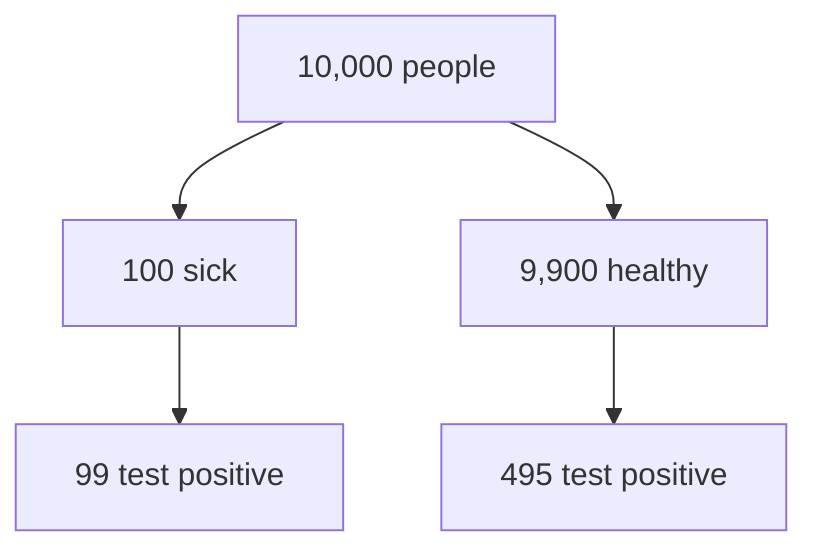

How should a test result change what you believe? Bayes' theorem gives the exact update.

## A surprising test result

:::quiz
A disease affects 1% of people. A test detects 99% of sick people and wrongly flags 5% of healthy people. You test positive. How likely are you to be sick?
- [ ] About 99%
  > 99% is the chance of a positive test *if* you are sick, not the chance of being sick *given* a positive test.
- [ ] About 50%
  > Closer, but most positives here come from the large healthy group.
- [x] About 17%
  > Most people guess 99%. This lesson shows why the answer is about 1 in 6.
:::

## Prior and posterior

Three quantities describe how evidence $E$ bears on a hypothesis $H$:

- **Prior** $P(H)$: how plausible $H$ is before seeing $E$.
- **Likelihood** $P(E \mid H)$: how probable $E$ is if $H$ is true.
- **Posterior** $P(H \mid E)$: how plausible $H$ is after seeing $E$.

## Bayes' theorem

$$P(H \mid E) = \frac{P(E \mid H)\,P(H)}{P(E)}$$

The numerator weighs how well $H$ predicts $E$ by how plausible $H$ was beforehand; dividing by $P(E)$ turns the result into a probability. The theorem reverses the conditional: from $P(E \mid H)$, which a test manual reports, to $P(H \mid E)$, which a patient wants.

:::cloze
Before seeing the evidence we hold the {{prior|prior probability}} $P(H)$; after seeing it we hold the {{posterior|posterior probability}} $P(H \mid E)$.
:::

## The evidence term

$P(E)$ counts every way to observe the evidence, whether $H$ is true or false:

$$P(E) = P(E \mid H)\,P(H) + P(E \mid \neg H)\,P(\neg H)$$

where $\neg H$ means "$H$ is false" and $P(\neg H) = 1 - P(H)$. This is the law of total probability.

:::cloze
Complete the law of total probability.

$$P(E) = P(E \mid H)\,P(H) + {{P(E \mid \neg H)\,P(\neg H)}}$$
:::

## Worked example: a positive test

:::steps
1% of people have a disease. The test detects 99% of sick people (sensitivity) and wrongly flags 5% of healthy people. You test positive. Find $P(\text{sick} \mid +)$.
1. Name the pieces: $P(\text{sick}) = 0.01$, $P(+ \mid \text{sick}) = 0.99$, $P(+ \mid \text{healthy}) = 0.05$.
2. Evidence term: $P(+) = 0.99 \cdot 0.01 + 0.05 \cdot 0.99 = 0.0594$.
3. Bayes: $P(\text{sick} \mid +) = \dfrac{0.0099}{0.0594} \approx$ {{0.167}}
> Only about 1 in 6 people who test positive is actually sick.
:::

## Counting people instead of percentages

Picture 10,000 people. 100 are sick and 99 of them test positive. Of the 9,900 healthy people, 5% (495) also test positive.



Only 99 of the 594 positives are sick: $99/594 = 1/6$. Counting people like this is a **natural frequency** format.

:::tip[Why does counting help?]{fold}
Natural frequencies keep the base rate visible: the huge healthy group produces most of the positives, which percentages hide.
:::

## Base-rate neglect

Reading $P(E \mid H)$ as if it were $P(H \mid E)$, and ignoring how rare $H$ is, is called **base-rate neglect**.

:::warning
In court the same confusion is called the prosecutor's fallacy: the chance of the evidence given innocence is not the chance of innocence given the evidence.
:::

:::quiz
A test is 99% sensitive and you test positive. Which statement is justified?
- [ ] You are about 99% likely to be sick.
  > That reads $P(+ \mid \text{sick})$ as $P(\text{sick} \mid +)$, the reverse conditional.
- [x] It depends on how common the disease is.
  > Right: the prior decides how many positives are true positives.
- [ ] The positive result tells you nothing.
  > It raised the probability from 1% to about 17%: real evidence, just not decisive.
::hint[Which conditional probability does "sensitivity" describe?]
:::

## Sequential updating

Today's posterior is tomorrow's prior. After a second, independent positive test, start from $P(\text{sick}) = 1/6$ instead of $0.01$.

:::cloze
With prior $1/6$, sensitivity $0.99$ and false-positive rate $0.05$, a second positive test gives $P(\text{sick} \mid +,+) \approx$ {{0.80}}.
::hint[Reuse the worked example with $0.01$ replaced by $1/6$.]
:::

## The odds form

<!-- added: odds form completed from standard probability; the notes flagged it as unclear (ch. 2.3) -->
In odds, Bayes' theorem is a single multiplication: posterior odds = prior odds × likelihood ratio.

$$\frac{P(H \mid E)}{P(\neg H \mid E)} = \frac{P(H)}{P(\neg H)} \cdot \frac{P(E \mid H)}{P(E \mid \neg H)}$$

For the test: prior odds are 1:99, the likelihood ratio is $0.99 / 0.05 = 19.8$, so the posterior odds are $19.8/99 = 1/5$, i.e. $P = 1/6$.

## Code check: posterior()

:::code
Write `posterior(prior, sens, fpr)` that returns $P(H \mid +)$ after one positive test.
```python
def posterior(prior, sens, fpr):
    ...
```
```python test
assert abs(posterior(0.01, 0.99, 0.05) - 1/6) < 1e-3
assert abs(posterior(0.5, 0.9, 0.1) - 0.9) < 1e-9
assert posterior(0.0, 0.99, 0.05) == 0
```
```python solution
def posterior(prior, sens, fpr):
    hit = sens * prior
    return hit / (hit + fpr * (1 - prior))
```
::hint[The denominator is $P(+)$ from the law of total probability.]
:::

## Recap

:::explain
Without scrolling back, explain to a friend why a positive result on a 99%-sensitive test can still mean they are probably healthy.
> - The disease is rare: the prior is only 1%.
> - Healthy people vastly outnumber sick people, so their 5% false positives outnumber the true positives.
> - Bayes' theorem combines both: $P(\text{sick} \mid +) \approx 1/6$.
:::

:::order
Put the steps of a Bayesian update in order.
1. State the prior $P(H)$.
2. Find the likelihoods $P(E \mid H)$ and $P(E \mid \neg H)$.
3. Compute the evidence $P(E)$.
4. Divide to get the posterior $P(H \mid E)$.
:::
